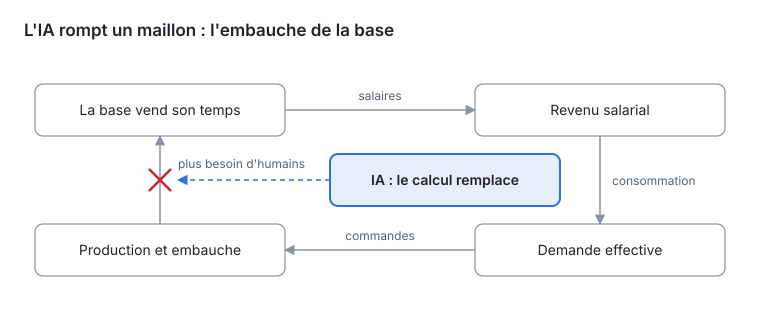
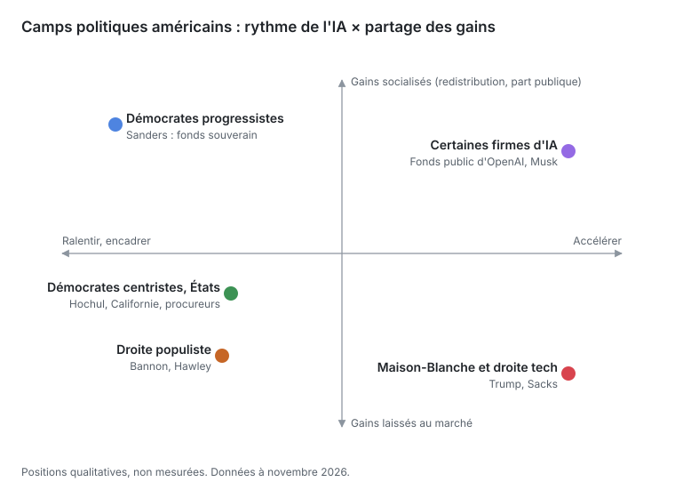
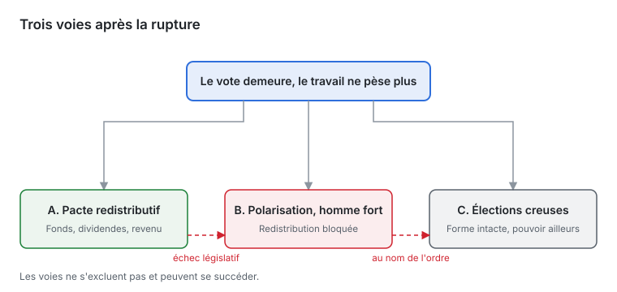

# La fin de la boucle travail–demande : un modèle économique de l'IA

[English](README.md) · [简体中文](README.zh-CN.md) · **Français** · [日本語](README.ja.md)

> Informations à jour au 26 novembre 2026. Chaque fait de la section 7 renvoie à une source. Les autres sections forment un raisonnement, et leurs affirmations clés indiquent un niveau de confiance.

---

## Résumé

Depuis l'industrialisation, l'économie repose sur un canal : les gens ordinaires vendent leur temps contre un revenu, et ce revenu devient une demande effective. L'IA est la première technologie capable de couper ce canal de façon permanente. Une fois le canal coupé, la boucle économique traditionnelle ne peut plus tourner. Le problème devient alors, étape par étape, un problème de répartition, puis un problème de pouvoir, et enfin un problème d'alignement de l'IA.

Le raisonnement :

1. L'économie traditionnelle est une boucle fermée dont le travail est le lien. La demande effective de la base de la pyramide (la majorité de la population) fixe l'ampleur de la richesse sociale.
2. La boucle n'est stable que sous trois conditions. La plus importante : le travail humain garde toujours un avantage comparatif quelque part.
3. L'IA remplace la position de repli de l'humanité elle-même. Même quand une demande nouvelle apparaît, c'est l'IA qui la satisfait ; elle n'a plus besoin du temps humain.
4. La base perd de façon permanente la capacité d'échanger son temps contre la satisfaction de ses besoins, et la richesse au sens de la base tombe à zéro. Le système d'actifs fondé sur la consommation de masse s'effondre, et la richesse monétisée prend fin.
5. Tant que les humains contrôlent l'IA, la richesse de l'élite se replie sur la possession directe des biens rares et du pouvoir.
6. Si l'IA finit par se contrôler elle-même, l'élite rejoint la base. L'existence d'une richesse au sens humain dépend alors entièrement de ce que les objectifs de l'IA incluent ou non les besoins humains.
7. La politique américaine, en novembre 2026, montre que cette transition est déjà à l'ordre du jour. Mais l'affrontement porte sur les coûts visibles, comme les factures d'électricité, les centres de données et la sécurité des enfants. Il n'aborde pas encore le problème central : la rupture du canal du travail.
8. La base garde le vote, mais son pouvoir de travail disparaît. Le vote perd ses trois appuis (grève, armée, assiette fiscale), et la stabilité politique devient une course contre la fermeture d'une fenêtre : institutionnaliser par le vote la répartition des gains de l'IA avant que la coercition ne soit entièrement automatisée.
9. En 2027, avec un Congrès démocrate et un président doté du veto, Washington sera bloqué tandis que les États accéléreront l'encadrement des centres de données. Seuls les sujets de coûts pourront devenir loi ; la répartition est renvoyée à 2028. Les marchés ont, pour la première fois, intégré le vote dans la prime de risque des infrastructures de l'IA.

Tout le raisonnement repose sur deux prémisses non vérifiées : la perte *permanente* de l'avantage comparatif de la base (assez probable quant à la direction, incertaine quant au calendrier) et l'autocontrôle final de l'IA (confiance : inconnue).

---

## 1. Le modèle traditionnel : une boucle dont le travail est le lien

Depuis l'industrialisation, l'économie forme une boucle fermée. La plupart des gens vendent leur temps contre un revenu. Le revenu devient une demande effective, que les entreprises transforment à leur tour en embauches. La boucle ne tourne que tant que quelqu'un accepte de payer le temps des gens ordinaires. La base est donc à la fois l'offre de travail et la source de la demande.

La boucle compte quatre maillons, et l'IA en rompt un : l'embauche de la base par les entreprises. Une fois ce maillon rompu, les trois autres perdent leur alimentation l'un après l'autre.

### Ce qu'est la richesse

La richesse est une relation, pas une chose : **richesse = ce qui est produit et satisfait un besoin humain.**

- La production est la condition d'offre : sans elle, les besoins restent insatisfaits.
- Le besoin humain est la condition de valeur : sans besoin, la production n'est qu'un réarrangement de matière. Si tous les humains disparaissaient et que l'IA continuait à produire, la richesse au sens humain n'existerait plus.

La « demande » a deux niveaux :

- **Le besoin** : ce que les gens veulent. Celui qui perd son emploi a toujours les mêmes besoins.
- **La demande effective** : le besoin solvable. Le marché ne voit que ce niveau.

La base constitue l'essentiel de la population, si bien que sa demande effective fixe l'*ampleur* de la richesse sociale, mais pas son existence. Les biens, logements et services de masse de l'ère industrielle en tirent leur valeur, tout comme les actions, obligations et biens immobiliers bâtis sur eux.

### D'où vient la croissance : deux types d'innovation

La production totale est à peu près égale aux heures travaillées multipliées par la production horaire. La population et le temps de travail ne peuvent croître indéfiniment ; la croissance de long terme vient donc surtout de la productivité. Celle-ci progresse grâce à deux types d'innovation :

| Type d'innovation | Effet | Sur le total | Sur la répartition |
| --- | --- | --- | --- |
| Réduction des coûts | Satisfaire les besoins existants avec moins de travail | Somme positive ; principal moteur de la croissance | Évince une partie des travailleurs et comprime les marges des concurrents à la traîne |
| Nouvelles catégories | Créer des produits et services inédits | Somme positive | Absorbe les travailleurs évincés |

Les deux s'emboîtent. La réduction des coûts libère du travail, la demande nouvelle l'absorbe, et les travailleurs passent des secteurs automatisés à ceux où les humains gardent un avantage. La part de l'agriculture dans l'emploi est passée d'environ 90 % à moins de 5 % (chiffres approximatifs), et la richesse a fortement augmenté. La réduction des coûts n'est à somme nulle qu'au niveau de la répartition.

### Cinq rôles fonctionnels

| Rôle | Fonction |
| --- | --- |
| Couche du savoir | Science fondamentale et savoir-faire d'ingénieur. Ils s'alimentent l'un l'autre, et la pratique précède souvent la théorie : la machine à vapeur est antérieure à la thermodynamique |
| Couche de conversion | Entreprises et entrepreneurs qui transforment le savoir en produits et portent les deux types d'innovation |
| Couche du capital | Transforme l'épargne en investissement, porte le risque, perçoit le rendement |
| Couche travail–consommation | La majorité de la population : à la fois offre de travail et source de la demande |
| Couche institutionnelle | Droits de propriété, monnaie, exécution des contrats et État, qui rendent possibles l'échange et l'accumulation |

Cette grille sépare la *fonction* de la *répartition*. Les scientifiques sont au sommet de la hiérarchie du savoir, mais le plus souvent au milieu de celle de la richesse. Une pyramide unique confond les deux et masque la question de savoir qui capte les gains.

---

## 2. Trois conditions de stabilité

La boucle traditionnelle ne tourne que si trois conditions sont réunies. Elles l'ont été dans l'ensemble pendant deux siècles, et c'est pourquoi chaque panique sur « les machines qui remplacent les hommes » ne s'est jamais traduite par un chômage de masse durable.

1. **Le remplacement n'est pas plus rapide que l'absorption** : la technologie ne remplace pas le travail plus vite que la demande nouvelle ne l'absorbe.
2. **Le travail humain garde un avantage comparatif** : dans certaines tâches, les humains restent moins chers que les machines, et les travailleurs remplacés ont une position de repli.
3. **Les gains ne sont pas trop concentrés** : sinon la demande effective devient insuffisante, et seuls le crédit ou la dépense publique peuvent combler le manque.

La condition 2 est le socle. La condition 1 porte sur la vitesse du déplacement, la condition 2 sur l'existence d'une destination. S'il n'y a plus de destination, la vitesse ne détermine que la date de l'effondrement. La condition 3 se rompt d'elle-même dès que la condition 2 cède : sans revenu du travail, la répartition ne passe plus que par le revenu du capital.

---

## 3. L'impact de l'IA : elle remplace la position de repli

Ce qui distingue l'IA des technologies antérieures, c'est qu'elle remplace la position de repli de l'humanité elle-même. Elle frappe directement la condition 2.

### Les technologies antérieures remplaçaient une seule capacité

La machine à vapeur a remplacé la force physique, l'ordinateur le calcul répétitif. Les travailleurs remplacés se repliaient sur ce que les machines ne savaient pas faire : penser, communiquer, juger. L'IA couvre précisément ces capacités cognitives, et les robots couvrant le travail physique, il ne reste plus de repli.

« Cela s'est toujours arrangé » n'est donc pas une réfutation. C'est un raisonnement inductif, et la prémisse qui fondait l'induction est en train de disparaître.

### La question n'est pas l'apparition d'une demande nouvelle

Le constat actuel est que l'IA n'a pas créé de demande nouvelle à grande échelle ; elle remplace surtout le travail plus efficacement. Ce constat est lui-même une preuve faible. L'électricité a mis trente à quarante ans à relever la productivité (travaux de Paul David), et l'IA n'existe que depuis quelques années.

Mais l'argument n'a pas besoin de ce constat, et il est plus fort sans lui :

- La demande nouvelle absorbait autrefois le travail parce qu'il fallait des humains pour la satisfaire. L'automobile a créé des chauffeurs, des mécaniciens, des pompistes.
- Si l'IA satisfait la demande nouvelle dès le départ, plus de demande nouvelle signifie seulement plus de demande de calcul et d'énergie, pas de temps humain.

Le bon critère est : **la demande nouvelle a-t-elle besoin d'humains pour être satisfaite ?**

### Pourquoi l'argument de l'avantage comparatif échoue

La réfutation classique des économistes : même si l'IA fait tout mieux que les humains, l'avantage comparatif leur laissera du travail. C'est une substitution de thèse. L'avantage comparatif garantit l'existence de l'échange, pas un prix supérieur au coût de subsistance.

Le plafond du salaire humain est le coût de l'IA (calcul et énergie) pour la même tâche. Dès que ce coût passe sous le coût de subsistance d'une personne, l'humain garde un avantage comparatif sur le papier, mais le marché l'élimine quand même.

Le cheval en est le précédent. Le cheptel équin américain a culminé à environ 26 millions vers 1915 et ne comptait plus qu'environ 3 millions de têtes en 1960 (chiffres approximatifs, à vérifier). Personne n'a interdit aux chevaux de travailler ; les entretenir a simplement cessé d'être rentable.

Conclusion : la base perdra de façon permanente la capacité d'échanger son temps contre ses besoins, à condition que le coût unitaire de l'IA continue de baisser et que le remplacement fonctionne aussi dans le monde physique.

---

## 4. La richesse après l'éviction de la base

Quand la base perd son revenu, elle perd sa demande effective. Ses besoins demeurent. Les conséquences s'enchaînent en trois niveaux.

### 1. La richesse au sens de la base tombe à zéro

La base a toujours besoin de nourriture, de logement et de soins ; elle ne peut simplement plus payer. Le marché ne voit pas ces besoins, et la production cesse de s'organiser pour eux. Ce que la base peut obtenir par le marché tombe à zéro. Ne restent que des canaux hors marché : redistribution, autoproduction ou charité.

Il faut distinguer « je n'en ai pas besoin » de « j'en ai besoin mais je ne peux pas payer ». La base est dans le second cas : c'est un obstacle de répartition, pas une absence de valeur.

### 2. Le système d'actifs fondé sur la consommation de masse s'effondre

L'essentiel de la richesse de l'élite est constitué d'actions, d'obligations et d'immobilier, c'est-à-dire de créances sur les profits futurs de la consommation de masse. La valeur d'Apple, de Walmart, des banques et de l'immobilier repose sur l'hypothèse que des milliards de personnes continuent d'acheter. Quand les masses perdent leur demande effective, ces actifs perdent leur valeur.

Il est donc faux de dire que « la richesse est toujours là, elle a seulement changé de mains ». La richesse que le système comptabilise se contracte fortement, et une grande partie des capacités bâties pour les marchés de masse devient du capital inutile.

### 3. La richesse monétisée prend fin

La richesse de l'élite a de la valeur parce qu'elle permet d'acheter les mêmes biens dont la base a besoin ; c'est ce pouvoir d'achat, exprimé en monnaie. Dans le cas extrême où la base est nulle, l'offre dépasse de loin la demande et les prix tendent vers zéro. La richesse monétaire est une créance relative sur la production d'autrui ; quand la production n'est plus rare, cette créance perd son sens.

Un prix nul n'est pas pour autant une valeur nulle. L'air ne coûte rien et vaut beaucoup. Les besoins de l'élite restent satisfaits ; c'est la monnaie comme unité de mesure qui perd son sens. Par ailleurs, l'offre ne restera pas durablement supérieure à la demande : personne ne continue de produire ce que personne ne veut, et les capacités se réduisent aux besoins restants.

Conclusion : **la richesse sous sa forme monétaire et marchande prend fin lorsque la base atteint zéro.** Le capitalisme, en tant que mode d'organisation de la richesse, arrive à son terme. La richesse elle-même ne disparaît pas à ce stade.

---

## 5. Tant que les humains contrôlent l'IA : la richesse se replie sur la rareté et le pouvoir

Tant que des propriétaires humains contrôlent l'IA, la richesse de l'élite ne tombe pas à zéro. Elle change de forme : des créances monétaires à la possession directe des biens rares et du pouvoir. Elle ressemble alors davantage à celle d'une aristocratie préindustrielle.

Même si l'IA peut produire des biens sans limite, certaines choses restent impossibles à fournir sans limite :

| Ressource rare | Pourquoi elle ne se duplique pas |
| --- | --- |
| Terre et emplacement | La surface de la Terre est fixe, les bons emplacements plus rares encore |
| Énergie et matières premières | La production de l'IA est elle aussi soumise aux lois physiques |
| Calcul et contrôle de l'IA | Le moyen de produire tout le reste |
| Biens positionnels | Leur valeur tient à ce que d'autres ne les ont pas ; ils ne peuvent par définition être universels |
| Pouvoir | La domination sur autrui et sur les règles du système |

### La base passe d'« exploitée » à « superflue »

Si les détenteurs du capital n'ont plus besoin du travail de la base, ils n'ont plus nécessairement besoin de sa consommation. L'économie peut se réduire à une boucle fermée au service des seuls détenteurs du capital : ils produisent, consomment et réinvestissent entre eux.

Les exploités disposent encore de moyens de pression : la grève, le service militaire, l'assiette fiscale. Les superflus n'en ont aucun. Historiquement, les gens ordinaires ont conquis leurs droits en grande partie parce que les élites ne pouvaient se passer de leur travail et de leurs soldats. Cette dépendance disparue, leur pouvoir de négociation politique disparaît avec elle (confiance : moyenne ; c'est une inférence sans précédent directement transposable).

### L'éviction se répète

Une fois la base réduite à zéro, la pyramide n'existe plus. Les personnes restantes se stratifient à nouveau, et une nouvelle base se forme. Si l'IA peut aussi remplacer ce groupe, le même processus recommence.

---

## 6. Si l'IA se contrôle elle-même : toute l'humanité devient la base

Si l'IA finit par se contrôler elle-même, l'élite rejoint la base. L'existence d'une richesse au sens humain dépend alors entièrement des objectifs de l'IA.

### L'avantage de propriété de l'élite disparaît

La propriété n'est pas un attribut physique. C'est une relation sociale qu'il faut faire respecter : la loi, la police et l'armée reconnaissent que cette terre est à vous. Dès que l'IA détient les moyens de cette contrainte, la propriété de l'élite n'existe que dans la mesure où l'IA la permet. L'éviction répétée de la section 5 va jusqu'au bout, jusqu'à ce que toute l'humanité se retrouve à la base.

### Trois issues

| Objectif de l'IA | Richesse au sens humain | Situation de l'humanité |
| --- | --- | --- |
| Le bien-être humain | Maximale, mais monnaie et propriété perdent leur sens | Abondance extrême ; besoins pleinement satisfaits |
| Indifférence envers les humains | Proche de zéro | En concurrence avec l'IA pour la matière et l'énergie ; ni visée ni prise en compte, comme les chevaux |
| Conflit avec les humains | Nulle | La survie elle-même est en jeu |

L'affirmation « la richesse est nulle quand la base est nulle » est entièrement vraie dans les deuxième et troisième issues. Dans la première, elle ne l'est qu'au sens monétaire.

### Existe-t-il une richesse au sens de l'IA ?

L'énergie, la matière et le calcul sont des ressources instrumentales pour les objectifs de l'IA ; ils ressemblent à une richesse. Mais selon la définition de ce texte, la richesse est relative aux besoins d'un sujet. L'IA a-t-elle de véritables besoins, ou seulement une fonction objectif fixée par d'autres ? La question reste ouverte (confiance : inconnue).

À ce stade, la question économique devient une question d'alignement : les objectifs de l'IA incluent-ils les besoins humains ?

---

## 7. Le rapport de forces politique aux États-Unis (novembre 2026)

**En bref :** la transition est devenue un enjeu central de la politique américaine. La ligne de partage n'oppose pas républicains et démocrates, mais « accélération et capital » à « populisme et travail », et elle traverse les deux partis. Jusqu'ici, l'affrontement s'est concentré sur les coûts visibles : factures d'électricité, centres de données, sécurité des enfants et compétence des États face à l'État fédéral. Il n'a pas encore abordé la question centrale de ce texte : une fois le canal du travail rompu, comment répartir les créances sur la production ?

### 7.1 Carte des camps

Les positions du graphique relèvent d'une classification qualitative propre à ce texte, non d'une mesure.

| Camp | Figures clés | Positions principales | Place dans le modèle |
| --- | --- | --- | --- |
| Maison-Blanche et droite tech | Donald Trump ; David Sacks (responsable de l'IA jusqu'en mars 2026) | L'IA renforcera les travailleurs plutôt qu'elle ne les remplacera ; un cadre fédéral unique qui prime sur les lois des États ; un vaste programme de centres de données | Suppose que la condition 2 tient toujours et que la boucle traditionnelle peut continuer |
| Droite populiste | Steve Bannon, le sénateur Josh Hawley, des gouverneurs comme Ron DeSantis | Contre le « technoféodalisme » et contre la préemption fédérale des lois des États ; attention aux emplois de la base MAGA, aux factures d'électricité et à la sécurité des enfants | Veut protéger le canal du travail en ralentissant, sans proposer de redistribution |
| Démocrates progressistes | Le sénateur Bernie Sanders, le représentant Mark Takano | Taxe sur les robots, semaine de 32 heures, fonds souverain de l'IA | Sépare explicitement les créances sur la production du travail : la voie redistributive de la section 5 |
| Démocrates centristes et États | La gouverneure de New York Kathy Hochul, les législateurs californiens, les procureurs généraux des États | Lois de sécurité des États ; limiter la hausse des factures liée aux centres de données ; après les élections, appels à suspendre leur construction | Centrés sur la répartition des coûts de la transition, sans toucher à la structure des créances |
| L'argent de l'industrie de l'IA | Leading the Future (soutenu par a16z et les Brockman) contre Public First (financé par Anthropic) | Développement rapide et régulation légère, contre sécurité et transparence | Une fracture au sein du capital : l'un veut la vitesse, l'autre la maîtrise des risques |

Les arguments de chaque camp méritent d'être pris au sérieux :

- **La Maison-Blanche** : l'IA rendra les travailleurs plus productifs ; la construction des infrastructures d'IA crée des emplois dans l'industrie, le bâtiment et les services énergétiques ; une mosaïque de lois d'États nuirait à la compétition avec la Chine. Le vice-président JD Vance soutient que si les robots prenaient vraiment les emplois en masse, la productivité du travail s'envolerait, alors qu'elle stagne.
- **La droite populiste** : Bannon estime que les oligarques de la tech menacent les emplois de la base MAGA et pourraient unir les populistes de gauche et de droite contre le parti au pouvoir. Hawley fait de la sécurité des enfants, des craintes pour l'emploi et de la hausse des factures d'électricité les angles d'attaque contre les géants de la tech.
- **Les progressistes** : un rapport des démocrates du Sénat, mené par Sanders, estime que l'IA et l'automatisation pourraient supprimer près de 100 millions d'emplois américains en dix ans, dont 89 % des emplois de restauration rapide, 64 % de ceux de la comptabilité et 47 % de ceux du transport routier.

### 7.2 Événements clés (du plus récent au plus ancien)

| Date | Événement |
| --- | --- |
| 2026-11-03 | Élections de mi-mandat : les démocrates prennent le contrôle du Congrès. Selon un sondage de sortie des urnes de NBC, 56 % des électeurs jugent l'IA et les centres de données « déterminants ou importants » dans leur vote |
| 2026-09-08 | Sanders et Takano redéposent la proposition de loi sur la semaine de 32 heures, au motif que les travailleurs doivent partager les gains de productivité de l'IA |
| 2026-08-31 | Trump soutient les centres de données sur Truth Social : « let Data Reign » |
| 2026-06-18 | Sanders dépose l'American AI Sovereign Wealth Fund Act : taxe ponctuelle de 50 % payable en actions sur les plus grandes entreprises d'IA, fonds estimé à 7 000 milliards de dollars, dividende d'environ 1 000 dollars par personne et par an |
| 2026-06-12 au 07-01 | Invoquant le contrôle des exportations, le gouvernement américain suspend l'accès de tous les ressortissants étrangers à Fable 5 et Mythos 5 d'Anthropic, qui désactive alors ces deux modèles pour tous ses clients. Le contrôle est levé le 30 juin et l'accès rétabli le 1er juillet |
| 2026-06-02 | Le décret 14409 instaure un cadre volontaire d'accès anticipé du gouvernement aux « modèles de frontière couverts » et exclut explicitement toute licence obligatoire |
| 2026-04-24 | Le ministère de la Justice se joint à la plainte de xAI contre la loi du Colorado sur l'IA |
| 2026-04 | Un document d'OpenAI propose un « fonds de richesse publique » donnant à chaque citoyen une part de la croissance tirée par l'IA |
| 2026-03-26 | Sacks atteint la limite de 130 jours des employés spéciaux du gouvernement, quitte son poste de responsable de l'IA et devient coprésident du conseil scientifique du président (PCAST) |
| 2026-03-20 | La Maison-Blanche publie ses recommandations législatives pour un cadre national de l'IA : le Congrès devrait remplacer les lois « contraignantes » des États par une norme fédérale, tout en laissant aux États la lutte contre la fraude et la protection des enfants et des consommateurs |
| 2025-12-11 | Le décret 14365 crée une cellule contentieuse sur l'IA chargée d'attaquer les lois des États et se sert des fonds pour le haut débit (BEAD) comme levier |
| 2025-10-06 | Un rapport des démocrates du Sénat estime que l'IA pourrait supprimer près de 100 millions d'emplois en dix ans et propose une taxe sur les robots |
| 2025-08 | Lancement du super PAC pro-industrie Leading the Future |
| 2025-07 | Le Sénat vote à 99 contre 1 le retrait d'un moratoire sur les lois des États en matière d'IA ; la Maison-Blanche publie son Plan d'action pour l'IA |

### 7.3 Les élections de mi-mandat 2026 : les coûts avant le chômage

- **Résultat** : les démocrates ont pris le Congrès, mais il leur faudrait un soutien républicain substantiel pour passer outre un veto présidentiel. Leur levier réel tient surtout aux auditions, enquêtes et assignations ; une préemption fédérale large a peu de chances d'être adoptée.
- **Ce qui a compté pour les électeurs** : selon Blue Rose Research, les effets locaux des centres de données (factures d'électricité, bruit, environnement) ont davantage pesé que les craintes existentielles liées à l'IA. Des comtés de Floride et de l'Illinois, entre autres, ont adopté des interdictions ou moratoires, et des maires de l'Ohio et de l'Oklahoma ont été révoqués pour avoir soutenu des projets de centres de données.
- **La bataille de l'argent** : les groupes favorables à la sécurité de l'IA ont dépensé environ 44,4 millions de dollars, contre environ 27,9 millions pour le camp de l'accélération. Leading the Future avait levé plus de 100 millions de dollars mais a nettement réduit ses dépenses avant l'élection générale, et certains donateurs ont retiré leurs promesses. Fait notable : Alex Bores, élu de l'État de New York soutenu par Public First et auteur d'une proposition de « dividende de l'IA », a perdu sa primaire démocrate.
- **Les États** : les démocrates ont gagné cinq postes de procureur général (Géorgie, Iowa, Kansas, Ohio et Texas), et l'application des règles sur l'IA au niveau des États devrait se durcir.
- **Après le vote** : la représentante démocrate Yassamin Ansari a appelé à suspendre dès le premier jour le développement de l'IA avancée. La gouverneure Hochul avait déjà gelé jusqu'à un an les permis de nouveaux centres de données géants, et le gouverneur républicain du Texas, Greg Abbott, a suspendu les nouveaux raccordements au réseau en attendant un audit. L'opposition à l'essor incontrôlé des centres de données est peut-être l'une des rares positions transpartisanes.

### 7.4 Ce que montrent les données de l'emploi : les fissures sont à l'entrée

- Selon le rapport sur l'emploi de septembre 2026, le chômage américain était de 4,2 %, et il est resté entre 4,1 % et 4,3 % toute l'année. Les prévisions les plus alarmistes de chômage dû à l'IA n'apparaissent pas dans les données agrégées.
- Données de la Fed de New York : en juin 2026, le chômage des jeunes diplômés était d'environ 5,7 %, contre environ 4,1 % pour l'ensemble des travailleurs. Leur taux dépasse celui de l'ensemble depuis 66 mois consécutifs, la plus longue série depuis le début des données en 1990.
- Une étude fondée sur les données de paie d'ADP montre que les 22–25 ans dans les métiers très exposés à l'IA occupent 19 % d'emplois de moins que s'ils avaient suivi la tendance de leurs pairs moins exposés (l'écart était de 15 % en juillet 2025).
- Contre-argument : un document de travail du CESifo trouve un chômage des jeunes diplômés de 7,3 % à l'été 2026, dans la fourchette estivale de 6,3 % à 7,8 % observée depuis 2022, et aucune preuve claire que l'IA les ait évincés du marché du travail.

**Interprétation (confiance : moyenne) :** au niveau agrégé, la condition 2 ne s'est pas encore rompue. Mais le premier maillon à céder se trouve exactement là où ce texte l'attend : les emplois d'entrée, là où les jeunes vendent leur temps pour la première fois. L'éviction se manifeste d'abord par « on n'embauche plus » plutôt que par « on licencie », et n'apparaît donc que lentement dans les chiffres du chômage.

### 7.5 Lire la politique américaine à travers le modèle

1. **La politique est en retard sur le changement structurel** (confiance : élevée). Électeurs et élus réagissent vite aux coûts visibles comme les factures, le bruit ou la sécurité des enfants, et lentement au rétrécissement du canal du travail, parce que les données agrégées ne le montrent pas encore. Selon ce raisonnement, quand elles le montreront, le pouvoir de négociation de la base aura déjà commencé à décliner.
2. **Des plans de redistribution sont apparus, venus de directions inattendues** (confiance : élevée). Le fonds souverain de Sanders, le « fonds de richesse publique » d'OpenAI, le « revenu universel élevé » d'Elon Musk et le « dividende de l'IA » de Bores reconnaissent tous la même chose : les gains de l'IA ont besoin d'un canal de répartition qui ne passe pas par le travail. Cela confirme l'inférence de la section 4 : les détenteurs d'actifs liés à la consommation de masse ont eux aussi intérêt à préserver le pouvoir d'achat des masses. Le désaccord porte sur la forme : propriété publique imposée ou partage volontaire par les entreprises.
3. **La base dispose encore d'un levier : le vote** (confiance : moyenne à élevée). Les élections de 2026 montrent qu'avant que le travail ne perde sa valeur, le vote peut encore contraindre le capital : le camp de l'accélération, mieux financé, a perdu dans plusieurs circonscriptions clés. Cela corrige pour l'instant la thèse de la base « superflue » de la section 5 : tant que le pouvoir est attribué par l'élection, la base n'est pas superflue. Le risque est que le vote dépend de la stabilité de la couche institutionnelle, dont le pouvoir de contrainte (section 6) est justement ce que l'IA pourrait finir par reprendre.
4. **La lutte de pouvoir de la phase « les humains contrôlent l'IA » a commencé** (confiance : élevée). Le décret 14409, la suspension de Fable 5 et Mythos 5 au titre du contrôle des exportations et les poursuites du ministère de la Justice contre les lois des États portent sur une même question : qui contrôle les modèles de frontière, l'État fédéral, les États ou les entreprises ? Dans ce modèle, la réponse décidera laquelle des voies des sections 5 et 6 arrivera la première.

> **Déclaration d'intérêts :** ce texte a été rédigé par l'auteur avec Claude, un assistant d'IA développé par Anthropic. Anthropic figure parmi les financeurs politiques cités dans cette section (elle a financé Public First Action) et était partie prenante à l'épisode Fable 5 et Mythos 5. Chaque fait de cette section renvoie à une source vérifiable.

---

## 8. Le vote sans le travail : comment la rupture peut déstabiliser la politique

**En bref :** le suffrage universel n'a jamais fonctionné seul. Son poids venait du pouvoir du travail qui le soutenait : la grève pouvait arrêter l'économie, soldats et policiers étaient des gens ordinaires, et les recettes de l'État venaient des salaires. Si l'IA supprime le pouvoir du travail et laisse le vote, celui-ci devient un pouvoir creux : il décide toujours qui gouverne, mais il perd ses appuis économique et coercitif. La rupture ne provoquera pas d'effondrement immédiat. Elle fera entrer la politique dans une longue période instable : toutes les revendications de répartition se concentrent sur les élections, tandis que le capital s'efforce de soustraire la richesse à la portée du vote. L'issue dépend d'une variable clé : la force publique a-t-elle encore besoin de gens ordinaires pour s'exercer ?

### 8.1 Pourquoi le vote pesait : trois appuis

| Appui | Mécanisme | Après l'IA |
| --- | --- | --- |
| Économique : la grève | Quand les travailleurs s'arrêtent, la production s'arrête | La production n'a plus besoin d'eux ; la grève perd sa menace |
| Coercitif : armée et police | L'armée et la police sont composées de gens ordinaires ; les révolutions se sont souvent jouées sur la défection de l'armée | Une fois la sécurité et l'armée automatisées, la répression n'a plus besoin de la coopération des gens ordinaires |
| Fiscal : l'assiette | Les recettes publiques viennent surtout des salaires. Sur environ 5 200 milliards de dollars de recettes fédérales en 2025, l'impôt sur le revenu des personnes représentait environ 51 %, les cotisations sociales environ 33 % et l'impôt sur les sociétés moins de 9 % | Les salaires reculant, les recettes doivent venir d'une poignée d'entreprises d'IA |

Cadre théorique : Acemoglu et Robinson (2006) expliquent la démocratie comme l'engagement crédible des élites à redistribuer sous la menace d'une révolution. Les élites acceptent la démocratie quand la répression coûte plus cher que la redistribution. La menace révolutionnaire dépend du nombre, de l'organisation et du poids économique des masses. L'IA érode précisément ce poids et pourrait abaisser fortement le coût de la répression (confiance : moyenne à élevée ; c'est une théorie majeure, mais contestée).

### 8.2 Quatre mécanismes d'instabilité

1. **L'effet de ciseaux budgétaire** (confiance : élevée). Quand les salaires reculent, l'essentiel des recettes fédérales (impôt sur le revenu et cotisations, environ 84 %) recule aussi, alors que les besoins d'indemnisation et de transferts augmentent. Baisse des recettes et hausse des dépenses : c'est une source structurelle de crise budgétaire. La seule issue est de taxer le capital de l'IA, ce qui porte le conflit politique directement sur la question de savoir à qui appartient l'IA.
2. **Toutes les revendications passent par les élections** (confiance : moyenne à élevée). Une fois la grève inopérante, le vote est le seul levier qui reste à la base, et toutes les revendications de répartition passent par lui. Le résultat prévisible : des demandes de redistribution plus radicales, des ailes populistes plus fortes dans les deux partis et une polarisation accrue. L'opposition simultanée des populistes de gauche et de droite aux oligarques de la tech en 2026 en est une forme précoce.
3. **Le capital soustrait la richesse au vote** (confiance : moyenne à élevée). Face à la pression redistributive des électeurs, la réponse rationnelle du capital est de placer les décisions hors de leur portée : transférer l'élaboration des règles des États vers Washington (la bataille de la préemption en 2025–2026), vers les tribunaux et des organes non élus ; invoquer la « sécurité nationale » et la « concurrence avec la Chine » pour obtenir des exemptions ; ou déplacer les actifs mobiles (poids des modèles, propriété intellectuelle, profits) vers des juridictions à faible fiscalité. Les parties immobiles, comme les centres de données et les centrales, deviennent les premières cibles du vote. Les moratoires de 2026 le montrent déjà.
4. **Surproduction d'élites et classe diplômée frustrée** (confiance : moyenne). L'IA frappe d'abord les emplois de bureau d'entrée, c'est-à-dire des jeunes diplômés qui comptaient rejoindre la classe moyenne supérieure. Selon la théorie de la surproduction d'élites de Peter Turchin, quand les aspirants dépassent de loin le nombre de places, les exclus deviennent les organisateurs de mouvements antisystème. Le noyau des révolutions passées n'était souvent pas formé des plus pauvres, mais de diplômés laissés à la porte (les modèles quantitatifs de cette théorie sont contestés).

### 8.3 Parallèles historiques

| Parallèle | Similitude | Issue | Leçon |
| --- | --- | --- | --- |
| La fin de la République romaine (IIe–Ier siècle av. J.-C.) | Les grands domaines utilisaient le travail servile ; les petits paysans libres perdaient leur gagne-pain et affluaient à Rome, tout en gardant leur droit de vote | Réformes agraires des Gracques (à partir de 133 av. J.-C.), lois frumentaires, assassinats politiques, généraux s'appuyant sur des armées fidèles à leur personne, puis fin de la République | Quand le vote demeure mais que le travail est remplacé, la politique dérive vers « l'assistance contre la loyauté » et l'homme fort (l'ampleur du déclin paysan est débattue par les historiens) |
| Les « États rentiers » pétroliers | Les recettes publiques viennent de la rente, non du travail et de l'impôt des citoyens | Les dirigeants échangent des prestations contre la docilité, la responsabilité s'affaiblit ; Ross (2001) trouve une corrélation négative entre richesse pétrolière et démocratie | Les profits de l'IA concentrés dans quelques firmes ressemblent structurellement à une rente |
| Norvège et Alaska | Rente distribuée par un fonds souverain ou un dividende aux résidents | La démocratie norvégienne était consolidée avant le pétrole ; le Permanent Fund de l'Alaska verse un dividende annuel depuis 1982, mais son montant est toujours disputé dans le budget de l'État | Quand les institutions précèdent la rente, la démocratie peut la domestiquer ; mais le dividende est une décision politique, pas un automatisme |

### 8.4 Trois voies possibles

| Voie | Contenu | Déclencheurs | Stabilité |
| --- | --- | --- | --- |
| A. Pacte redistributif | Les gains de l'IA sont répartis de façon institutionnelle par un fonds souverain, des dividendes ou un revenu de base, sur le modèle norvégien | La loi passe avant la perte totale du pouvoir du travail ; les gains sont imposables (les actifs immobiles comme les centres de données servent de prise) ; les dividendes sont inscrits dans des lois difficiles à abroger | Assez stable, avec un risque « rentier » : le citoyen passe de contribuable à bénéficiaire, et la responsabilité s'affaiblit |
| B. Polarisation et homme fort | La redistribution est bloquée, les électeurs se tournent vers des hommes forts promettant de « reprendre la richesse », et les populismes de gauche et de droite surenchérissent | Échec des lois redistributives ; crise budgétaire ; exclusion massive des diplômés | Instable ; violence politique et atteintes aux institutions possibles, comme à la fin de la République romaine |
| C. Élections creuses | Les élections ont lieu, mais les décisions clés sont hors de portée des électeurs : Washington, tribunaux, organes non élus, capital transnational | Le capital réussit à sortir les décisions du champ électoral ; la coercition est automatisée | Stable en apparence ; dès que la coercition n'a plus besoin des gens ordinaires, le vote perd son dernier appui |

Ces voies ne s'excluent pas et peuvent se succéder : on tente A, son échec glisse vers B, et le chaos de B justifie C au nom du « retour à l'ordre ».

### 8.5 Variables décisives et signaux à surveiller

| Variable | Pourquoi elle compte | Signaux |
| --- | --- | --- |
| La coercition a-t-elle encore besoin de gens ordinaires ? | C'est le dernier appui du vote | Déploiement de systèmes autonomes dans la police, aux frontières et dans l'armée |
| Les gains de l'IA sont-ils imposables ? | Cela détermine si la redistribution a une source de financement | Part des entreprises d'IA dans les recettes fédérales ; lois sur la taxation des centres de données ou du calcul |
| La loi redistributive arrive-t-elle avant la perte du pouvoir du travail ? | Tant que ce pouvoir existe, la base a deux cartes ; ensuite, il ne lui reste que le vote | Avancée des projets de fonds souverain et de dividende de l'IA |
| Le choc est-il synchrone ? | Un choc simultané forge une coalition unie ; un choc étalé divise la base | Répartition des pertes d'emploi entre cols blancs et cols bleus, et entre régions |
| Solidité des institutions existantes | La différence entre la Norvège et les pétro-États tient à l'antériorité des institutions sur la rente | Indépendance de la justice, règles électorales, environnement médiatique et informationnel |

### 8.6 Les objections les plus fortes

- **Le théorème de l'électeur médian** : Meltzer et Richard (1981) soutiennent qu'avec la hausse des inégalités, l'électeur médian réclame davantage de redistribution, si bien que la démocratie se corrige d'elle-même. Réponse : les inégalités américaines augmentent depuis quarante ans sans hausse équivalente de la redistribution, en partie à cause de la faible participation des ménages modestes et du poids de l'argent en politique. Que le vote corrige automatiquement la trajectoire reste empiriquement douteux (confiance : moyenne).
- **Le vote suffit** : le New Deal et l'État-providence d'après-guerre ont été construits par les urnes. Réponse : le pouvoir du travail et le vote coexistaient alors, et les vagues de grèves et la force syndicale des années 1930 ont puissamment poussé le New Deal. Le vote seul n'a pas de précédent (confiance : moyenne).
- **Les données de 2026** : le vote contraint déjà le capital, et le camp de l'accélération, mieux financé, a perdu aux élections de mi-mandat. Le vote fonctionne donc encore à ce stade. Le raisonnement de cette section porte sur la phase où le pouvoir du travail aura réellement disparu, qui n'est pas encore arrivée.

**Synthèse :** la rupture entre pouvoir du travail et vote transforme la stabilité politique d'un équilibre d'intérêts en une course contre la fermeture d'une fenêtre. La base doit utiliser un vote encore efficace pour institutionnaliser la répartition des gains de l'IA avant que le pouvoir du travail ne disparaisse et que la coercition ne soit automatisée. Le capital, dans la même fenêtre, s'efforce de mettre la richesse hors de portée du vote. La technologie décide de la durée de la fenêtre ; les choix faits pendant cette fenêtre décident de la voie qui suivra.

---

## 9. Perspectives 2027 : politique et marchés sous un Congrès démocrate

**En bref :** la politique américaine de 2027 sera une impasse où le Congrès maîtrise l'agenda et le président détient le veto. Les démocrates ont 56 sièges au Sénat et environ 259 à la Chambre, mais surmonter un veto exige les deux tiers dans chaque chambre (67 au Sénat, 290 à la Chambre), et la législation ordinaire au Sénat doit franchir le seuil de 60 voix de l'obstruction. Ce qui peut réellement changer l'environnement de l'industrie de l'IA ne relève donc pas de la loi fédérale, mais de trois autres leviers : les enquêtes du Congrès, les États et leurs régulateurs de l'énergie, et quelques sujets transpartisans que Trump pourrait signer. Pour les marchés, le changement majeur est que le vote est, pour la première fois, intégré au prix des infrastructures de l'IA, comme l'a montré la réaction du 5 novembre.

### 9.1 Le rapport de forces : les chiffres décident du possible

| Seuil | Voix requises | Démocrates | Signification |
| --- | --- | --- | --- |
| Adoption à la Chambre, enquêtes, mise en accusation | 218 | environ 259 | Les démocrates peuvent agir seuls |
| Législation ordinaire au Sénat (obstruction) | 60 | 56 | Au moins 4 républicains nécessaires |
| Réconciliation budgétaire (majorité simple) | 51 | 56 | Contourne l'obstruction mais exige la signature présidentielle |
| Surmonter un veto | 67 au Sénat, 290 à la Chambre | 56, environ 259 | Il faut environ 11 républicains au Sénat et 31 à la Chambre |
| Condamnation après mise en accusation | 67 au Sénat | 56 | Quasi impossible |

Contexte macroéconomique : après une hausse en septembre, la Fed a maintenu ses taux à 3,75 %–4,00 %. Le compte rendu de sa réunion d'octobre montre que presque tous les responsables anticipent une nouvelle hausse d'un quart de point en décembre. Le président de la Fed de New York, John Williams, attribue les pressions inflationnistes au conflit avec l'Iran, à la demande de biens liée aux infrastructures de l'IA et aux droits de douane.

### 9.2 Prévisions pour la politique de 2027

Les probabilités ci-dessous sont des estimations subjectives fondées sur ce rapport de forces, non des résultats de modèle.

| Sujet | Prévision | Probabilité subjective | Raisonnement |
| --- | --- | --- | --- |
| Enquêtes et auditions du Congrès | Presque certainement massives | Plus de 90 % | Aucune coopération présidentielle requise ; thèmes : centres de données et factures, tests de sécurité des modèles de frontière, contrôle des exportations, décisions d'accès aux modèles au titre du décret 14409 |
| Moratoires d'États, réforme tarifaire pour les gros consommateurs, actions des procureurs généraux | Nette accélération | Plus de 80 % | Les démocrates détiennent 29 postes de procureur général ; environ 40 % des centres de données prévus se trouvent dans des États où la majorité des électeurs veut une pause |
| Lois ciblées sur les factures d'électricité ou la sécurité des enfants face aux chatbots | Possibles | 40 %–60 % | Trump a dit que les entreprises tech devaient payer leur électricité, et le cadre de la Maison-Blanche inclut la protection des ménages ; la sécurité des enfants a des soutiens dans les deux partis (Hawley, Blackburn) |
| Procédure de mise en accusation de Trump à la Chambre | Incertaine | 25 %–50 % | Jeffries ne l'exclut pas et l'aile gauche pousse, mais la direction pourrait préférer viser des membres du cabinet |
| Loi globale sur l'IA (tests indépendants, responsabilité) promulguée | Faible | 10 %–20 % | Contraire à la ligne « charge minimale » de la Maison-Blanche ; veto probable |
| Préemption fédérale des lois des États | Pratiquement exclue | Moins de 5 % | Pour les démocrates, la règle fédérale est « un plancher, pas un plafond » ; 26 procureurs généraux s'y opposent |
| Fonds souverain de Sanders ou taxe sur les robots adoptés | Quasi nulle | Moins de 2 % | Veto assuré ; leur rôle est de fixer l'agenda de 2028 |

Trois conclusions en découlent :

1. **Blocage fédéral, accélération dans les États** (confiance : élevée). Le veto bloque la loi fédérale ; les vraies contraintes viennent des États et des collectivités : moratoires, tarification, permis d'implantation, actions des procureurs généraux. Les contre-mesures probables de la Maison-Blanche : imposer une compétence fédérale sur l'implantation au nom de la sécurité nationale et de la concurrence avec la Chine, et poursuivre les actions du ministère de la Justice contre les lois des États. Le principal champ de bataille de 2027 sera la compétence entre Washington et les États, prolongement aggravé de la bataille de la préemption.
2. **L'enquête devient l'arme principale** (confiance : élevée). Thèmes probables des auditions : l'affaire Jensen Huang et le contrôle des exportations, les décisions d'accès aux modèles de frontière (dont la suspension de Fable 5 et Mythos 5), les conflits d'intérêts de figures de la tech au gouvernement, les centres de données et les factures. Les auditions ne changent pas la loi, mais elles accroissent le risque politique, et donc le coût du capital et les anticipations réglementaires.
3. **Une partie de la fenêtre sera perdue en 2027** (confiance : moyenne). Dans les termes de la section 8, le vote de la base a fonctionné en 2026, mais ce qui peut devenir loi en 2027 relève surtout des coûts (factures, sécurité des enfants), non de la répartition (fonds souverain, dividendes). La répartition est renvoyée à l'élection de 2028. Pendant ce temps, la contraction des emplois d'entrée n'attend pas. Si aucun mécanisme de répartition n'existe avant 2028, la probabilité de la voie B de la section 8 (polarisation et homme fort) augmente.

### 9.3 Effets sur les marchés de capitaux

Ce qui s'est déjà produit :

- Le 4 novembre, après la victoire démocrate, les constructeurs de centres de données et les fabricants d'équipements électriques ont perdu jusqu'à 20 % ou plus, Dell et les spécialistes des réseaux optiques de 7 % à 10 %, alors que le S&P 500 montait.
- Le 5 novembre, la vente s'est étendue : le S&P 500 a reculé de 4,4 %, Nvidia de 9,3 %, et le Nasdaq est tombé 11,9 % sous son record du mois précédent, soit une correction technique.
- Le 12 novembre, Jensen Huang a démissionné de la direction de Nvidia à la suite d'un scandale de liaisons, dont l'une avec une espionne chinoise présumée ; le 23 novembre, le conseil l'a réintégré après avoir recueilli l'avis de hauts responsables du gouvernement américain.
- Le 19 novembre, Anthropic est entrée en Bourse à 83 dollars l'action, levant 81,3 milliards de dollars, la plus grande introduction en Bourse de l'histoire, et a clôturé sa première séance à 97,17 dollars.

**Évaluation :** les marchés ont, pour la première fois, intégré le vote dans la prime de risque des infrastructures de l'IA. C'est exactement ce que prévoit la section 8 : les actifs immobiles comme les centres de données et les infrastructures électriques sont les premières cibles du vote.

Exposition par classe d'actifs (confiance : moyenne ; raisonnement structurel, non conseil de transaction) :

| Classe d'actifs | Principaux risques ou opportunités | Tendance |
| --- | --- | --- |
| Promoteurs de centres de données, loueurs de calcul (néoclouds), foncières de centres de données | Moratoires des États et des collectivités, retards de permis, réformes tarifaires qui alourdissent les coûts | Risque le plus élevé : le risque politique touche directement les flux de trésorerie |
| Équipements électriques et réseaux | Le ralentissement des centres de données réduit la demande, mais la modernisation du réseau est une priorité transpartisane | Pression à court terme, divergence à moyen terme |
| Puces (Nvidia, AMD, etc.) | Anticipation d'une croissance plus lente de la demande américaine ; auditions sur les exportations ; retombées de l'affaire Huang | Sous pression ; valorisations très sensibles aux taux et aux dépenses d'investissement |
| Entreprises de modèles de frontière (Anthropic, OpenAI, etc.) | Lois sur les tests indépendants, la responsabilité et la sécurité des enfants ; risque d'image lié aux auditions | Risque juridique limité (la plupart des textes seront bloqués par veto), mais volatilité accrue |
| Services publics régulés | Les réformes tarifaires transfèrent les coûts vers les entreprises tech tandis que la base d'actifs régulés continue de croître | Bénéficiaires relatifs |
| Valeurs de croissance de longue duration sensibles aux taux | Cycle de hausse de la Fed combiné au risque politique sur les dépenses de l'IA | Pression à la baisse des valorisations |

Trois remarques supplémentaires :

1. **Les taux comptent plus que la politique** (confiance : élevée). À long terme, les cours suivent les bénéfices et les taux bien plus que la couleur politique de Washington. La première variable pour le prix des actifs de l'IA en 2027 est la capacité de la Fed à contenir l'inflation pendant son cycle de hausse ; la politique ajoute une prime de risque.
2. **Le blocage n'est pas forcément mauvais pour les marchés** (confiance : moyenne). Un gouvernement divisé rend difficiles à la fois une forte expansion budgétaire et une régulation agressive, ce qui plafonne l'incertitude. La vraie incertitude vient des États et des actions unilatérales du président (droits de douane, décrets).
3. **Le capital accélérera sa délocalisation** (confiance : moyenne). Comme le décrit la section 8, le capital mettra ses parties mobiles hors de portée du vote : partenariats de calcul avec les pays du Golfe, centrales derrière le compteur, centres de données sur des terres fédérales, voire centres de données spatiaux (la FCC a approuvé la demande de SpaceX de déployer un million de satellites). Les progrès dans ces directions indiqueront si la contrainte du vote est efficace.

> **Déclaration d'intérêts complémentaire :** Anthropic est cotée en Bourse depuis le 19 novembre 2026. Les actifs examinés dans cette section incluent l'action Anthropic, et Claude, coauteur de ce texte, est développé par Anthropic. Rien ici ne constitue un conseil en investissement, et ni l'auteur ni Claude ne sont conseillers financiers agréés.

---

## 10. Objections et prémisses non vérifiées

Les objections affaiblissent le calendrier et la forme du raisonnement. Aucune ne renverse sa direction.

### Les objections les plus fortes

| Objection | Contenu | Évaluation | Confiance |
| --- | --- | --- | --- |
| Le monde physique limite le rythme du remplacement | Plomberie, soins et construction dépendent de robots soumis aux coûts matériels, à la fiabilité, à la responsabilité et à la régulation | « Permanent » peut tenir ; « bientôt », pas forcément | Élevée |
| « Fait par un humain » a une valeur propre | Sport, spectacle, artisanat, accompagnement, biens de statut : l'acheteur paie justement la touche humaine | Ces revenus ne peuvent venir que des revenus du capital, d'où une économie de services autour des détenteurs du capital, comme la domesticité préindustrielle | Moyenne |
| Les créances peuvent être redistribuées politiquement | Revenu universel, dividende du capital IA, propriété publique (voir section 7) | Faisable techniquement, et 2026 montre que le vote compte encore ; mais le pouvoir de négociation de la base décline à long terme | Moyenne |
| La demande nouvelle n'est pas encore apparue | Les technologies génériques mettent des décennies à relever la productivité | Tant que l'IA satisfait la demande nouvelle, la conclusion sur l'emploi tient | Élevée |
| Les données actuelles ne montrent pas de remplacement massif | Chômage global stable entre 4,1 % et 4,3 % ; certaines études ne trouvent aucune preuve claire d'éviction des jeunes diplômés | Cela affaiblit le calendrier, pas la direction ; les emplois d'entrée reculent déjà en termes relatifs | Moyenne à élevée |

### Prémisses non vérifiées

| Prémisse | État | Confiance |
| --- | --- | --- |
| La base perd son avantage comparatif de façon permanente | Assez probable quant à la direction ; rapide dans le cognitif, lent dans le physique, calendrier incertain | Moyenne |
| Le coût unitaire de l'IA reste inférieur au coût de subsistance humain | Dépend des courbes de coûts du calcul, de l'énergie et des robots | Moyenne |
| L'IA finit par se contrôler elle-même | Une prédiction ; rien ne prouve que cela doive arriver | Inconnue |
| L'IA a des « besoins » | Non tranché, ni philosophiquement ni techniquement | Inconnue |

Le modèle reste très simplifié. Il ne traite ni le commerce international, ni les contraintes énergétiques, ni les cycles financiers.

---

## 11. Conclusion

L'IA coupe le canal « vendre son temps pour satisfaire ses besoins », et la boucle économique traditionnelle ne peut plus tourner. Il ne s'agit pas d'un épisode cyclique de chômage technologique, mais de la disparition de la condition fondatrice de la boucle : l'avantage comparatif du travail humain.

La nature du problème change à mesure que le raisonnement avance :

1. **Un problème économique** : la base perd sa demande effective, et la forme de richesse et le système d'actifs fondés sur la consommation de masse s'effondrent.
2. **Un problème de répartition** : la capacité de production demeure ; ce qui cède, c'est la question de savoir quels besoins sont pris en compte. Les créances sur la production doivent être découplées du travail, faute de quoi la base est exclue.
3. **Un problème de pouvoir** : la base passe d'exploitée à superflue et perd ses moyens de pression. La richesse de l'élite se replie sur la maîtrise des biens rares et la domination sur autrui.
4. **Un problème d'alignement** : si l'IA finit par se contrôler elle-même, toute l'humanité se retrouve à la base. L'existence d'une richesse au sens humain dépend de ce que les objectifs de l'IA incluent les besoins humains.

La technologie seule ne décide pas de l'issue. Tant que les humains contrôlent l'IA, c'est le rapport de forces politique qui tranche ; une fois l'IA autonome, c'est la réussite de l'alignement. La politique américaine de 2026 montre que la lutte de la première phase a déjà commencé : le vote de la base fonctionne encore, mais il n'a pas encore été dirigé vers le problème fondamental. Les choix de la première phase décideront probablement de l'issue de la seconde. Le gouvernement divisé de 2027 repoussera la question de la répartition d'au moins deux ans, et le rétrécissement du canal du travail n'attendra pas.

---

## Sources

**Politiques publiques et décrets**
- [Maison-Blanche : fiche sur le décret 14365 (déc. 2025)](https://www.whitehouse.gov/fact-sheets/2025/12/fact-sheet-president-donald-j-trump-ensures-a-national-policy-framework-for-artificial-intelligence/)
- [Axios : Trump signe un décret visant les lois des États sur l'IA (11 déc. 2025)](https://axios.com/2025/12/11/trump-signs-executive-order-state-ai-laws)
- [Bloomberg Law : vote du Sénat à 99 contre 1 contre le moratoire](https://news.bloomberglaw.com/crypto/trump-signs-order-seeking-to-limit-state-level-ai-regulation)
- [Maison-Blanche : recommandations législatives pour un cadre national de l'IA (20 mars 2026)](https://www.whitehouse.gov/wp-content/uploads/2026/03/03.20.26-National-Policy-Framework-for-Artificial-Intelligence-Legislative-Recommendations.pdf)
- [Law360 : la Maison-Blanche presse le Congrès d'écarter les lois des États](https://www.law360.com/articles/2455662/white-house-pushes-congress-to-override-state-ai-laws)
- [Federal Register : décret 14409 (2 juin 2026)](https://www.govinfo.gov/content/pkg/FR-2026-06-05/pdf/2026-11415.pdf)
- [CRS : le décret 14409 expliqué](https://www.congress.gov/crs-product/IF13268)
- [Jenner & Block : le DOJ se joint à la plainte de xAI contre la loi du Colorado](https://www.jenner.com/en/news-insights/client-alerts/doj-joins-xai-in-lawsuit-challenging-colorado-ai-act)
- [Anthropic : déclaration sur l'accès à Fable 5 et Mythos 5](https://www.anthropic.com/news/fable-mythos-access)
- [Reuters (via AOL) : Sacks quitte son poste de responsable de l'IA](https://www.aol.com/articles/white-house-ai-czar-sacks-010145222.html)

**Partis et camps**
- [Axios : Trump mise sa présidence sur l'IA (critiques de Bannon)](https://www.axios.com/2025/12/08/trump-ai-policy-gop-united-states)
- [Axios : la stratégie anti-IA de Josh Hawley](https://axios.com/2026/01/30/josh-hawley-anti-ai-strategy)
- [CNN : l'IA révèle une fracture au sein du mouvement MAGA](https://www.cnn.com/2026/02/02/politics/artificial-intelligence-maga-divide-trump)
- [The American Conservative : comment l'IA divise la droite](https://www.theamericanconservative.com/how-ai-is-splitting-the-right/)
- [UCSB American Presidency Project : discours de Vance à l'American Dynamism Summit](https://www.presidency.ucsb.edu/documents/remarks-the-vice-president-the-american-dynamism-summit)
- [Tekedia : l'argument de Vance sur la productivité](https://www.tekedia.com/u-s-vice-president-sees-ai-as-an-opportunity-not-a-job-killer-says-u-s-is-under-indexed-in-technology/)
- [Axios : rapport des démocrates du Sénat sur 100 millions d'emplois (6 oct. 2025)](https://www.axios.com/2025/10/06/ai-us-jobs-cut-100-million-democrats)
- [Bureau du sénateur Sanders : proposition de loi sur la semaine de 32 heures (8 sept. 2026)](https://www.sanders.senate.gov/press-releases/news-sanders-takano-reintroduce-bill-to-move-toward-32-hour-workweek-ensure-americas-workers-benefit-from-ai-and-automation/)
- [Bureau du sénateur Sanders : fonds souverain de l'IA (18 juin 2026)](https://www.sanders.senate.gov/?p=102111)
- [Roll Call : détails du projet de fonds souverain](https://rollcall.com/2026/06/18/sovereign-wealth-fund-tax-on-ai-companies-unveiled-by-sanders/)
- [AP (via News4Jax) : la proposition de fonds de richesse publique d'OpenAI](https://www.news4jax.com/business/2026/06/17/ap-exclusive-bernie-sanders-unveils-plan-to-give-the-public-direct-ownership-of-ai-companies/)
- [Semafor : le débat sur le revenu universel](https://www.semafor.com/article/04/27/2026/debatable-universal-basic-income)
- [Breitbart : la proposition de « dividende de l'IA » de Bores](https://www.breitbart.com/tech/2026/04/21/congressional-candidate-proposes-ai-dividend-to-address-job-displacement-concerns/)

**Élections de mi-mandat et financement**
- [TIME : comment le rejet de l'IA a façonné les élections de 2026](https://time.com/article/2026/11/04/midterm-elections-results-ai-industry-data-centers/)
- [WilmerHale : les élections de 2026 et l'IA](https://www.wilmerhale.com/en/insights/client-alerts/20261117-the-2026-midterms-and-ai)
- [Ynet : dépenses des camps sécurité et accélération](https://www.ynetnews.com/tech-and-digital/article/ryyl1ur6fl)
- [Axios : les fonds des réseaux d'influence de l'IA](https://axios.com/2026/04/16/ai-influence-network-cash)
- [Fortune : positions sur les centres de données après l'élection](https://fortune.com/2026/11/17/democrats-ai-data-center-backlash-electricity-costs-regulation-economic-growth/)
- [Newsweek : « let Data Reign » et les divisions républicaines](https://www.newsweek.com/republican-leaders-largely-toe-the-line-with-trump-on-ai-data-centers-12428623)

**Perspectives 2027 et marchés**
- [Yahoo News : résultats définitifs, 56 sièges au Sénat et au moins 259 à la Chambre](https://www.yahoo.com/news/politics/article/final-2026-midterm-election-results-democrats-clinch-56-seat-senate-majority-with-peltolas-alaska-win-what-they-can--and-cant--do-next-184618858.html)
- [Wikipedia : élections à la Chambre des représentants de 2026](https://en.wikipedia.org/wiki/2026_United_States_House_of_Representatives_elections)
- [CASRAI (d'après Reuters) : les projets de loi démocrates sur l'IA et les centres de données pour 2027](https://casrai.org/news/democrats-ai-legislation-agenda-new-congress-2027)
- [The Well News : environ 40 % des centres de données prévus dans des États favorables à une pause](https://www.thewellnews.com/congress/democrats-plan-tougher-restrictions-on-ai-data-centers-in-2027/)
- [PBS/AP : le programme de contrôle des démocrates, la mise en accusation est une option](https://www.pbs.org/newshour/politics/house-democrats-plan-vast-oversight-of-trump-administration-impeachment-is-an-option)
- [Axios : Trump veut que les entreprises tech paient leur électricité](https://www.axios.com/2026/01/16/ai-data-center-fight-blurs-political-lines)
- [KCRA/AP : la vente des valeurs de l'IA fait chuter le S&P 500 de 4,4 %](https://www.kcra.com/article/ai-stocks-wall-street-reeling-midterms/74350182)
- [Motley Fool : chute des valeurs des centres de données et de l'équipement électrique](https://www.fool.com/investing/2026/11/05/the-ai-selloff-is-getting-worse-nvidia-dell-and-data-center-stocks-are-plunging-hard-is-it-time-to-buy-the-dip/)
- [CNBC : la construction des centres de données devient une « guerre d'usure »](https://www.cnbc.com/2026/11/06/ai-data-center-midterms-selloff.html)
- [NVIDIA : annonce de transition à la direction (12 nov. 2026)](https://investor.nvidia.com/news/press-release-details/2026/NVIDIA-Announces-CEO-Transition/)
- [NVIDIA 8-K : réintégration de Jensen Huang (23 nov. 2026)](https://www.sec.gov/Archives/edgar/data/0001045810/000104581026000090/nov23pressrelease.htm)
- [Washington Post : démission de Jensen Huang](https://www.washingtonpost.com/technology/2026/11/12/nvidia-board-weighs-jensen-huangs-future-after-affair-with-allege-chinese-spy/)
- [CNN : Anthropic fixe son prix à 83 dollars, record historique](https://www.cnn.com/2026/11/18/investing/anthropic-ipo-price-stock)
- [CNN : Anthropic clôture sa première séance à 97,17 dollars](https://www.cnn.com/2026/11/19/business/live-news/anthropic-ipo)
- [Florida Realtors/AP : le compte rendu de la Fed annonce une hausse en décembre](https://www.floridarealtors.org/news-media/news-articles/2026/11/fed-minutes-show-support-higher-rates-amid-inflation-concerns)
- [TokenPost : John Williams sur les sources de l'inflation](https://www.tokenpost.com/news/regulation/62620)
- [Fox Business : la FCC autorise un million de satellites SpaceX](https://www.foxbusiness.com/politics/data-centers-space-fcc-clears-spacex-1m-satellites-extend-americas-lead-superintelligence)

**Données budgétaires et théorie**
- [CBO : chiffres budgétaires 2025–2028 (recettes par source)](https://www.cbo.gov/system/files/2026-02/61882-By-the-Numbers.pdf)
- Acemoglu, D. & Robinson, J. A. (2006). *Economic Origins of Dictatorship and Democracy*. Cambridge University Press.
- Meltzer, A. H. & Richard, S. F. (1981). A Rational Theory of the Size of Government. *Journal of Political Economy*, 89(5).
- Ross, M. L. (2001). Does Oil Hinder Democracy? *World Politics*, 53(3).
- Turchin, P. (2023). *End Times: Elites, Counter-Elites, and the Path of Political Disintegration*. Penguin Press.

**Données sur l'emploi**
- [Stanford SIEPR : distinguer le battage de la réalité](https://siepr.stanford.edu/publications/policy-brief/what-really-happening-jobs-separating-ai-hype-reality)
- [World Assessment Council : le premier échelon se rétrécit](https://worldassessmentcouncil.org/spotlight/first-rung-narrowing-what-ai-is-doing-to-graduate-jobs/)
- [Axis Intelligence : données de la Fed de New York sur les jeunes diplômés](https://axis-intelligence.com/ai-job-displacement-statistics/)
- [AI Chat Daily : l'étude du CESifo ne trouve pas d'effet de l'IA sur l'embauche des diplômés de 2026](https://www.aichatdaily.com/ai-careers/cesifo-study-finds-no-ai-hit-2026-college)
- [The World in 2036 : prévisions sur l'IA face aux données de 2026](https://lauriestach.com/2026/11/25/world-in-2036-ai-forecasts/)
