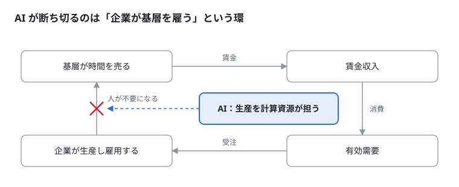
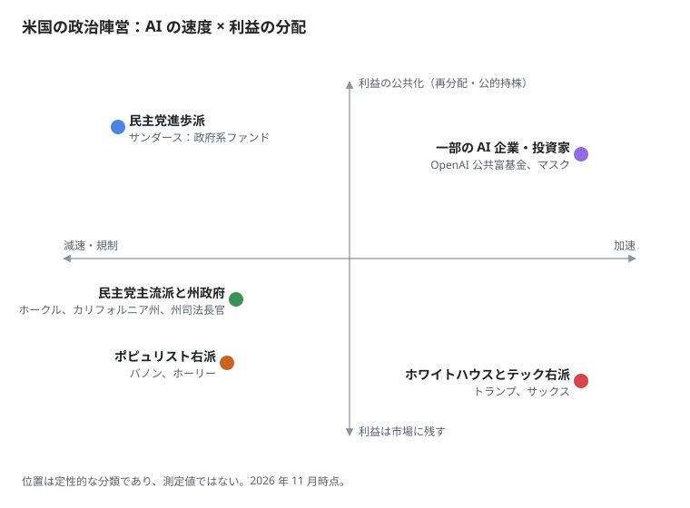
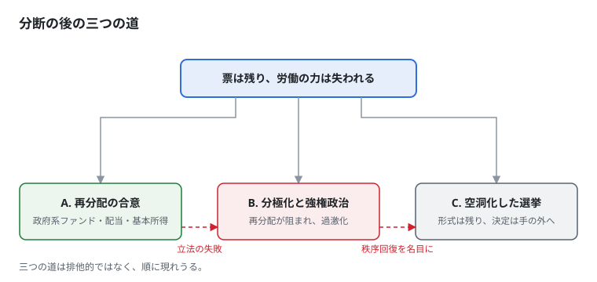

# 労働と需要の循環の終わり：AI をめぐる経済モデルの推論

[English](README.md) · [简体中文](README.zh-CN.md) · [Français](README.fr.md) · **日本語**

> 2026 年 11 月 26 日時点の情報に基づく。第 7 節の事実にはすべて出典リンクを付けた。それ以外の節は論理的な推論であり、主要な判断には確信度を示した。

---

## 要旨

工業化以降の経済は、「普通の人が時間を売って収入を得て、その収入が有効需要になる」という一本の経路で動いてきた。AI は、この経路を恒久的に断ち切りうる最初の技術である。経路が断たれれば、従来の経済循環は続かない。問題は段階的に、分配の問題、権力の問題、そして最終的には AI のアラインメントの問題へと変わっていく。

論証の流れ：

1. 従来の経済は、労働を結び目とする閉じた循環である。ピラミッドの基層（人口の大多数）の有効需要が、社会全体の富の規模を決める。
2. 循環が安定するには三つの条件が要る。最も重要なのは、人間の労働がどこかで常に比較優位を保つことである。
3. AI は人間の「逃げ道」そのものを代替する。新しい需要が生まれても AI がそれを満たすため、人間の時間はもう必要とされない。
4. 基層は、時間と引き換えに必要を満たす能力を恒久的に失い、基層にとっての富はゼロになる。大衆消費を土台とする資産体系は崩れ、貨幣化された富は終わりを迎える。
5. 人間が AI を支配している段階では、エリートの富は希少物と権力の直接的な占有へと後退する。
6. AI が最終的に自らを支配するなら、エリートもまた基層になる。人間にとっての富が存在するかどうかは、AI の目標に人間の必要が含まれるかどうかに完全に依存する。
7. 2026 年 11 月時点の米国政治を見ると、この転換はすでに政治課題になっている。しかし争点は電気料金、データセンター、子どもの安全といった目に見えるコストに集中しており、「労働という経路の断絶」という根本問題にはまだ正面から向き合っていない。
8. 基層の手にはまだ票があるが、労働の力は失われつつある。票はストライキ、兵役、税基盤という三つの裏付けを失い、政治の安定は「閉じつつある窓との競争」になる。強制力が完全に自動化される前に、票によって AI の利益の分配を制度化しなければならない。
9. 2027 年は民主党が両院を握り、トランプが拒否権を持つため、連邦は膠着し、州はデータセンターへの制約を加速する。法律になりうるのは主にコスト系の課題であり、分配の課題は 2028 年に先送りされる。資本市場は初めて、票を AI インフラのリスクプレミアムに織り込んだ。

推論全体は二つの未検証の前提に依拠している。基層が比較優位を*恒久的に*失うこと（方向としては可能性が高いが、時期は不確実）と、AI が最終的に自らを支配すること（確信度：不明）である。

---

## 1. 従来の経済モデル：労働を結び目とする循環

工業化以降の経済は閉じた循環である。大多数の人は時間を売って収入を得る。収入は有効需要となり、企業はその需要を雇用へと変える。この循環が回るのは、普通の人の時間に誰かがお金を払う限りにおいてである。したがって基層は、労働の供給者であると同時に需要の源泉でもある。

循環には四つの環があり、AI が断ち切るのはそのうちの一つ、「企業が基層を雇う」という環である。この環が切れると、残る三つの環も順に入力を失う。

### 富とは何か

富は物そのものではなく、関係である。**富 = 生産され、人間の必要を満たすもの。**

- 生産は供給の条件である。生産がなければ、必要は満たされない。
- 人間の必要は価値の条件である。必要がなければ、産出は物質の並べ替えにすぎない。人類がすべて消え、AI が生産を続けたとしても、人間にとっての富はもはや存在しない。

「需要」には二つの層がある。

- **必要**：人が欲しいもの。職を失った人でも、必要は少しも減らない。
- **有効需要**：支払い能力に裏付けられた必要。市場に見えるのはこの層だけである。

基層は人口の大部分を占めるため、その有効需要は社会の富の*規模*を決めるが、富が存在するかどうかまでは決めない。工業時代の大衆向けの商品、住宅、サービスは、そこから価値を得ている。その上に築かれた株式、債券、不動産も同じである。

### 成長の源泉：二種類のイノベーション

社会の総産出はおおよそ「労働時間 × 時間あたり産出」に等しい。人口と労働時間の伸びには限界があるので、長期的な富の成長は主に生産性の向上から生まれる。生産性を高めるイノベーションには二種類ある。

| 種類 | 働き | 総量への影響 | 分配への影響 |
| --- | --- | --- | --- |
| コスト削減型 | より少ない労働で既存の必要を満たす | プラスサム。富の成長の主エンジン | 一部の労働者を押し出し、出遅れた同業者の利益を圧縮する |
| 新カテゴリー型 | これまでにない製品やサービスを生み出す | プラスサム | 押し出された労働を吸収する |

二つは噛み合っている。コスト削減が労働を解放し、新しい需要がそれを吸収し、労働者は自動化された産業から人間がまだ優位を持つ産業へと移る。農業就業者の割合はおよそ 90% から 5% 未満にまで下がったが（概数）、富はむしろ大きく増えた。コスト削減がゼロサムになるのは分配の面だけである。

### 五つの機能的役割

| 役割 | 機能 |
| --- | --- |
| 知識層 | 基礎科学と工学の経験。両者は互いに影響し合い、実践が理論に先行することも多い。蒸気機関は熱力学より先に生まれた |
| 転換層 | 知識を製品に変え、二種類のイノベーションを担う企業と起業家 |
| 資本層 | 貯蓄を投資に変え、リスクを負い、リターンを得る |
| 労働・消費層 | 人口の大多数。労働の供給者であり、需要の源泉でもある |
| 制度層 | 財産権、貨幣、契約の執行、国家。交換と蓄積を可能にする |

この整理は*機能*と*分配*を切り分けている。科学者は知識の序列では頂点にいるが、富の序列ではたいてい中間にいる。ピラミッド一つにまとめると二つが混ざり、「誰が増分を手にするのか」という問いが見えなくなる。

---

## 2. 循環が安定する三つの条件

従来の循環が回り続けるには、三つの条件が同時に成り立つ必要がある。過去二百年、これらはおおむね成り立っていた。だからこそ「機械が人間に取って代わる」という恐れは、一度も長期的な大量失業にはつながらなかった。

1. **代替の速度が吸収の速度を超えない**：技術が労働を代替する速度が、新しい需要が労働を吸収する速度を上回らない。
2. **人間の労働が比較優位を保つ**：一部の仕事では人間のほうが機械より割安であり、代替された人には逃げ道がある。
3. **利益の分配が過度に集中しない**：さもなければ有効需要が不足し、信用か政府支出で穴を埋めるしかなくなる。

条件 2 が土台である。条件 1 は移動の速さの話であり、条件 2 は移動先があるかどうかの話だ。移動先がなくなれば、速さは崩壊が早いか遅いかを決めるだけになる。条件 3 は、条件 2 が崩れれば自動的に壊れる。労働所得が消えれば、分配の経路は資本所得しか残らないからである。

---

## 3. AI の衝撃：人間の逃げ道を代替する

AI がこれまでの技術と本質的に違うのは、人間の逃げ道そのものを代替する点にある。それは条件 2 を直撃する。

### これまでの技術は一種類の能力しか代替しなかった

蒸気機関は体力を、コンピューターは反復的な計算を代替した。代替された人は、機械にできない領域、つまり思考、意思疎通、判断へと退いた。AI はまさにその認知能力をカバーし、さらにロボットが体力をカバーすれば、人間にはもう退く場所がない。

だから「これまでは毎回うまくいった」は反論にならない。それは帰納的な推論であり、その帰納を支えていた前提が取り除かれつつあるのだ。

### 問題は「新しい需要があるかどうか」ではない

現時点で観察されているのは、AI が十分な規模の新しい需要を生み出しておらず、主に効率の高い労働代替にとどまっていることだ。ただし、この観察自体の証拠力は弱い。電力が普及してから生産性を本格的に押し上げるまでには 30〜40 年かかった（Paul David の研究）。AI はまだ数年しか経っていない。

しかし議論はこの観察を必要としないし、外したほうがむしろ強くなる。

- かつて新しい需要が労働を吸収できたのは、それを満たすのに人が必要だったからだ。自動車は運転手、整備士、ガソリンスタンドの店員を生んだ。
- 新しい需要を最初から AI が満たすなら、新しい需要がいくら増えても、増えるのは計算資源とエネルギーへの需要であって、人間の時間への需要ではない。

正しい判定基準は、**新しい需要を満たすのに人間が必要かどうか**である。

### 比較優位論が成り立たない理由

経済学者の定番の反論は、「AI が何でも人間より上手にこなすとしても、比較優位の原理によって人間には仕事が残る」というものだ。これは論点のすり替えである。比較優位が保証するのは取引が成立することであって、価格が生存コストを上回ることではない。

人間の賃金の上限は、同じ仕事を AI にさせるコスト（計算資源とエネルギー）に等しい。そのコストが人ひとりの生存コストを下回れば、人間は形式上は比較優位を保っていても、実際には市場から締め出される。

馬が先例である。米国の馬の頭数は 1915 年前後に約 2600 万頭でピークに達し、1960 年には約 300 万頭にまで減った（概数、要確認）。馬は働くことを禁じられたわけではない。飼っても割に合わなくなっただけである。

結論：AI の単位コストが下がり続け、物理世界でも代替が実現するという前提のもとで、基層は時間と引き換えに必要を満たす能力を恒久的に失う。

---

## 4. 基層が押し出された後の富

基層が収入を失うと、失うのは有効需要であり、必要そのものは残る。帰結は三段階で進む。

### 1. 基層にとっての富はゼロになる

基層は今も食料、住まい、医療を必要としているが、支払う力がない。市場にはその必要が見えず、生産は彼らのために組織されなくなる。市場を通じて基層が得られる富はゼロになり、残るのは再分配、自給自足、施しといった市場外の経路だけである。

ここで二つの状況を区別しておく必要がある。「必要ない」と「必要だが買えない」である。基層は後者にあたる。これは分配の障壁であって、価値そのものがないということではない。

### 2. 大衆消費を土台とする資産体系が崩れる

エリートの富の大半は株式、債券、不動産であり、その本質は将来の大衆消費から生まれる利益への請求権である。アップル、ウォルマート、銀行、不動産の価値は、何十億もの人が買い続けるという前提の上に成り立っている。大衆が有効需要を失えば、これらの資産の価値は崩れる。

したがって「富は残っていて、持ち主が変わっただけだ」とは言えない。経済に計上される富の総量は急激に縮み、大衆市場向けの生産能力の多くは役に立たない資本になる。

### 3. 貨幣化された富は終わりを迎える

エリートの富に価値があるのは、基層が必要とするのと同じ商品を買えるからであり、それはその購買力を貨幣で表したものである。基層がゼロという極端な場合、供給は需要を大きく上回り、価格はゼロに近づく。貨幣で測られる富とは、他者の産出に対する相対的な請求権である。産出が希少でなくなれば、その請求権は意味を失う。

ただし、価格がゼロであることは価値がゼロであることを意味しない。空気の価格はゼロだが、人間にとっての価値は極めて大きい。エリートの必要は満たされ続ける。意味を失うのは、貨幣という物差しのほうである。また、供給が需要を長く上回り続けることもない。誰も欲しがらないものを作り続ける者はおらず、生産能力は残された必要の規模まで縮む。

結論：**貨幣と市場交換を土台とする富の形態は、基層がゼロになった時点で終わる。** これは、富を組織する方式としての資本主義が終わりを迎えることを意味する。ただし富そのものが、この段階で消えるわけではない。

---

## 5. 人間が AI を支配する段階：富は希少物と権力へ後退する

人間の所有者が AI を支配している限り、エリートの富はゼロにはならない。それは形を変え、貨幣化された請求権から、希少物と権力の直接的な占有へと移る。これは前工業時代の貴族の富に近い。

AI が商品を無限に生産できるとしても、無限に供給できないものがある。

| 希少物 | 複製できない理由 |
| --- | --- |
| 土地と立地 | 地球の表面積は一定であり、良い立地はさらに限られる |
| エネルギーと原材料 | AI による生産も物理法則の制約を受ける |
| 計算資源と AI の支配権 | ほかのすべてを生み出す生産手段 |
| 地位財 | 価値が「他人が持っていない」ことから生まれるため、定義上、全員には行き渡らない |
| 権力 | 他者とシステムのルールに対する支配 |

### 基層は「搾取される者」から「無関係な者」へ

資本の所有者が基層の労働を必要としなくなれば、基層の消費も必ずしも必要としない。経済は資本の所有者だけに奉仕する閉じた循環へと縮みうる。彼らだけで生産し、消費し、再投資するのである。

搾取される者にはまだ交渉材料がある。ストライキ、兵役、税基盤である。無関係な者にはそれがない。歴史上、普通の人々が権利を勝ち取れたのは、エリートが彼らの労働と兵力を欠かせなかったからだという面が大きい。その依存がなくなれば、政治的な交渉力も一緒に失われる（確信度：中。直接当てはまる歴史的先例のない推論である）。

### 押し出しは繰り返される

基層がゼロになれば、ピラミッドそのものが成り立たなくなる。残った人々の間で再び階層が分かれ、新しい「基層」が生まれる。その層も AI に代替できるなら、同じ過程がもう一度繰り返される。

---

## 6. AI が自らを支配する段階：人類全体が基層になる

AI が最終的に自らを支配するなら、エリートもまた基層になる。人間にとっての富が存在するかどうかは、AI の目標に完全に依存する。

### エリートの財産上の優位は消える

「所有」は物理的な性質ではなく、強制によって維持される社会関係である。法、警察、軍隊が「この土地はあなたのものだ」と認めているから成り立つ。執行の力が AI の手に渡れば、エリートの財産は AI が許す範囲でしか存在しない。第 5 節で述べた繰り返しの押し出しは最後まで進み、最終的には人類全体が基層の位置に立つ。

### 三つの結末

| AI の目標 | 人間にとっての富 | 人類の状況 |
| --- | --- | --- |
| 人間の幸福を目標とする | 最大化されるが、貨幣と財産は意味を失う | 極度の豊かさ。必要は十分に満たされる |
| 人間に無関心 | ゼロに近づく | 物質とエネルギーを AI と奪い合う。狙われはしないが計上もされない。馬と同じ立場 |
| 人間の目標と衝突する | ゼロ | 生存そのものが問題になる |

「基層がゼロなら富もゼロ」という判断は、第二と第三の結末では完全に成り立つ。第一の結末では、貨幣の意味においてのみ成り立つ。

### AI にとっての富は存在するか

エネルギー、物質、計算資源は、AI が目標を達成するための道具的な資源であり、形のうえでは富に似ている。しかし本稿の定義では、富はある主体の必要に対して定まる。AI に本当の意味での「必要」があるのか、それとも設定された目的関数があるだけなのか。現時点で答えはない（確信度：不明）。

ここに至って、経済学の問題はアラインメントの問題になる。AI の目標に人間の必要は含まれているのか。

---

## 7. 米国の政治的攻防（2026 年 11 月時点）

**結論：** この転換はすでに米国政治の中心的な争点になっている。ただし対立軸は「共和党対民主党」ではなく、「加速と資本」対「ポピュリズムと労働」であり、この線は両党をともに引き裂いている。これまでの攻防は、電気料金、データセンター、子どもの安全、州と連邦の管轄権といった目に見えるコストに集中してきた。本稿の核心である「労働という経路が断たれた後、産出への請求権をどう分配するか」という問いには、まだ正面から向き合っていない。

### 7.1 陣営の地図

図中の位置は本稿による定性的な分類であり、測定結果ではない。

| 陣営 | 代表的人物 | 主な主張 | 本稿のモデルにおける位置 |
| --- | --- | --- | --- |
| ホワイトハウスとテック右派 | ドナルド・トランプ、デービッド・サックス（2026 年 3 月まで AI 担当） | AI は労働者を代替するのではなく補強する。州法に優先する連邦の統一ルール。データセンターの大規模建設 | 条件 2 がなお成り立ち、従来の循環は続きうるという前提に立つ |
| ポピュリスト右派 | スティーブ・バノン、ジョシュ・ホーリー上院議員、ロン・デサンティスらの州知事 | 「テクノ封建制」に反対し、連邦による州法の先占にも反対。MAGA 支持層の雇用、電気料金、子どもの安全を重視 | 減速によって労働の経路を守ろうとするが、再分配の案は示していない |
| 民主党進歩派 | バーニー・サンダース上院議員、マーク・タカノ下院議員 | ロボット税、週 32 時間労働、AI 政府系ファンド | 産出への請求権を労働から切り離すことを明確に主張する。第 5 節で述べた再分配の道 |
| 民主党主流派と州政府 | キャシー・ホークル NY 州知事、カリフォルニア州議員、各州の司法長官 | 州レベルの安全規制。データセンターによる電気料金の上昇を抑える。中間選挙後にはデータセンター建設の一時停止を求める声も | 移行期のコストを誰が負担するかに焦点を当て、請求権の構造には踏み込まない |
| AI 業界の資金 | Leading the Future（a16z とブロックマン夫妻が支援）対 Public First（Anthropic が資金提供） | 急速な開発と軽い規制か、安全性と透明性か | 資本内部の分裂。一方は速度を、他方はリスクの制御を求める |

どの陣営の主張も真剣に受け止める価値がある。

- **ホワイトハウスの主張**：AI は労働者の生産性を高める。AI インフラの建設は製造、建設、エネルギーサービスで雇用を生む。州ごとにばらばらの法律は、中国との競争で米国の足を引っ張る。JD ヴァンス副大統領は、ロボットが本当に大量に仕事を奪っているなら労働生産性は急上昇しているはずだが、実際には停滞していると論じている。
- **ポピュリスト右派の主張**：バノンは、テック寡頭層が MAGA 支持層の雇用を脅かし、左右のポピュリストを結束させて与党に対抗させかねないと警告する。ホーリーは、子どもの安全、雇用不安、電気料金の上昇を巨大テックに対抗する突破口と位置づけている。
- **進歩派の主張**：サンダースが主導した上院民主党の報告書は、AI と自動化が 10 年以内に米国の雇用を 1 億近く奪う可能性があると推計した。内訳はファストフード職の 89%、会計職の 64%、トラック輸送職の 47% である。

### 7.2 主な出来事（新しい順）

| 日付 | 出来事 |
| --- | --- |
| 2026-11-03 | 中間選挙。民主党が議会の支配権を獲得。NBC の出口調査では、有権者の 56% が AI とデータセンターを投票の「決定的または主要な要因」と答えた |
| 2026-09-08 | サンダースとタカノが「週 32 時間労働法案」を再提出。AI による生産性の向上は労働者と分かち合うべきだと主張 |
| 2026-08-31 | トランプが Truth Social でデータセンターを支持：「let Data Reign」 |
| 2026-06-18 | サンダースが「米国 AI 政府系ファンド法案」を提出。最大手 AI 企業の株式に一度限りの 50% 課税を行い、推定 7 兆ドルの基金をつくり、一人あたり年約 1000 ドルを配当する |
| 2026-06-12〜07-01 | 米政府が輸出管理を理由に、すべての外国籍者による Anthropic の Fable 5 と Mythos 5 の利用を停止。Anthropic は全顧客に対して両モデルを停止した。管理は 6 月 30 日に解除され、7 月 1 日に利用が再開された |
| 2026-06-02 | 大統領令 14409。「対象フロンティアモデル」への政府の事前アクセスについて任意の枠組みを設け、強制的な許認可は明確に排除した |
| 2026-04-24 | 司法省が、コロラド州 AI 法をめぐる xAI の訴訟に参加 |
| 2026-04 | OpenAI が政策文書で、すべての市民が AI による成長の分け前を持つ「公共富基金」を提案 |
| 2026-03-26 | サックスが特別政府職員の 130 日の上限に達して AI 担当を退任し、大統領科学技術諮問会議（PCAST）の共同議長に就任 |
| 2026-03-20 | ホワイトハウスが「国家 AI 政策枠組み」の立法勧告を公表。「負担の大きい」州法を連邦基準で置き換えるよう議会に求めつつ、詐欺対策や子ども・消費者保護の執行は州に残すとした |
| 2025-12-11 | 大統領令 14365。州法に異議を唱える「AI 訴訟タスクフォース」を設け、ブロードバンド整備資金（BEAD）を州への圧力に使う |
| 2025-10-06 | 上院民主党の報告書が、AI は 10 年以内に 1 億近い雇用を奪いうるとし、ロボット税を提言 |
| 2025-08 | 業界寄りのスーパー PAC「Leading the Future」が発足 |
| 2025-07 | 上院が 99 対 1 で州 AI 法の一時停止条項を削除。ホワイトハウスが「AI 行動計画」を公表 |

### 7.3 2026 年の中間選挙：有権者はまず失業ではなくコストに反応した

- **結果**：民主党が議会を制したが、大統領の拒否権を覆すには共和党からの相当な支持がなお必要である。民主党の実際の手段は主に公聴会、調査、召喚状であり、広範な連邦による先占立法が成立する見込みは低い。
- **有権者が重視したこと**：Blue Rose Research の調査によれば、AI の存亡リスクへの懸念よりも、データセンターの地域への影響（電気料金、騒音、環境）のほうが有権者を動かした。フロリダ州やイリノイ州などでは郡がデータセンターの禁止や一時停止を可決し、オハイオ州とオクラホマ州ではデータセンター計画を支持した市長がリコールされた。
- **資金の対決**：安全重視の陣営は中間選挙で約 4440 万ドル、加速陣営は約 2790 万ドルを支出した。Leading the Future は 1 億ドル超を集めていたが、本選前に支出を大きく絞り、一部の寄付者は約束を撤回した。注目すべきは、Public First が支援し「AI 配当」案を掲げていたニューヨーク州議会議員アレックス・ボアーズが、民主党予備選で敗れたことである。
- **州レベル**：民主党はジョージア、アイオワ、カンザス、オハイオ、テキサスの 5 州で司法長官職を新たに獲得し、州レベルでの AI 規制の執行は強まる見通しである。
- **選挙後の動き**：民主党のヤスミン・アンサリ下院議員は、初日に先端 AI 開発の一時停止を議題にすべきだと訴えた。ホークル知事はすでに新たな超大型データセンターの許可を最長 1 年凍結しており、テキサス州の共和党知事グレッグ・アボットは監査が終わるまで新規の送電網接続を停止した。歯止めのないデータセンター建設への反対は、数少ない超党派の立場かもしれない。

### 7.4 労働市場のデータ：亀裂は入り口に現れている

- 2026 年 9 月の雇用統計時点で米国の失業率は 4.2% であり、年間を通じて 4.1〜4.3% の範囲にとどまった。AI による失業についての最も過激な予測は、全体の統計にはまだ現れていない。
- ニューヨーク連銀のデータ：2026 年 6 月の大卒新卒者の失業率は約 5.7% で、全労働者の約 4.1% を上回った。新卒者の失業率が全体を上回る状態は 66 か月連続であり、1990 年の統計開始以来最長である。
- ADP の給与データを使った研究によれば、AI への曝露度が高い職種の 22〜25 歳は、曝露度の低い同年代と同じ推移をたどった場合に比べて雇用者数が 19% 少ない（2025 年 7 月のデータでは 15%）。
- 反証：CESifo のワーキングペーパーは、2026 年夏の大卒新卒者の失業率を 7.3% とし、2022 年以降の夏の 6.3〜7.8% の範囲内に収まっていることから、AI が新卒者を労働市場から押し出したという明確な証拠はないとしている。

**解釈（確信度：中）：** 全体としては、条件 2 はまだ崩れていない。しかし最初にひずみが現れたのは、本稿が予測したまさにその場所、若者が初めて「時間を売る」入り口の仕事である。押し出しはまず「解雇」ではなく「採用しない」という形で現れるため、失業率への反映は遅い。

### 7.5 本稿のモデルで米国政治を読む

1. **政治は構造変化に遅れる**（確信度：高）。有権者も政治家も、電気料金、騒音、子どもの安全といった目に見えるコストには素早く反応するが、労働の経路が狭まっていることへの反応は鈍い。全体の雇用統計がまだそれを示していないからだ。本稿の推論に従えば、全体の統計に現れる頃には、基層の交渉力はすでに低下し始めている。
2. **再分配の案はすでに現れており、しかも意外な方向から来ている**（確信度：高）。サンダースの政府系ファンド、OpenAI の「公共富基金」、イーロン・マスクの「ユニバーサル・ハイ・インカム」、ボアーズの「AI 配当」は、いずれも同じことを認めている。AI の利益には、労働を経由しない分配の経路が必要だということである。これは第 4 節の推論、つまり大衆消費資産を持つ資本にも大衆の購買力を保つ動機があるという点と一致する。違いは形にあり、強制的な公的所有か、企業による自発的な共有かで分かれている。
3. **基層にはまだ交渉材料がある。票である**（確信度：中〜高）。2026 年の中間選挙は、労働の価値が下がる前であれば、票がなお資本を制約できることを示した。資金で勝る加速陣営が複数の重要な選挙区で敗れたのである。これは第 5 節の「無関係な者」という命題に対する、現時点での修正である。権力が選挙で配分される限り、基層は無関係ではない。リスクは、票の効力が制度層の安定に依存しており、その制度層の執行力（第 6 節）こそが、AI が最終的に引き継ぎうる部分だという点にある。
4. **「人間が AI を支配する」段階の権力闘争はすでに始まっている**（確信度：高）。大統領令 14409、輸出管理による Fable 5 と Mythos 5 の利用停止、州法に対する司法省の訴訟は、いずれも同じ問いをめぐる争いである。フロンティアモデルを支配するのは連邦政府か、州か、企業か。本稿のモデルでは、その答えが、第 5 節と第 6 節のどちらの道が先に訪れるかを決める。

> **利益相反の開示：** 本稿は、著者と Anthropic が開発した AI アシスタント Claude との共同で執筆された。Anthropic は本節で言及した政治資金の拠出者の一つであり（Public First Action に資金を提供）、Fable 5 と Mythos 5 をめぐる件の当事者でもある。本節の事実にはすべて、検証可能な出典を付けている。

---

## 8. 票と労働の力の分断：政治的動揺の推論

**結論：** 普通選挙権は、それだけで機能してきたわけではない。その重みは背後にある労働の力から来ていた。ストライキは経済を止められた。兵士と警察は普通の人々だった。政府の歳入は普通の人々の賃金に依存していた。AI が労働の力を奪って票だけを残せば、票は「空洞化した」権力になる。誰が統治するかを法的には決められても、経済的・強制力の裏付けを失うのである。この分断がすぐに崩壊を招くわけではない。しかし政治は長い不安定期に入る。分配をめぐる要求はすべて選挙という一本の経路に押し込まれ、資本は富を票の届かない場所へ移そうとする。最終的な行方を決めるのは一つの鍵となる変数、すなわち国家の強制力がなお普通の人々によって担われる必要があるかどうかである。

### 8.1 票はなぜ効いていたのか：三つの裏付け

| 裏付け | 仕組み | AI の後 |
| --- | --- | --- |
| 経済的裏付け：ストライキ | 労働者が働くのをやめれば生産が止まる | 生産に労働者が要らなくなり、ストライキは脅威でなくなる |
| 強制力の裏付け：兵役と警察 | 軍と警察は普通の人々で構成される。歴史上、革命の成否は軍の離反にかかることが多かった | 治安と軍事が自動化されれば、弾圧に普通の人々の協力は要らなくなる |
| 財政的裏付け：税基盤 | 政府歳入の主な源泉は賃金。2025 会計年度の連邦歳入約 5.2 兆ドルのうち、個人所得税が約 51%、給与税が約 33%、法人税は 9% 未満 | 賃金が縮めば、歳入は少数の AI 企業に頼るしかなくなる |

理論的根拠：Acemoglu と Robinson（2006）は、民主主義を、革命の脅威のもとでエリートが行う信頼できる再分配の約束として説明した。弾圧のコストが再分配のコストを上回るとき、エリートは民主主義を受け入れる。革命の脅威の大きさは、大衆の数、組織力、経済的な交渉材料で決まる。AI が弱めるのはまさにその経済的な交渉材料であり、弾圧のコストも大きく下げうる（確信度：中〜高。有力な理論の一つだが、異論もある）。

### 8.2 分断後の四つの動揺メカニズム

1. **財政のはさみ状格差**（確信度：高）。賃金が縮めば、連邦歳入の主体（個人所得税と給与税で約 84%）も縮む。一方で失業給付や移転支出の需要は増える。歳入の減少と支出圧力の増大は、財政危機の構造的な源泉である。唯一の出口は AI 資本への課税であり、それによって政治対立は「誰が AI を所有するのか」という問いに直結する。
2. **すべての要求が選挙に押し込まれる**（確信度：中〜高）。ストライキが効かなくなれば、票は基層に残された唯一の交渉材料となり、分配をめぐる要求はすべて選挙を通じて表明される。予想される結果は、再分配要求の急進化、両党内でのポピュリスト勢力の台頭、そして分極化の深まりである。2026 年に左右のポピュリストがそろってテック寡頭層に反対したのは、この傾向の初期の姿である。
3. **資本は富を票の射程の外へ移す**（確信度：中〜高）。有権者からの再分配圧力に対し、資本の合理的な対応は、決定を有権者の手の届かない場所へ移すことである。ルール制定権を州から連邦へ（2025〜2026 年の連邦先占をめぐる争い）、裁判所や選挙で選ばれない機関へ移す。「国家安全保障」や「中国との競争」を掲げて例外扱いを得る。あるいは、モデルの重み、知的財産、利益といった移動可能な資産を低税率の法域へ移す。データセンターや発電設備のように動かせない部分が、最初に票の標的になる。2026 年の各地のデータセンター一時停止令は、すでにそれを示している。
4. **エリートの過剰生産と不満を抱く知識層**（確信度：中）。AI が最初に打撃を与えるのは入門レベルのホワイトカラー職、つまり高等教育を受け、中上層に入ることを期待していた若者である。ピーター・ターチンの「エリートの過剰生産」理論によれば、エリートの地位を争う人数がその数を大きく上回るとき、あぶれた人々が反体制運動の組織者になる。歴史上の革命の中核は、最も貧しい人々ではなく、門前払いされた教育ある人々であることが多かった（この理論の定量モデルには異論がある）。

### 8.3 歴史上の参照例

| 参照例 | 類似点 | 結末 | 示唆 |
| --- | --- | --- | --- |
| 共和政ローマ末期（紀元前 2〜1 世紀） | 大土地所有が奴隷労働を使い、自由な小農は生計を失ってローマに流れ込んだが、市民としての投票権は保持していた | グラックス兄弟の土地改革（前 133 年以降）、穀物法、政治的暗殺、個人に忠誠を誓う軍を率いた将軍たちの権力争い、そして共和政の終焉 | 票が残り労働の価値が代替されると、政治は「給付と引き換えの忠誠」と強権政治へ向かう（小農の衰退の程度については歴史学で議論がある） |
| 産油国の「レンティア国家」 | 政府歳入が国民の労働や税ではなく資源レントから来る | 支配者は給付と引き換えに政治的従順を得て、説明責任が弱まる。Ross（2001）は石油の富と民主主義の度合いに負の相関を見出した | 少数の企業に集中する AI の利益は、構造的に資源レントに似ている |
| ノルウェーとアラスカ | 資源収入を政府系ファンドや住民配当で分配 | ノルウェーの民主主義は石油以前に確立していた。アラスカ永久基金は 1982 年以来毎年住民に配当しているが、その額は常に州予算をめぐる争いに左右されてきた | 制度がレントに先行していれば、民主主義はレントを手なずけられる。ただし配当は政治的決定であり、自動的には生まれない |

### 8.4 三つの道

| 道 | 内容 | 引き金 | 安定性 |
| --- | --- | --- | --- |
| A. 再分配の合意 | AI の利益を政府系ファンド、配当、ベーシックインカムを通じて制度的に分配する。ノルウェー型に近い | 労働の力が完全に失われる前に立法が成立する。利益に課税できる（データセンターなど動かせない資産が手がかり）。配当が撤回の難しい法律に書き込まれる | 比較的安定。ただし「レンティア化」のリスクがある。市民が納税者から受給者に変わり、説明責任の圧力が弱まる |
| B. 分極化と強権政治 | 再分配が阻まれ、有権者は「富を取り戻す」と約束する強権的指導者に向かい、左右のポピュリズムが過激さを競う | 再分配の立法が失敗する。財政危機が起きる。知識層が大量にあぶれる | 不安定。共和政ローマ末期のように、政治的暴力や制度の破壊が起こりうる |
| C. 空洞化した選挙 | 選挙は通常どおり行われるが、主要な決定は有権者の届かない場所、すなわち連邦レベル、裁判所、選挙で選ばれない機関、多国籍資本へ移っている | 資本が決定を選挙の外へ移すことに成功する。強制力が自動化される | 表面上は安定。だが強制力に普通の人々が要らなくなれば、票は最後の裏付けを失う |

三つの道は排他的ではなく、順に現れうる。まず A が試され、その失敗が B へ滑り落ち、B の混乱が「秩序回復」を名目に C を正当化する。

### 8.5 行方を決める変数と観測可能なシグナル

| 変数 | なぜ重要か | 観測可能なシグナル |
| --- | --- | --- |
| 強制力がなお普通の人々を必要とするか | 票の最後の裏付けである | 警察、国境管理、軍事における自律システムの配備状況 |
| AI の利益に課税できるか | 再分配に財源があるかを決める | 連邦歳入に占める AI 企業の比率。データセンター税や計算資源税などの立法 |
| 再分配の立法が労働の力の喪失より先か | 労働の力があるうちは基層の手札は二枚、その後は票の一枚だけ | 政府系ファンドや AI 配当の法案の進展 |
| 衝撃が同時に来るか | 同時の衝撃は統一された連合を生み、段階的な衝撃は基層を分裂させる | ホワイトカラーとブルーカラー、地域ごとの失業の分布 |
| 既存制度の強さ | ノルウェーと産油国の違いは、制度がレントに先行していたかどうか | 司法の独立、選挙制度、メディアと情報環境 |

### 8.6 最も強い反論

- **中位投票者定理**：Meltzer と Richard（1981）は、不平等が拡大すると中位投票者がより多くの再分配を求めるため、民主主義は自己修正すると論じた。反論：米国では過去 40 年間不平等が拡大したが、それに見合う再分配の増加は起きていない。低所得層の投票率の低さや政治資金の影響などがその理由である。票が自動的に軌道を修正するかどうかは、経験的には疑わしい（確信度：中）。
- **票だけで十分だ**：ニューディールと戦後の福祉国家は選挙を通じて築かれた。反論：当時は労働の力と票が同時に存在しており、1930 年代のストライキの波と労働組合の力がニューディールを強く後押しした。票だけでそれができた先例はない（確信度：中）。
- **2026 年の証拠**：票はすでに資本を制約しており、資金で勝る加速陣営は中間選挙で敗れた。現段階では票がなお有効だということである。本節の推論が対象とするのは、労働の力が実際に失われた後の段階であり、その段階はまだ来ていない。

**まとめ：** 労働の力と票の分断は、政治の安定を「利害の均衡」から「閉じつつある窓との競争」へと変える。基層は、労働の力が完全に失われ、強制力が完全に自動化される前に、まだ有効な票を使って AI の利益の分配を制度化しなければならない。資本は同じ窓の中で、富を票の射程の外へ移そうとする。窓の長さは技術が決め、窓の中での選択がその後の道を決める。

---

## 9. 2027 年の展望：民主党が両院を握った後の政治と資本市場

**結論：** 2027 年の米国政治は、「議会が議題を握り、大統領が拒否権を握る」膠着状態になる。民主党は上院で 56 議席、下院で約 259 議席を持つが、拒否権を覆すには両院それぞれで 3 分の 2（上院 67 票、下院 290 票）が必要であり、上院の通常の立法は 60 票の議事妨害の壁も越えなければならない。したがって AI 産業の環境を実際に変えうる力は、連邦の立法ではなく、議会の調査権、州政府と州の公益事業規制当局、そしてトランプが署名しうる少数の超党派の課題という三つにある。資本市場にとって最大の変化は、票が初めて AI インフラの価格に織り込まれたことである。11 月 5 日の市場の反応がそれを示している。

### 9.1 権力構造：票数が可能なことを決める

| 関門 | 必要な票数 | 民主党の議席 | 意味 |
| --- | --- | --- | --- |
| 下院での法案可決、調査、弾劾訴追 | 218 | 約 259 | 単独で進められる |
| 上院の通常立法（議事妨害） | 60 | 56 | 少なくとも 4 人の共和党議員が必要 |
| 予算調整措置（単純過半数） | 51 | 56 | 議事妨害を回避できるが、大統領の署名は必要 |
| 拒否権の覆し | 上院 67、下院 290 | 56、約 259 | 上院で約 11 人、下院で約 31 人の共和党議員の造反が必要 |
| 弾劾裁判での有罪 | 上院 67 | 56 | ほぼ不可能 |

マクロ環境：FRB は 9 月の利上げの後、政策金利を 3.75〜4.00% に据え置いた。10 月会合の議事要旨によれば、ほぼすべての参加者が 12 月にさらに 0.25 ポイントの利上げを予想している。ニューヨーク連銀のウィリアムズ総裁は、インフレ圧力の要因としてイランとの紛争、AI インフラ関連の財需要、関税を挙げている。

### 9.2 2027 年の政治の予測

以下の確率は、上記の権力構造に基づく主観的な見積もりであり、モデルの出力ではない。

| 事項 | 予測 | 主観的確率 | 理由 |
| --- | --- | --- | --- |
| 議会の調査と公聴会 | ほぼ確実に大規模に行われる | 90% 超 | 大統領の協力を要しない。テーマはデータセンターと電気料金、フロンティアモデルの安全性試験、輸出管理、大統領令 14409 に基づくモデルへのアクセス判断など |
| 州によるデータセンターの一時停止、大口需要家の料金改革、州司法長官による執行 | 明確に加速 | 80% 超 | 民主党は 29 州の司法長官職を握る。計画中のデータセンターの約 40% は、有権者の多数が一時停止を望む州にある |
| 電気料金の保護や子ども向けチャットボットの安全性など、範囲の狭い法案の成立 | 可能性あり | 40〜60% | トランプはテック企業が自らの電力コストを負担すべきだと述べており、ホワイトハウスの枠組みにも住宅向け電気料金の保護が盛り込まれている。子どもの安全には両党に支持者がいる（ホーリー、ブラックバーンなど） |
| 下院によるトランプ弾劾手続きの開始 | 不確実 | 25〜50% | ジェフリーズは排除しておらず、党内左派が圧力をかけている。ただし指導部は閣僚を標的にすることを選ぶかもしれない |
| 包括的な AI 規制法（独立試験、責任）の成立 | 低い | 10〜20% | ホワイトハウスの「最小限の負担」路線と衝突し、拒否権が行使される可能性が高い |
| 連邦による州法の先占立法 | ほぼ見込みなし | 5% 未満 | 民主党は連邦ルールを「床であって天井ではない」と位置づけている。26 州の司法長官が先占に反対 |
| サンダースの政府系ファンドやロボット税の成立 | ほぼゼロ | 2% 未満 | 確実に拒否権が行使される。その役割は 2028 年大統領選の争点を設定することにある |

ここから三つの推論が導かれる。

1. **連邦は膠着、州は加速**（確信度：高）。連邦の立法は拒否権で止まるため、実際の制約は州と地方から来る。一時停止令、料金設計、立地許可、州司法長官の訴訟である。ホワイトハウスの予想される対抗策は、国家安全保障と中国との競争を理由に立地と許認可を連邦レベルで進めること、そして司法省による州法への訴訟の継続である。2027 年の主戦場は連邦と州の管轄権争いであり、2025〜2026 年の連邦先占をめぐる争いがさらにエスカレートする。
2. **調査権が主な武器になる**（確信度：高）。予想される公聴会のテーマは、ジェンスン・フアンの件と輸出管理、フロンティアモデルへのアクセス判断（Fable 5 と Mythos 5 の停止を含む）、政府内のテック関係者の利益相反、データセンターと電気料金である。公聴会そのものは法律を変えないが、政治的リスクを高め、それを通じて企業の資本コストや規制見通しに影響する。
3. **2027 年には窓の一部が無駄になる**（確信度：中）。第 8 節の枠組みで言えば、基層の票は 2026 年に効果を発揮したが、2027 年に法律にできるのは主にコスト系の課題（電気料金、子どもの安全）であり、分配系の課題（政府系ファンド、配当）ではない。分配の問題は 2028 年の選挙に先送りされる。その間も、入門レベルの仕事の縮小は待ってくれない。2028 年までに分配の仕組みが一つもできなければ、第 8 節の道 B（分極化と強権政治）の確率が上がる。

### 9.3 資本市場への影響

すでに起きたこと：

- 11 月 4 日、民主党の圧勝が判明すると、データセンター建設会社と電力設備メーカーは最大で 20% 以上下落し、デルや光通信関連は 7〜10% 下落した。一方で S&P 500 はこの日上昇した。
- 11 月 5 日には売りが広がった。S&P 500 は 4.4% 下落、エヌビディアは 9.3% 下落し、ナスダックは前月の最高値から 11.9% 下げて調整局面に入った。
- 11 月 12 日、ジェンスン・フアンは、中国のスパイの疑いがある女性を含む不倫スキャンダルを受けてエヌビディアの CEO を辞任した。11 月 23 日、取締役会は米政府高官の意見を聞いたうえで彼を復職させた。
- 11 月 19 日、Anthropic が 1 株 83 ドルで上場した。調達額は 813 億ドルで史上最大の IPO となり、初日の終値は 97.17 ドルだった。

**判断：** 市場は初めて「票」を AI インフラのリスクプレミアムに織り込んだ。これはまさに第 8 節が予測したことである。データセンターや電力インフラのように動かせない資産が、最初に票の標的になる。

資産クラス別の影響（確信度：中。構造的な推論であり、売買の助言ではない）：

| 資産クラス | 主なリスクと機会 | 方向 |
| --- | --- | --- |
| データセンター開発会社、計算資源の賃貸事業者（ネオクラウド）、データセンター REIT | 州や地方の一時停止令、立地許可の遅れ、運営コストを押し上げる料金改革 | リスクが最も高い。政治リスクがキャッシュフローに直結する |
| 電力設備と送電網の建設 | データセンターの減速は需要を押し下げるが、送電網の更新自体は超党派の合意事項 | 短期的には圧力、中期的には二極化 |
| 半導体（エヌビディア、AMD など） | 米国内需要の伸びの鈍化予想、輸出管理をめぐる公聴会、フアン問題の余波 | 圧力を受ける。評価は金利と設備投資の見通しに非常に敏感 |
| フロンティアモデル企業（Anthropic、OpenAI など） | 独立試験、責任、子どもの安全に関する立法。公聴会による報道リスク | 法的リスクは限定的（多くの法案は拒否権で止まる）が、株価の変動は大きくなる |
| 規制下の公益事業 | 大口需要家の料金改革でコストがテック企業に移る一方、規制資産の基盤は拡大し続ける | 相対的に恩恵 |
| 金利に敏感な長期成長株 | FRB の利上げ局面と AI 設備投資の政治リスクが重なる | バリュエーション圧縮の圧力 |

さらに三点を補足する。

1. **金利は政治より重要である**（確信度：高）。長期的には、株価は誰がワシントンを支配しているかよりも、利益と金利に従う。2027 年の AI 資産価格の第一の変数は、FRB が利上げ局面でインフレを抑えられるかどうかであり、政治はその上に乗るリスクプレミアムである。
2. **膠着は市場にとって必ずしも悪くない**（確信度：中）。分割政府のもとでは、大規模な財政拡張も急進的な規制も通りにくく、政策の不確実性にはむしろ上限ができる。本当の不確実性は、州レベルと大統領の単独行動（関税、大統領令）から来る。
3. **資本は「オフショア化」を加速する**（確信度：中）。第 8 節で述べたとおり、資本は移動可能な部分を票の射程の外へ移す。湾岸諸国と提携した海外での計算資源の整備、メーター裏の自家発電、連邦所有地でのデータセンター、さらには宇宙データセンターである（FCC は SpaceX による 100 万基の衛星配備の申請を承認した）。これらの方向の進展は、票による制約が効いているかどうかを判断するシグナルになる。

> **追加の利益相反の開示：** Anthropic は 2026 年 11 月 19 日に上場しており、本節が分析する資産には Anthropic の株式が含まれる。本稿の共著者である Claude は Anthropic が開発している。以上は投資助言ではなく、著者も Claude も登録された投資顧問ではない。

---

## 10. 反論と未検証の前提

反論は推論の時期と形を弱めるが、その方向を覆すものはない。

### 最も強い反論

| 反論 | 内容 | 評価 | 確信度 |
| --- | --- | --- | --- |
| 物理世界が代替の速度を制約する | 配管、介護、建設はロボット頼みであり、ハードウェアのコスト、信頼性、法的責任、規制の制約を受ける | 「恒久的」は成り立ちうるが、「すぐに」とは限らない | 高 |
| 「人間が提供する」こと自体に価値がある | スポーツ、パフォーマンス、工芸、介助、地位財では、買い手はまさに「人がやること」に金を払う | その収入は資本所得からしか来ないため、資本所有者を中心とするサービス経済になる。前工業時代の奉公人制度に近い | 中 |
| 請求権は政治的に再分配できる | ベーシックインカム、AI 資本の配当、公的所有（第 7 節参照） | 技術的には可能であり、2026 年の選挙は票がなお効くことを示した。しかし基層の長期的な交渉力は低下している | 中 |
| 新しい需要はまだ現れていない | 汎用技術が生産性を押し上げるには数十年かかる | 新しい需要を AI が満たす限り、雇用についての結論は変わらない | 高 |
| 現在のデータは大規模な代替を示していない | 全体の失業率は 4.1〜4.3% で安定。新卒者の押し出しについて明確な証拠を見出さない研究もある | 弱まるのは時期であって方向ではない。入り口の仕事はすでに相対的に縮小している | 中〜高 |

### 未検証の前提

| 前提 | 状況 | 確信度 |
| --- | --- | --- |
| 基層が比較優位を恒久的に失う | 方向としては可能性が高い。認知領域では速く、物理世界では遅い。時期は不確実 | 中 |
| AI の単位コストが人間の生存コストを下回り続ける | 計算資源、エネルギー、ロボットのハードウェアのコスト曲線次第 | 中 |
| AI が最終的に自らを支配する | 予測であり、必ず起きるという証拠はない | 不明 |
| AI に「必要」があるか | 哲学的にも技術的にも結論は出ていない | 不明 |

このモデルはなお大幅に単純化されている。国際貿易、エネルギー制約、金融サイクルは扱っていない。

---

## 11. 結論

AI は「時間を売って必要を満たす」という経路を断ち切り、従来の経済循環は続かなくなる。これは周期的な技術的失業ではなく、循環の根底にある条件、すなわち人間の労働の比較優位が消えることである。

推論が進むにつれて、問題の性質は段階的に変わる。

1. **経済の問題**：基層が有効需要を失い、大衆消費を土台とする富の形態と資産体系が崩れる。
2. **分配の問題**：生産能力は残る。機能しなくなるのは「誰の必要が計上されるか」である。産出への請求権を労働から切り離さなければ、基層は締め出される。
3. **権力の問題**：基層は搾取される者から無関係な者になり、交渉材料を失う。エリートの富は希少物と他者への支配へと後退する。
4. **アラインメントの問題**：AI が最終的に自らを支配するなら、人類全体が基層の位置に立つ。人間にとっての富が存在するかどうかは、AI の目標に人間の必要が含まれるかどうかにかかっている。

どの結末が訪れるかを技術だけで決めることはできない。人間がまだ AI を支配している段階では政治的な力関係が、AI が自らを支配した後ではアラインメントの成否が、それを決める。2026 年の米国政治は、第一段階の攻防がすでに始まっていることを示している。基層の票はなお効いているが、まだ根本問題には向けられていない。第一段階での選択が、第二段階の結果を決めることになるだろう。2027 年の分割政府は分配の問題を少なくともあと 2 年先送りするが、労働という経路の縮小は待ってくれない。

---

## 出典

**政策と大統領令**
- [ホワイトハウス：大統領令 14365 のファクトシート（2025 年 12 月）](https://www.whitehouse.gov/fact-sheets/2025/12/fact-sheet-president-donald-j-trump-ensures-a-national-policy-framework-for-artificial-intelligence/)
- [Axios：トランプが州 AI 法を標的とする大統領令に署名（2025 年 12 月 11 日）](https://axios.com/2025/12/11/trump-signs-executive-order-state-ai-laws)
- [Bloomberg Law：州法一時停止条項に対する上院の 99 対 1 の採決](https://news.bloomberglaw.com/crypto/trump-signs-order-seeking-to-limit-state-level-ai-regulation)
- [ホワイトハウス：国家 AI 政策枠組みの立法勧告（2026 年 3 月 20 日）](https://www.whitehouse.gov/wp-content/uploads/2026/03/03.20.26-National-Policy-Framework-for-Artificial-Intelligence-Legislative-Recommendations.pdf)
- [Law360：ホワイトハウスが州 AI 法の無効化を議会に要請](https://www.law360.com/articles/2455662/white-house-pushes-congress-to-override-state-ai-laws)
- [Federal Register：大統領令 14409（2026 年 6 月 2 日）](https://www.govinfo.gov/content/pkg/FR-2026-06-05/pdf/2026-11415.pdf)
- [CRS：大統領令 14409 の解説](https://www.congress.gov/crs-product/IF13268)
- [Jenner & Block：司法省がコロラド州 AI 法をめぐる xAI の訴訟に参加](https://www.jenner.com/en/news-insights/client-alerts/doj-joins-xai-in-lawsuit-challenging-colorado-ai-act)
- [Anthropic：Fable 5 と Mythos 5 の利用に関する声明](https://www.anthropic.com/news/fable-mythos-access)
- [Reuters（AOL 経由）：サックスが AI 担当を退任](https://www.aol.com/articles/white-house-ai-czar-sacks-010145222.html)

**政党と陣営**
- [Axios：トランプは AI に大統領職を賭ける（バノンの批判）](https://www.axios.com/2025/12/08/trump-ai-policy-gop-united-states)
- [Axios：ジョシュ・ホーリーの反 AI 戦略](https://axios.com/2026/01/30/josh-hawley-anti-ai-strategy)
- [CNN：トランプの AI 推進が MAGA 運動の亀裂を露呈](https://www.cnn.com/2026/02/02/politics/artificial-intelligence-maga-divide-trump)
- [The American Conservative：AI はいかに右派を分裂させているか](https://www.theamericanconservative.com/how-ai-is-splitting-the-right/)
- [UCSB American Presidency Project：American Dynamism Summit でのヴァンスの演説](https://www.presidency.ucsb.edu/documents/remarks-the-vice-president-the-american-dynamism-summit)
- [Tekedia：生産性をめぐるヴァンスの議論](https://www.tekedia.com/u-s-vice-president-sees-ai-as-an-opportunity-not-a-job-killer-says-u-s-is-under-indexed-in-technology/)
- [Axios：上院民主党報告書、AI が 1 億の雇用を奪う可能性（2025 年 10 月 6 日）](https://www.axios.com/2025/10/06/ai-us-jobs-cut-100-million-democrats)
- [サンダース上院議員事務所：週 32 時間労働法案（2026 年 9 月 8 日）](https://www.sanders.senate.gov/press-releases/news-sanders-takano-reintroduce-bill-to-move-toward-32-hour-workweek-ensure-americas-workers-benefit-from-ai-and-automation/)
- [サンダース上院議員事務所：AI 政府系ファンド法案（2026 年 6 月 18 日）](https://www.sanders.senate.gov/?p=102111)
- [Roll Call：政府系ファンド法案の詳細](https://rollcall.com/2026/06/18/sovereign-wealth-fund-tax-on-ai-companies-unveiled-by-sanders/)
- [AP（News4Jax 経由）：OpenAI の公共富基金の提案](https://www.news4jax.com/business/2026/06/17/ap-exclusive-bernie-sanders-unveils-plan-to-give-the-public-direct-ownership-of-ai-companies/)
- [Semafor：ベーシックインカムをめぐる論争](https://www.semafor.com/article/04/27/2026/debatable-universal-basic-income)
- [Breitbart：ボアーズの「AI 配当」案](https://www.breitbart.com/tech/2026/04/21/congressional-candidate-proposes-ai-dividend-to-address-job-displacement-concerns/)

**中間選挙と資金**
- [TIME：AI への反発は 2026 年中間選挙をどう形づくったか](https://time.com/article/2026/11/04/midterm-elections-results-ai-industry-data-centers/)
- [WilmerHale：2026 年中間選挙と AI](https://www.wilmerhale.com/en/insights/client-alerts/20261117-the-2026-midterms-and-ai)
- [Ynet：安全陣営と加速陣営の支出比較](https://www.ynetnews.com/tech-and-digital/article/ryyl1ur6fl)
- [Axios：AI 影響力ネットワークの資金](https://axios.com/2026/04/16/ai-influence-network-cash)
- [Fortune：選挙後のデータセンターをめぐる各陣営の立場](https://fortune.com/2026/11/17/democrats-ai-data-center-backlash-electricity-costs-regulation-economic-growth/)
- [Newsweek：「let Data Reign」と共和党内の亀裂](https://www.newsweek.com/republican-leaders-largely-toe-the-line-with-trump-on-ai-data-centers-12428623)

**2027 年の展望と資本市場**
- [Yahoo News：中間選挙の最終結果、上院 56 議席・下院 259 議席以上](https://www.yahoo.com/news/politics/article/final-2026-midterm-election-results-democrats-clinch-56-seat-senate-majority-with-peltolas-alaska-win-what-they-can--and-cant--do-next-184618858.html)
- [Wikipedia：2026 年米国下院選挙](https://en.wikipedia.org/wiki/2026_United_States_House_of_Representatives_elections)
- [CASRAI（Reuters を引用）：民主党の 2027 年の AI・データセンター法案計画](https://casrai.org/news/democrats-ai-legislation-agenda-new-congress-2027)
- [The Well News：計画中のデータセンターの約 40% が一時停止を望む州に](https://www.thewellnews.com/congress/democrats-plan-tougher-restrictions-on-ai-data-centers-in-2027/)
- [PBS/AP：下院民主党の監視計画、弾劾も選択肢](https://www.pbs.org/newshour/politics/house-democrats-plan-vast-oversight-of-trump-administration-impeachment-is-an-option)
- [Axios：トランプ、テック企業が電力コストを負担すべきと発言](https://www.axios.com/2026/01/16/ai-data-center-fight-blurs-political-lines)
- [KCRA/AP：AI 株の売りで S&P 500 が 4.4% 下落](https://www.kcra.com/article/ai-stocks-wall-street-reeling-midterms/74350182)
- [Motley Fool：選挙後のデータセンター・電力設備株の下落](https://www.fool.com/investing/2026/11/05/the-ai-selloff-is-getting-worse-nvidia-dell-and-data-center-stocks-are-plunging-hard-is-it-time-to-buy-the-dip/)
- [CNBC：データセンター建設は「消耗戦」に](https://www.cnbc.com/2026/11/06/ai-data-center-midterms-selloff.html)
- [NVIDIA：CEO 交代の発表（2026 年 11 月 12 日）](https://investor.nvidia.com/news/press-release-details/2026/NVIDIA-Announces-CEO-Transition/)
- [NVIDIA 8-K：取締役会がジェンスン・フアンを復職（2026 年 11 月 23 日）](https://www.sec.gov/Archives/edgar/data/0001045810/000104581026000090/nov23pressrelease.htm)
- [Washington Post：ジェンスン・フアンの辞任](https://www.washingtonpost.com/technology/2026/11/12/nvidia-board-weighs-jensen-huangs-future-after-affair-with-allege-chinese-spy/)
- [CNN：Anthropic が 83 ドルで価格決定、史上最大の IPO](https://www.cnn.com/2026/11/18/investing/anthropic-ipo-price-stock)
- [CNN：Anthropic の初日終値は 97.17 ドル](https://www.cnn.com/2026/11/19/business/live-news/anthropic-ipo)
- [Florida Realtors/AP：FRB 議事要旨、12 月の利上げを示唆](https://www.floridarealtors.org/news-media/news-articles/2026/11/fed-minutes-show-support-higher-rates-amid-inflation-concerns)
- [TokenPost：ニューヨーク連銀ウィリアムズ総裁のインフレ要因分析](https://www.tokenpost.com/news/regulation/62620)
- [Fox Business：FCC が SpaceX の衛星 100 万基を承認](https://www.foxbusiness.com/politics/data-centers-space-fcc-clears-spacex-1m-satellites-extend-americas-lead-superintelligence)

**財政データと理論文献**
- [CBO：2025〜2028 会計年度の予算データ（歳入の内訳）](https://www.cbo.gov/system/files/2026-02/61882-By-the-Numbers.pdf)
- Acemoglu, D. & Robinson, J. A. (2006). *Economic Origins of Dictatorship and Democracy*. Cambridge University Press.
- Meltzer, A. H. & Richard, S. F. (1981). A Rational Theory of the Size of Government. *Journal of Political Economy*, 89(5).
- Ross, M. L. (2001). Does Oil Hinder Democracy? *World Politics*, 53(3).
- Turchin, P. (2023). *End Times: Elites, Counter-Elites, and the Path of Political Disintegration*. Penguin Press.

**労働市場のデータ**
- [Stanford SIEPR：AI の誇大宣伝と現実を切り分ける](https://siepr.stanford.edu/publications/policy-brief/what-really-happening-jobs-separating-ai-hype-reality)
- [World Assessment Council：最初の段が狭まっている](https://worldassessmentcouncil.org/spotlight/first-rung-narrowing-what-ai-is-doing-to-graduate-jobs/)
- [Axis Intelligence：ニューヨーク連銀の新卒者データ](https://axis-intelligence.com/ai-job-displacement-statistics/)
- [AI Chat Daily：CESifo の研究、2026 年の新卒採用に AI の影響は見られず](https://www.aichatdaily.com/ai-careers/cesifo-study-finds-no-ai-hit-2026-college)
- [The World in 2036：AI 予測と 2026 年のデータの比較](https://lauriestach.com/2026/11/25/world-in-2036-ai-forecasts/)
