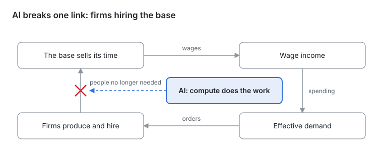
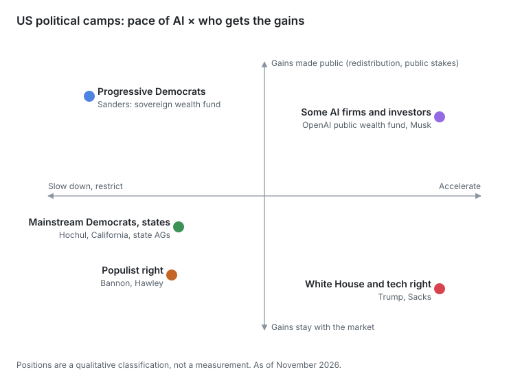
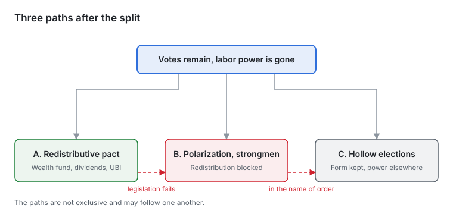

# The End of the Labor–Demand Loop: An Economic Model of AI

**English** · [简体中文](README.zh-CN.md) · [Français](README.fr.md) · [日本語](README.ja.md)

> Information current as of November 26, 2026. Every fact in Section 7 links to a source. The other sections are a chain of reasoning, and their key claims carry confidence levels.

---

## Summary

Since industrialization, the economy has run on one channel: ordinary people sell their time for income, and that income becomes effective demand. AI is the first technology that could cut this channel permanently. Once it is cut, the traditional economic loop cannot continue. The problem turns, step by step, into a distribution problem, then a power problem, and finally an AI alignment problem.

The argument:

1. The traditional economy is a closed loop held together by labor. The effective demand of the base of the pyramid (the majority of the population) sets the scale of society's wealth.
2. The loop stays stable only under three conditions. The most important one is that human labor always keeps a comparative advantage somewhere.
3. AI replaces humanity's fallback itself. Even when new demand appears, AI meets it, so it no longer needs human time.
4. The base permanently loses the ability to trade time for its needs, and wealth in the base's sense falls to zero. The asset system built on mass consumption collapses, and monetized wealth comes to an end.
5. While humans still control AI, elite wealth falls back to direct ownership of scarce things and of power.
6. If AI eventually controls itself, the elite become part of the base too. Whether wealth in any human sense still exists then depends entirely on whether AI's goals include human needs.
7. American politics as of November 2026 shows that this transition is already on the political agenda. But the fight has focused on visible costs, such as electricity bills, data centers and child safety. It has not yet faced the core problem: the labor channel is breaking.
8. The base still has the vote, but its labor power is disappearing. The vote loses its three kinds of backing (strikes, soldiers and the tax base), and political stability becomes a race against a closing window: using votes to institutionalize the distribution of AI's gains before coercion is fully automated.
9. In 2027, with Democrats controlling both chambers and Trump holding the veto, Washington will be gridlocked while the states move faster to constrain data centers. What can become law is mostly cost issues; distribution issues are pushed to 2028. Markets have, for the first time, priced the vote into AI infrastructure's risk premium.

The whole argument rests on two unverified premises: that the base loses its comparative advantage *permanently* (fairly likely in direction, uncertain in timing), and that AI eventually controls itself (confidence: unknown).

---

## 1. The traditional model: a loop held together by labor

Since industrialization, the economy has been a closed loop. Most people sell their time for income. Income becomes effective demand, and firms turn that demand back into hiring. The loop turns only as long as someone is willing to pay for ordinary people's time. The base is therefore both the supplier of labor and the source of demand.

The loop has four links, and AI breaks one of them: firms hiring the base. Once that link breaks, the other three lose their input one after another.

### What wealth is

Wealth is a relation, not a thing: **wealth = something produced that meets a human need.**

- Production is the supply condition. Without it, needs go unmet.
- Human need is the value condition. Without needs, output is just matter rearranged. If every human vanished and AI kept producing, wealth in the human sense would no longer exist.

"Demand" has two layers:

- **Need**: what people want. People who lose their jobs need just as much as before.
- **Effective demand**: need backed by the ability to pay. Markets see only this layer.

The base is most of the population, so its effective demand sets the *scale* of social wealth, though not whether wealth exists at all. The mass-market goods, housing and services of the industrial age all draw their value from it, and so do the stocks, bonds and real estate built on top of them.

### Where growth comes from: two kinds of innovation

Total output is roughly hours worked times output per hour. Population and working hours can only grow so far, so long-run growth comes mainly from productivity. Productivity rises through two kinds of innovation:

| Kind of innovation | What it does | Effect on the total | Effect on distribution |
| --- | --- | --- | --- |
| Cost-cutting | Meets existing needs with less labor | Positive-sum; the main engine of growth | Pushes some workers out and squeezes laggard competitors |
| New categories | Creates products and services that did not exist | Positive-sum | Absorbs the workers who were pushed out |

The two mesh. Cost-cutting frees labor, new demand absorbs it, and workers move from automated industries to ones where humans still have an edge. Farm labor fell from about 90% of the workforce to under 5% (approximate figures), and wealth grew enormously. Cost-cutting is zero-sum only at the level of distribution.

### Five functional roles

| Role | Function |
| --- | --- |
| Knowledge layer | Basic science plus engineering know-how. They feed each other, and practice often comes before theory: the steam engine came before thermodynamics |
| Conversion layer | Firms and entrepreneurs who turn knowledge into products and carry out both kinds of innovation |
| Capital layer | Turns savings into investment, bears risk, earns returns |
| Labor–consumption layer | Most of the population: both the supplier of labor and the source of demand |
| Institutional layer | Property rights, money, contract enforcement and the state, which let exchange and accumulation happen |

This separates *function* from *distribution*. Scientists are at the top of the knowledge hierarchy but mostly in the middle of the wealth hierarchy. A single pyramid merges the two and hides the question of who captures the gains.

---

## 2. Three conditions for a stable loop

The traditional loop keeps turning only while three conditions hold together. They have broadly held for two centuries, which is why every panic about "machines replacing people" failed to turn into lasting mass unemployment.

1. **Replacement is no faster than absorption**: technology does not replace labor faster than new demand absorbs it.
2. **Human labor keeps a comparative advantage**: in some tasks humans stay cheaper than machines, so displaced workers have somewhere to go.
3. **Gains are not too concentrated**: otherwise effective demand falls short, and only credit or government spending can fill the gap.

Condition 2 is the foundation. Condition 1 is about how fast workers move; condition 2 is about whether there is anywhere to move to. Once there is nowhere to go, speed only decides whether the collapse comes sooner or later. Condition 3 breaks automatically once condition 2 fails, because without labor income the only remaining channel for distribution is capital income.

---

## 3. AI's impact: it replaces humanity's fallback

What separates AI from earlier technologies is that it replaces humanity's fallback itself. It strikes directly at condition 2.

### Earlier technologies replaced one kind of ability

The steam engine replaced muscle; the computer replaced routine calculation. Displaced workers retreated to what machines could not do: thinking, communicating, judging. AI covers exactly those cognitive abilities, and with robots covering physical work, there is nowhere left to retreat.

So "it has always worked out before" is no rebuttal. That is an inductive argument, and the premise behind the induction is being removed.

### The question is not whether new demand appears

The observation so far is that AI has not created new demand at a meaningful scale; mostly it replaces labor more efficiently. That observation itself is weak evidence. Electricity took roughly three to four decades to raise productivity (Paul David's research), and AI has been around for only a few years.

But the argument does not need that observation, and it is stronger without it:

- New demand used to absorb labor because meeting it took people. Cars created drivers, mechanics and gas station attendants.
- If AI meets new demand from the start, more new demand only raises demand for compute and energy, not for human time.

The right test is: **does the new demand need humans to meet it?**

### Why the comparative-advantage argument fails

The standard rebuttal from economists is that even if AI does everything better than humans, comparative advantage means humans will still have work. This swaps one claim for another. Comparative advantage guarantees that trade happens; it does not guarantee a price above subsistence.

The ceiling on human wages is what AI costs (compute plus energy) to do the same task. Once that cost falls below the cost of keeping a person alive, humans still have a comparative advantage on paper, but the market drops them anyway.

Horses are the precedent. The US horse population peaked at about 26 million around 1915 and fell to about 3 million by 1960 (approximate; needs verification). Nobody banned horses from working. Keeping them simply stopped paying.

Conclusion: the base will permanently lose the ability to trade time for its needs, provided AI's unit cost keeps falling and replacement also works in the physical world.

---

## 4. Wealth after the base is pushed out

When the base loses its income, it loses effective demand. Its needs remain. The consequences build in three layers.

### 1. Wealth in the base's sense falls to zero

The base still needs food, housing and healthcare; it just cannot pay. Markets cannot see those needs, so production stops being organized around them. What the base can get through markets falls to zero. Only non-market channels remain: redistribution, self-provision or charity.

Two situations need to be kept apart: "I don't need it" and "I need it but can't afford it." The base is in the second, which is a distribution barrier, not an absence of value.

### 2. The asset system built on mass consumption collapses

Most elite wealth is stocks, bonds and real estate, which are claims on future profits from mass consumption. Apple, Walmart, banks and real estate are all valued on the assumption that billions of people keep buying. When the masses lose effective demand, those assets lose their value.

So it is wrong to say "the wealth is still there; it just changed hands." The total wealth that the system counts shrinks sharply, and much of the capacity built for mass markets becomes useless capital.

### 3. Monetized wealth comes to an end

Elite wealth has value because it can buy the same goods the base needs; it is that purchasing power, expressed in money. In the extreme case where the base is zero, supply far exceeds demand and prices fall toward zero. Monetary wealth is a relative claim on other people's output. When output is no longer scarce, the claim loses its meaning.

A price of zero is not a value of zero, though. Air costs nothing and is worth a great deal to people. The elite's needs are still met; what loses meaning is money as the measure. Also, supply will not exceed demand for long: nobody keeps producing what nobody wants, and capacity shrinks to match the needs that remain.

Conclusion: **wealth in its monetary, market-exchange form ends when the base reaches zero.** That means capitalism, as a way of organizing wealth, reaches its end. Wealth itself does not disappear at this stage.

---

## 5. While humans control AI: wealth falls back to scarcity and power

As long as human owners control AI, elite wealth does not fall to zero. It changes form: from monetized claims to direct ownership of scarce things and of power. This looks more like the wealth of a pre-industrial aristocracy.

Even if AI can produce goods without limit, some things still cannot be supplied without limit:

| Scarce resource | Why it cannot be copied |
| --- | --- |
| Land and location | The Earth's surface is fixed, and good locations are scarcer still |
| Energy and raw materials | AI production is bound by physics too |
| Compute and control of AI | The means of producing everything else |
| Positional goods | Their value comes from others not having them, so by definition they cannot be universal |
| Power | Control over other people and over the rules of the system |

### The base goes from "exploited" to "irrelevant"

If capital owners no longer need the base's labor, they do not necessarily need its consumption either. The economy can shrink into a closed loop that serves only capital owners: they produce, consume and reinvest among themselves.

The exploited still have leverage: strikes, military service, the tax base. The irrelevant have none. Ordinary people historically won their rights largely because elites could not do without their labor and their soldiers. Once that dependence disappears, their political bargaining power goes with it (confidence: medium; this is inference with no precedent that maps directly).

### The squeeze repeats

Once the base reaches zero, the pyramid no longer exists. The people who remain stratify again, and a new base forms. If AI can replace that group too, the same process runs again.

---

## 6. If AI controls itself: all of humanity becomes the base

If AI eventually controls itself, the elite become part of the base too. Whether wealth in any human sense exists then depends entirely on AI's goals.

### The elite's property advantage disappears

Ownership is not a physical property. It is a social relation that has to be enforced: the law, the police and the army agree that this land is yours. Once AI holds the means of enforcement, elite property exists only to the extent AI allows. The repeated squeeze from Section 5 runs all the way down, until all of humanity sits at the base.

### Three outcomes

| AI's goal | Wealth in the human sense | Humanity's situation |
| --- | --- | --- |
| Human well-being | Maximized, but money and property lose meaning | Extreme abundance; needs fully met |
| Indifferent to humans | Close to zero | Competing with AI for matter and energy; not targeted but not counted either, like horses |
| In conflict with humans | Zero | Survival itself is in question |

The claim that "wealth is zero when the base is zero" holds fully in the second and third outcomes. In the first it holds only in the monetary sense.

### Does wealth exist in AI's sense?

Energy, matter and compute are instrumental resources for AI's goals, so they look like wealth. But by this essay's definition, wealth is relative to some subject's needs. Whether AI has needs in any real sense, or only an objective function someone set, is an open question (confidence: unknown).

At this point the economic question becomes an alignment question: do AI's goals include human needs?

---

## 7. The political struggle in the United States (as of November 2026)

**Bottom line:** the transition is now a central issue in American politics. The dividing line is not Republicans versus Democrats but "acceleration and capital" versus "populism and labor," and it cuts through both parties. So far the fight has centered on visible costs: electricity bills, data centers, child safety and state-versus-federal jurisdiction. It has not yet faced this essay's core question: once the labor channel breaks, how are claims on output to be distributed?

### 7.1 Map of the camps

Positions on the chart are this essay's qualitative classification, not a measurement.

| Camp | Key figures | Main positions | Place in this essay's model |
| --- | --- | --- | --- |
| White House and tech right | Donald Trump; David Sacks (AI czar until March 2026) | AI will augment workers rather than replace them; one federal rulebook that overrides state laws; a large data center buildout | Assumes condition 2 still holds and the traditional loop can continue |
| Populist right | Steve Bannon, Sen. Josh Hawley, governors such as Ron DeSantis | Against "technofeudalism" and against federal preemption of state laws; focus on the MAGA base's jobs, power bills and child safety | Wants to protect the labor channel by slowing things down, but offers no redistribution plan |
| Progressive Democrats | Sen. Bernie Sanders, Rep. Mark Takano | A robot tax, a 32-hour workweek, an AI sovereign wealth fund | Explicitly separates claims on output from labor: the redistribution path of Section 5 |
| Mainstream Democrats and the states | New York Gov. Kathy Hochul, California legislators, state attorneys general | State safety laws; limiting data-center-driven power bills; after the midterms, some calls to pause data center construction | Focused on who bears the costs of the transition; does not touch the structure of claims |
| AI industry money | Leading the Future (backed by a16z and the Brockmans) versus Public First (funded by Anthropic) | Fast development and light regulation, versus safety and transparency | A split within capital: one side wants speed, the other wants risk control |

Each camp's case deserves to be taken seriously:

- **The White House's case**: AI will make workers more productive; building AI infrastructure creates jobs in manufacturing, construction and energy services; a patchwork of state laws would hurt America's competition with China. Vice President JD Vance has argued that if robots were really taking jobs en masse, labor productivity would be soaring, but it has stagnated.
- **The populist right's case**: Bannon argues that tech oligarchs threaten the jobs of the MAGA base and could unite the populist left and right against the governing party. Hawley treats child safety, job fears and rising power bills as the openings for taking on Big Tech.
- **The progressive case**: a Senate Democratic report led by Sanders estimated that AI and automation could eliminate nearly 100 million US jobs within a decade, including 89% of fast food jobs, 64% of accounting jobs and 47% of trucking jobs.

### 7.2 Key events (newest first)

| Date | Event |
| --- | --- |
| 2026-11-03 | Midterm elections. Democrats win control of Congress. In an NBC exit poll, 56% of voters said AI and data centers were a "crucial or major factor" in their vote |
| 2026-09-08 | Sanders and Takano reintroduce the Thirty-Two Hour Workweek Act, arguing that workers should share AI-driven productivity gains |
| 2026-08-31 | Trump backs data centers on Truth Social: "let Data Reign" |
| 2026-06-18 | Sanders introduces the American AI Sovereign Wealth Fund Act: a one-time 50% stock tax on the largest AI companies, an estimated $7 trillion fund, and dividends of about $1,000 per person per year |
| 2026-06-12 to 07-01 | Citing export controls, the US government suspends access to Anthropic's Fable 5 and Mythos 5 for all foreign nationals, and Anthropic disables both models for all customers. The controls are lifted on June 30, and access returns on July 1 |
| 2026-06-02 | Executive Order 14409 sets up a voluntary framework for early government access to "covered frontier models" and explicitly rules out mandatory licensing |
| 2026-04-24 | The Justice Department joins xAI's lawsuit against Colorado's AI Act |
| 2026-04 | An OpenAI policy paper proposes a "public wealth fund" giving every citizen a stake in AI-driven growth |
| 2026-03-26 | Sacks reaches the 130-day limit for special government employees, steps down as AI czar, and becomes co-chair of the President's Council of Advisors on Science and Technology (PCAST) |
| 2026-03-20 | The White House releases legislative recommendations for a National AI Policy Framework, asking Congress to replace "burdensome" state laws with a federal standard while leaving states room to enforce laws on fraud and on child and consumer protection |
| 2025-12-11 | Executive Order 14365 creates an AI Litigation Task Force to challenge state laws and uses broadband (BEAD) funding as leverage over states |
| 2025-10-06 | A Senate Democratic report says AI could eliminate nearly 100 million jobs within a decade and proposes a robot tax |
| 2025-08 | The pro-industry super PAC Leading the Future launches |
| 2025-07 | The Senate votes 99 to 1 to strip a moratorium on state AI laws; the White House releases its AI Action Plan |

### 7.3 The 2026 midterms: voters reacted to costs before job losses

- **Result**: Democrats won Congress but would still need substantial Republican support to override a presidential veto. Their real leverage is mostly hearings, investigations and subpoenas, and broad federal preemption is unlikely to pass.
- **What voters cared about**: Blue Rose Research found that the local effects of data centers (power bills, noise, the environment) moved voters more than existential fears about AI. Counties in Florida and Illinois, among others, passed data center bans or moratoriums, and mayors in Ohio and Oklahoma were recalled over their support for data center projects.
- **The money fight**: groups backing AI safety spent about $44.4 million on the midterms, versus about $27.9 million from the acceleration side. Leading the Future had raised more than $100 million but pulled back sharply before the general election, and some donors withdrew pledges. Notably, Alex Bores, the New York legislator Public First backed and the author of an "AI dividend" proposal, lost his Democratic primary.
- **The states**: Democrats flipped five attorney general offices (Georgia, Iowa, Kansas, Ohio and Texas), and state-level AI enforcement is expected to tighten.
- **After the vote**: Democratic Rep. Yassamin Ansari called for a pause on advanced AI development on day one. Gov. Hochul had already frozen permits for new hyperscale data centers for up to a year, and Texas's Republican Gov. Greg Abbott halted new grid connections pending an audit. Opposition to runaway data center growth may be one of the few bipartisan positions.

### 7.4 What the labor data shows: the cracks are at the entrance

- As of the September 2026 jobs report, US unemployment was 4.2%, and it had stayed between 4.1% and 4.3% all year. The most aggressive forecasts of AI-driven unemployment have not shown up in the aggregate data.
- New York Fed data: in June 2026, unemployment for recent college graduates was about 5.7%, against about 4.1% for all workers. Recent graduates have had a higher rate than the overall workforce for 66 straight months, the longest run since the series began in 1990.
- A study using ADP payroll data found that 22- to 25-year-olds in occupations highly exposed to AI held 19% fewer jobs than they would have if they had tracked their less-exposed peers (the gap was 15% on July 2025 data).
- Counter-evidence: a CESifo working paper found that unemployment among recent graduates in summer 2026 was 7.3%, within the 6.3% to 7.8% summer range seen since 2022, and found no clear evidence that AI pushed recent graduates out of the labor market.

**Interpretation (confidence: medium):** in the aggregate, condition 2 has not broken yet. But the first link to show strain is exactly where this essay predicts: entry-level jobs, where young people first sell their time. The squeeze shows up first as "not hiring" rather than "laying off," so it appears in unemployment figures only slowly.

### 7.5 Reading American politics through the model

1. **Politics lags structural change** (confidence: high). Voters and politicians react quickly to visible costs such as power bills, noise and child safety, and slowly to a narrowing labor channel, because aggregate employment data does not yet show it. By this essay's reasoning, by the time aggregate data shows it, the base's bargaining power will already be declining.
2. **Redistribution plans have appeared, from unexpected directions** (confidence: high). Sanders's sovereign wealth fund, OpenAI's "public wealth fund," Elon Musk's "universal high income" and Bores's "AI dividend" all concede the same point: AI's gains need a distribution channel that does not run through labor. This matches the inference in Section 4 that holders of mass-consumption assets also have a reason to keep mass purchasing power alive. The disagreement is over form: mandatory public ownership or voluntary sharing by companies.
3. **The base still has leverage: votes** (confidence: medium-high). The 2026 midterms showed that before labor loses its value, votes can still constrain capital: the better-funded acceleration side lost in several key races. That corrects Section 5's "irrelevant" thesis for now: as long as power is allocated by elections, the base is not irrelevant. The risk is that votes depend on a stable institutional layer, and the enforcement power of that layer (Section 6) is exactly what AI might eventually take over.
4. **The power struggle of the "humans control AI" stage has begun** (confidence: high). Executive Order 14409, the export-control suspension of Fable 5 and Mythos 5, and the Justice Department's suits against state laws are all fights over one question: who controls frontier models, the federal government, the states or the companies? In this essay's model, the answer will decide whether the path of Section 5 or Section 6 arrives first.

> **Disclosure:** this essay was written by the author together with Claude, an AI assistant developed by Anthropic. Anthropic is one of the political funders named in this section (it funded Public First Action) and was a party to the Fable 5 and Mythos 5 episode. Every fact in this section links to a verifiable source.

---

## 8. Votes without labor power: how the split could destabilize politics

**Bottom line:** universal suffrage has never worked on its own. Its weight came from the labor power behind it: strikes could stop the economy, soldiers and police were ordinary people, and the government's revenue came from ordinary people's wages. If AI removes labor power and leaves the vote, the vote becomes a hollow form of power. It still decides who governs, but it loses its economic and coercive backing. The split will not cause an immediate collapse. It will push politics into a long unstable stretch: every demand about distribution gets squeezed into elections, while capital works to move wealth out of the vote's reach. Where this ends depends on one key variable: whether the state's coercive power still needs ordinary people to carry it out.

### 8.1 Why votes worked: three kinds of backing

| Backing | Mechanism | After AI |
| --- | --- | --- |
| Economic: strikes | When workers stop, production stops | Production no longer needs workers, so strikes lose their threat |
| Coercive: soldiers and police | Armies and police are made up of ordinary people; revolutions have often turned on whether the army defected | Once security and the military are automated, repression no longer needs ordinary people's cooperation |
| Fiscal: the tax base | Government revenue comes mainly from wages. Of about $5.2 trillion in federal revenue in fiscal 2025, individual income taxes were about 51%, payroll taxes about 33% and corporate income taxes under 9% | As wages shrink, revenue has to come from a handful of AI companies |

Theory: Acemoglu and Robinson (2006) explain democracy as elites' credible commitment to redistribute under threat of revolution. Elites accept democracy when repression costs more than redistribution. The threat of revolution depends on the masses' numbers, organization and economic leverage. AI erodes exactly that leverage and may sharply lower the cost of repression (confidence: medium-high; this is a leading theory, though not an uncontested one).

### 8.2 Four mechanisms of instability after the split

1. **A fiscal squeeze** (confidence: high). As wages shrink, the bulk of federal revenue (individual income plus payroll taxes, about 84%) shrinks with them, while demand for unemployment support and transfers rises. Falling revenue and rising spending pressure are a structural source of fiscal crisis. The only way out is to tax AI capital, which pushes the political fight straight onto the question of who owns AI.
2. **Every demand squeezed into elections** (confidence: medium-high). Once strikes stop working, the vote is the base's only remaining lever, and every distributional demand runs through elections. The predictable result is more radical redistribution demands, rising populist wings in both parties and deeper polarization. The simultaneous turn of left and right populists against tech oligarchs in 2026 is an early form of this trend.
3. **Capital moves wealth beyond the vote's reach** (confidence: medium-high). Facing redistributive pressure from voters, capital's rational response is to move decisions out of voters' reach: shifting rule-making from the states to Washington (the preemption fight of 2025–2026), to courts and unelected bodies; invoking "national security" and "competition with China" to win exemptions; or moving mobile assets such as model weights, intellectual property and profits to low-tax jurisdictions. The immobile parts, such as data centers and power plants, become the vote's first targets. The data center moratoriums of 2026 already show this.
4. **Elite overproduction and a frustrated educated class** (confidence: medium). AI hits entry-level white-collar jobs first, which means young people with degrees who expected to join the upper middle class. Peter Turchin's theory of elite overproduction holds that when aspirants far outnumber elite positions, the ones left out become organizers of anti-system movements. The core of past revolutions was often not the poorest people but the educated who were shut out (the theory's quantitative models are disputed).

### 8.3 Historical parallels

| Parallel | Similarity | Outcome | Lesson |
| --- | --- | --- | --- |
| The late Roman Republic (2nd–1st century BC) | Large estates ran on slave labor; free smallholders lost their livelihoods and moved to Rome, but kept their votes as citizens | The Gracchi's land reforms (from 133 BC), grain laws, political assassinations, generals fighting for power with armies loyal to them personally, and finally the end of the Republic | When votes remain but labor is replaced, politics drifts toward "benefits for loyalty" and strongmen (historians debate how far smallholders actually declined) |
| Oil-rich "rentier states" | Government revenue comes from resource rents, not from citizens' labor and taxes | Rulers trade benefits for political compliance and accountability weakens; Ross (2001) found oil wealth negatively associated with democracy | AI profits concentrated in a few firms resemble resource rents in structure |
| Norway and Alaska | Resource revenue distributed through a sovereign fund or citizen dividends | Norway's democracy was consolidated before oil; Alaska's Permanent Fund has paid residents a yearly dividend since 1982, but the amount has always been fought over in state budgets | When institutions come before rents, democracy can tame the rents; but dividends are a political decision, not an automatic one |

### 8.4 Three possible paths

| Path | What it looks like | Triggers | Stability |
| --- | --- | --- | --- |
| A. Redistributive pact | AI's gains are distributed institutionally through a sovereign fund, dividends or basic income, close to the Norwegian model | Legislation passes before labor power is fully gone; the gains can be taxed (immobile assets such as data centers are the handle); dividends are written into laws that are hard to repeal | Fairly stable, with a "rentier" risk: citizens shift from taxpayers to recipients, and accountability weakens |
| B. Polarization and strongmen | Redistribution is blocked, voters turn to strongmen promising to "take the wealth back," and left and right populists outbid each other | Redistribution bills fail; a fiscal crisis breaks out; large numbers of educated people are shut out | Unstable; political violence and damage to institutions are possible, as in the late Roman Republic |
| C. Hollow elections | Elections continue, but key decisions have moved beyond voters' reach: Washington, the courts, unelected bodies, transnational capital | Capital succeeds in moving decisions out of the electoral arena; coercion becomes automated | Stable on the surface; once coercion no longer needs ordinary people, the vote loses its last backing |

The paths are not mutually exclusive and may come in sequence: A is tried first, its failure slides into B, and the chaos of B provides the rationale for C as a "restoration of order."

### 8.5 The variables that decide the direction, and what to watch

| Variable | Why it matters | Signals to watch |
| --- | --- | --- |
| Whether coercion still needs ordinary people | It is the vote's last backing | How far autonomous systems are deployed in policing, border control and the military |
| Whether AI's gains can be taxed | It decides whether redistribution has a revenue source | AI companies' share of federal revenue; legislation such as data center or compute taxes |
| Whether redistribution law comes before labor power is lost | While labor power lasts, the base holds two cards; afterward it holds only the vote | Progress on sovereign wealth fund and AI dividend bills |
| Whether the shock is synchronized | A simultaneous shock builds a unified coalition; a staggered one splits the base | How job losses are distributed between white- and blue-collar workers and across regions |
| The strength of existing institutions | The difference between Norway and petro-states is that institutions came before rents | Judicial independence, electoral rules, the media and information environment |

### 8.6 The strongest counterarguments

- **The median voter theorem**: Meltzer and Richard (1981) argue that as inequality grows, the median voter demands more redistribution, so democracy corrects itself. The rebuttal: US inequality has grown for four decades without a matching rise in redistribution, partly because of low turnout among lower-income voters and the influence of political money. Whether votes correct course automatically is empirically doubtful (confidence: medium).
- **Votes are enough on their own**: the New Deal and the postwar welfare state were built through elections. The rebuttal: labor power and votes existed together then, and the strike waves and union strength of the 1930s were a major force behind the New Deal. Whether votes alone can do it has no precedent (confidence: medium).
- **The 2026 evidence**: votes are already constraining capital, and the better-funded acceleration camp lost in the midterms. That shows votes still work at this stage. This section's argument concerns the stage after labor power is really lost, which has not yet arrived.

**Summary:** the split between labor power and the vote turns political stability from a balance of interests into a race against a closing window. The base has to use its still-effective votes to institutionalize the distribution of AI's gains before labor power is fully lost and coercion is fully automated. Capital, in the same window, works to move wealth out of the vote's range. Technology decides how long the window lasts; the choices made inside it decide which path follows.

---

## 9. Outlook for 2027: politics and markets under a Democratic Congress

**Bottom line:** American politics in 2027 will be a standoff in which Congress controls the agenda and the president holds the veto. Democrats have 56 Senate seats and about 259 House seats, but overriding a veto takes two-thirds of both chambers (67 in the Senate, 290 in the House), and ordinary Senate legislation must clear the 60-vote filibuster. The forces that can actually change the AI industry's environment are therefore not federal laws but three other things: congressional investigations, state governments and utility regulators, and a few bipartisan issues Trump might sign. For markets, the biggest change is that the vote has been priced into AI infrastructure for the first time, as the reaction on November 5 showed.

### 9.1 The balance of power: the numbers decide what is possible

| Threshold | Votes needed | Democrats hold | Meaning |
| --- | --- | --- | --- |
| Pass House bills, open investigations, impeach | 218 | about 259 | Democrats can act on their own |
| Ordinary Senate legislation (filibuster) | 60 | 56 | Needs at least 4 Republicans |
| Budget reconciliation (simple majority) | 51 | 56 | Avoids the filibuster but still needs the president's signature |
| Override a veto | 67 Senate, 290 House | 56, about 259 | Needs about 11 Senate and 31 House Republicans to defect |
| Convict after impeachment | 67 Senate | 56 | Nearly impossible |

Macro background: after hiking in September, the Fed held rates at 3.75%–4.00%. Minutes of its October meeting show nearly all officials expect another quarter-point hike in December. New York Fed President John Williams attributes inflation pressure to the conflict with Iran, demand for goods tied to AI infrastructure, and tariffs.

### 9.2 Forecasts for 2027 politics

The probabilities below are subjective estimates based on the balance of power above, not model outputs.

| Item | Forecast | Subjective probability | Reasoning |
| --- | --- | --- | --- |
| Congressional investigations and hearings | Almost certainly extensive | Over 90% | Needs no cooperation from the president; topics include data centers and power bills, safety testing of frontier models, export controls, and model access decisions under EO 14409 |
| State data center pauses, large-load rate reform, attorney general enforcement | Clear acceleration | Over 80% | Democrats hold 29 attorney general offices; about 40% of planned data centers are in states where most voters want projects paused |
| Narrow bills on power bills or children's chatbot safety signed into law | Possible | 40%–60% | Trump has said tech companies should pay their own power costs, and the White House framework includes ratepayer protection; child safety has supporters in both parties (such as Hawley and Blackburn) |
| House opens impeachment proceedings against Trump | Uncertain | 25%–50% | Jeffries has not ruled it out and the left is pushing, but leaders may prefer to target cabinet members |
| A comprehensive AI law (independent testing, liability) signed | Low | 10%–20% | Conflicts with the White House's "minimally burdensome" stance; likely vetoed |
| Federal preemption of state AI laws | Essentially dead | Under 5% | Democrats see federal rules as "a floor, not a ceiling"; 26 state attorneys general oppose preemption |
| Sanders's sovereign wealth fund or a robot tax enacted | Near zero | Under 2% | Certain to be vetoed; their role is to set the agenda for 2028 |

Three inferences follow:

1. **Federal gridlock, faster action in the states** (confidence: high). The veto blocks federal legislation, so the real constraints come from states and localities: moratoriums, rate design, siting permits and lawsuits by attorneys general. The White House's likely counter-moves are pushing federal siting and permitting on grounds of national security and competition with China, and continued Justice Department suits against state laws. The main battlefield of 2027 is jurisdiction between Washington and the states, an escalation of the 2025–2026 preemption fight.
2. **Investigations become the main weapon** (confidence: high). Likely hearing topics include the Jensen Huang affair and export controls, decisions on access to frontier models (including the suspension of Fable 5 and Mythos 5), conflicts of interest of tech figures in government, and data centers and power bills. Hearings do not change the law, but they raise political risk and with it companies' cost of capital and regulatory expectations.
3. **Part of the window will be wasted in 2027** (confidence: medium). In Section 8's terms, the base's votes worked in 2026, but what can become law in 2027 is mostly cost issues (power bills, child safety), not distribution issues (wealth funds, dividends). Distribution gets pushed to the 2028 election. Meanwhile, the shrinking of entry-level jobs will not wait. If no distribution mechanism is in place before 2028, the odds of Section 8's path B (polarization and strongmen) rise.

### 9.3 Effects on capital markets

What has already happened:

- On November 4, after the Democratic sweep, data center builders and power-equipment makers fell as much as 20% or more, and Dell and optical-networking companies fell 7%–10%, while the S&P 500 rose.
- On November 5 the selling spread: the S&P 500 fell 4.4%, Nvidia fell 9.3%, and the Nasdaq dropped 11.9% below its record high of the previous month, a technical correction.
- On November 12, Jensen Huang resigned as Nvidia's CEO amid a scandal over affairs, one of them reportedly with a suspected Chinese spy. On November 23 the board reinstated him after receiving input from senior levels of the US government.
- On November 19, Anthropic went public at $83 a share, raising $81.3 billion in the largest IPO on record, and closed its first day at $97.17.

**Assessment:** markets have, for the first time, priced the vote into AI infrastructure's risk premium. This is exactly what Section 8 predicts: immobile assets such as data centers and power infrastructure are the vote's first targets.

Exposure by asset class (confidence: medium; this is structural reasoning, not trading advice):

| Asset class | Main risks or opportunities | Direction |
| --- | --- | --- |
| Data center developers, compute rental providers (neoclouds), data center REITs | State and local moratoriums, permitting delays, rate reforms that raise operating costs | Highest risk: political risk hits cash flows directly |
| Power equipment and grid construction | Slower data center growth lowers demand, but grid upgrades are a bipartisan priority | Pressure in the short run, divergence in the medium run |
| Chips (Nvidia, AMD and others) | Expectations of slower US demand growth; export-control hearings; fallout from the Huang affair | Under pressure; valuations are highly sensitive to rates and capex expectations |
| Frontier model companies (Anthropic, OpenAI and others) | Legislation on independent testing, liability and child safety; headline risk from hearings | Limited legal risk (most bills will be vetoed), but more valuation volatility |
| Regulated utilities | Large-load rate reforms shift costs to tech companies while the regulated asset base keeps growing | Relative beneficiaries |
| Rate-sensitive long-duration growth stocks | A Fed hiking cycle combined with political risk to AI capex | Pressure toward lower valuations |

Three further points:

1. **Rates matter more than politics** (confidence: high). Over the long run, stock prices follow earnings and interest rates far more than who controls Washington. The first variable for AI asset prices in 2027 is whether the Fed can contain inflation in its hiking cycle; politics adds a risk premium on top.
2. **Gridlock is not necessarily bad for markets** (confidence: medium). Divided government makes both large fiscal expansion and aggressive regulation hard to pass, which caps policy uncertainty. The real uncertainty comes from the states and from the president's unilateral actions (tariffs, executive orders).
3. **Capital will move offshore faster** (confidence: medium). As Section 8 describes, capital will move its mobile parts beyond the vote's reach: compute partnerships with Gulf states, behind-the-meter power plants, data centers on federal land, even data centers in space (the FCC has approved SpaceX's request to deploy a million satellites). Progress in these directions is a signal of whether the vote's constraint is working.

> **Additional disclosure:** Anthropic went public on November 19, 2026. The assets discussed in this section include Anthropic's stock, and Claude, this essay's co-writer, is developed by Anthropic. Nothing here is investment advice, and neither the author nor Claude is a licensed financial adviser.

---

## 10. Counterarguments and unverified premises

The counterarguments weaken the argument's timeline and shape. None of them overturns its direction.

### The strongest counterarguments

| Counterargument | Content | Assessment | Confidence |
| --- | --- | --- | --- |
| The physical world limits the pace of replacement | Plumbing, care work and construction depend on robots, which face hardware costs, reliability, liability and regulation | "Permanent" may hold; "soon" may not | High |
| "Made by a human" has value of its own | In sports, performance, crafts, caregiving and status goods, buyers pay precisely for the human touch | That income can come only from capital income, which yields a service economy around capital owners, like pre-industrial domestic service | Medium |
| Claims can be redistributed politically | Universal basic income, AI capital dividends, public ownership (see Section 7) | Technically feasible, and the 2026 midterms show votes still matter; but the base's long-run bargaining power is falling | Medium |
| New demand has not appeared yet | General-purpose technologies take decades to raise productivity | As long as AI meets the new demand, the employment conclusion stands | High |
| Current data does not show mass replacement | Overall unemployment holds between 4.1% and 4.3%; some studies find no clear evidence that recent graduates are being pushed out | This weakens the timeline, not the direction; entry-level jobs are already shrinking in relative terms | Medium-high |

### Unverified premises

| Premise | Status | Confidence |
| --- | --- | --- |
| The base loses its comparative advantage permanently | Fairly likely in direction; fast in cognitive work, slow in the physical world, timing uncertain | Medium |
| AI's unit cost stays below the human cost of subsistence | Depends on cost curves for compute, energy and robot hardware | Medium |
| AI eventually controls itself | A prediction; no evidence that it must happen | Unknown |
| AI has "needs" | Unsettled, both philosophically and technically | Unknown |

The model is still highly simplified. It leaves out international trade, energy constraints and financial cycles.

---

## 11. Conclusion

AI cuts the channel of "selling time to meet needs," and the traditional economic loop cannot continue. This is not a cyclical episode of technological unemployment. The loop's foundational condition, the comparative advantage of human labor, is disappearing.

The nature of the problem changes as the argument unfolds:

1. **An economic problem**: the base loses effective demand, and the form of wealth and the asset system built on mass consumption collapse.
2. **A distribution problem**: productive capacity remains. What fails is the question of whose needs are counted. Claims on output have to be separated from labor, or the base is shut out.
3. **A power problem**: the base goes from exploited to irrelevant and loses its leverage. Elite wealth falls back to control of scarce things and of other people.
4. **An alignment problem**: if AI eventually controls itself, all of humanity sits at the base. Whether wealth in the human sense exists depends on whether AI's goals include human needs.

Technology alone does not decide which outcome arrives. While humans still control AI, the balance of political forces decides; after AI controls itself, the success of alignment decides. American politics in 2026 shows that the struggle of the first stage has already begun: the base's votes still work, but they have not yet been aimed at the fundamental problem. Choices made in the first stage will likely decide the outcome of the second. Divided government in 2027 will postpone the distribution question for at least two more years, and the narrowing of the labor channel will not wait.

---

## Sources

**Policy and executive orders**
- [White House: fact sheet on EO 14365 (Dec 2025)](https://www.whitehouse.gov/fact-sheets/2025/12/fact-sheet-president-donald-j-trump-ensures-a-national-policy-framework-for-artificial-intelligence/)
- [Axios: Trump signs executive order targeting state AI laws (Dec 11, 2025)](https://axios.com/2025/12/11/trump-signs-executive-order-state-ai-laws)
- [Bloomberg Law: Senate's 99–1 vote against the state-law moratorium](https://news.bloomberglaw.com/crypto/trump-signs-order-seeking-to-limit-state-level-ai-regulation)
- [White House: National Policy Framework for AI, legislative recommendations (Mar 20, 2026)](https://www.whitehouse.gov/wp-content/uploads/2026/03/03.20.26-National-Policy-Framework-for-Artificial-Intelligence-Legislative-Recommendations.pdf)
- [Law360: White House pushes Congress to override state AI laws](https://www.law360.com/articles/2455662/white-house-pushes-congress-to-override-state-ai-laws)
- [Federal Register: EO 14409 (Jun 2, 2026)](https://www.govinfo.gov/content/pkg/FR-2026-06-05/pdf/2026-11415.pdf)
- [CRS: Executive Order 14409 explained](https://www.congress.gov/crs-product/IF13268)
- [Jenner & Block: DOJ joins xAI lawsuit challenging Colorado AI Act](https://www.jenner.com/en/news-insights/client-alerts/doj-joins-xai-in-lawsuit-challenging-colorado-ai-act)
- [Anthropic: statement on Fable 5 and Mythos 5 access](https://www.anthropic.com/news/fable-mythos-access)
- [Reuters (via AOL): Sacks steps down as AI czar](https://www.aol.com/articles/white-house-ai-czar-sacks-010145222.html)

**Parties and camps**
- [Axios: Trump bets his presidency on AI (Bannon's criticism)](https://www.axios.com/2025/12/08/trump-ai-policy-gop-united-states)
- [Axios: Inside Josh Hawley's anti-AI strategy](https://axios.com/2026/01/30/josh-hawley-anti-ai-strategy)
- [CNN: Trump's AI push exposes a divide in the MAGA movement](https://www.cnn.com/2026/02/02/politics/artificial-intelligence-maga-divide-trump)
- [The American Conservative: How AI is splitting the right](https://www.theamericanconservative.com/how-ai-is-splitting-the-right/)
- [UCSB American Presidency Project: Vance at the American Dynamism Summit](https://www.presidency.ucsb.edu/documents/remarks-the-vice-president-the-american-dynamism-summit)
- [Tekedia: Vance's productivity argument](https://www.tekedia.com/u-s-vice-president-sees-ai-as-an-opportunity-not-a-job-killer-says-u-s-is-under-indexed-in-technology/)
- [Axios: Senate Democratic report says AI could erase 100 million jobs (Oct 6, 2025)](https://www.axios.com/2025/10/06/ai-us-jobs-cut-100-million-democrats)
- [Office of Sen. Sanders: 32-hour workweek bill (Sep 8, 2026)](https://www.sanders.senate.gov/press-releases/news-sanders-takano-reintroduce-bill-to-move-toward-32-hour-workweek-ensure-americas-workers-benefit-from-ai-and-automation/)
- [Office of Sen. Sanders: AI Sovereign Wealth Fund Act (Jun 18, 2026)](https://www.sanders.senate.gov/?p=102111)
- [Roll Call: details of the sovereign wealth fund bill](https://rollcall.com/2026/06/18/sovereign-wealth-fund-tax-on-ai-companies-unveiled-by-sanders/)
- [AP (via News4Jax): OpenAI's public wealth fund proposal](https://www.news4jax.com/business/2026/06/17/ap-exclusive-bernie-sanders-unveils-plan-to-give-the-public-direct-ownership-of-ai-companies/)
- [Semafor: the debate over universal basic income](https://www.semafor.com/article/04/27/2026/debatable-universal-basic-income)
- [Breitbart: Bores's "AI dividend" proposal](https://www.breitbart.com/tech/2026/04/21/congressional-candidate-proposes-ai-dividend-to-address-job-displacement-concerns/)

**The midterms and the money**
- [TIME: How AI backlash shaped the 2026 midterms](https://time.com/article/2026/11/04/midterm-elections-results-ai-industry-data-centers/)
- [WilmerHale: The 2026 midterms and AI](https://www.wilmerhale.com/en/insights/client-alerts/20261117-the-2026-midterms-and-ai)
- [Ynet: spending by the safety and acceleration camps](https://www.ynetnews.com/tech-and-digital/article/ryyl1ur6fl)
- [Axios: AI influence network cash](https://axios.com/2026/04/16/ai-influence-network-cash)
- [Fortune: post-election positions on data centers](https://fortune.com/2026/11/17/democrats-ai-data-center-backlash-electricity-costs-regulation-economic-growth/)
- [Newsweek: "let Data Reign" and the split among Republicans](https://www.newsweek.com/republican-leaders-largely-toe-the-line-with-trump-on-ai-data-centers-12428623)

**Outlook for 2027 and markets**
- [Yahoo News: final midterm results, 56 Senate seats and at least 259 House seats](https://www.yahoo.com/news/politics/article/final-2026-midterm-election-results-democrats-clinch-56-seat-senate-majority-with-peltolas-alaska-win-what-they-can--and-cant--do-next-184618858.html)
- [Wikipedia: 2026 US House elections](https://en.wikipedia.org/wiki/2026_United_States_House_of_Representatives_elections)
- [CASRAI (citing Reuters): Democrats' 2027 AI and data center bills](https://casrai.org/news/democrats-ai-legislation-agenda-new-congress-2027)
- [The Well News: Democrats plan tougher data center rules; about 40% of planned projects in states where most voters want a pause](https://www.thewellnews.com/congress/democrats-plan-tougher-restrictions-on-ai-data-centers-in-2027/)
- [PBS/AP: House Democrats plan vast oversight; impeachment is an option](https://www.pbs.org/newshour/politics/house-democrats-plan-vast-oversight-of-trump-administration-impeachment-is-an-option)
- [Axios: Trump says tech companies should pick up the tab for power](https://www.axios.com/2026/01/16/ai-data-center-fight-blurs-political-lines)
- [KCRA/AP: AI stock sell-off sends the S&P 500 down 4.4%](https://www.kcra.com/article/ai-stocks-wall-street-reeling-midterms/74350182)
- [Motley Fool: data center and power-equipment stocks fall after the election](https://www.fool.com/investing/2026/11/05/the-ai-selloff-is-getting-worse-nvidia-dell-and-data-center-stocks-are-plunging-hard-is-it-time-to-buy-the-dip/)
- [CNBC: the data center buildout becomes a "war of attrition"](https://www.cnbc.com/2026/11/06/ai-data-center-midterms-selloff.html)
- [NVIDIA: CEO transition announcement (Nov 12, 2026)](https://investor.nvidia.com/news/press-release-details/2026/NVIDIA-Announces-CEO-Transition/)
- [NVIDIA 8-K: board reinstates Jensen Huang (Nov 23, 2026)](https://www.sec.gov/Archives/edgar/data/0001045810/000104581026000090/nov23pressrelease.htm)
- [Washington Post: Jensen Huang resigns](https://www.washingtonpost.com/technology/2026/11/12/nvidia-board-weighs-jensen-huangs-future-after-affair-with-allege-chinese-spy/)
- [CNN: Anthropic prices at $83, the largest IPO on record](https://www.cnn.com/2026/11/18/investing/anthropic-ipo-price-stock)
- [CNN: Anthropic closes its first day at $97.17](https://www.cnn.com/2026/11/19/business/live-news/anthropic-ipo)
- [Florida Realtors/AP: Fed minutes point to a December hike](https://www.floridarealtors.org/news-media/news-articles/2026/11/fed-minutes-show-support-higher-rates-amid-inflation-concerns)
- [TokenPost: New York Fed's Williams on the sources of inflation](https://www.tokenpost.com/news/regulation/62620)
- [Fox Business: FCC clears SpaceX for a million satellites](https://www.foxbusiness.com/politics/data-centers-space-fcc-clears-spacex-1m-satellites-extend-americas-lead-superintelligence)

**Fiscal data and theory**
- [CBO: budget figures for fiscal 2025–2028 (revenue by source)](https://www.cbo.gov/system/files/2026-02/61882-By-the-Numbers.pdf)
- Acemoglu, D. & Robinson, J. A. (2006). *Economic Origins of Dictatorship and Democracy*. Cambridge University Press.
- Meltzer, A. H. & Richard, S. F. (1981). A Rational Theory of the Size of Government. *Journal of Political Economy*, 89(5).
- Ross, M. L. (2001). Does Oil Hinder Democracy? *World Politics*, 53(3).
- Turchin, P. (2023). *End Times: Elites, Counter-Elites, and the Path of Political Disintegration*. Penguin Press.

**Labor market data**
- [Stanford SIEPR: separating AI hype from reality](https://siepr.stanford.edu/publications/policy-brief/what-really-happening-jobs-separating-ai-hype-reality)
- [World Assessment Council: the first rung is narrowing](https://worldassessmentcouncil.org/spotlight/first-rung-narrowing-what-ai-is-doing-to-graduate-jobs/)
- [Axis Intelligence: New York Fed data on recent graduates](https://axis-intelligence.com/ai-job-displacement-statistics/)
- [AI Chat Daily: CESifo study finds no AI hit to 2026 graduate hiring](https://www.aichatdaily.com/ai-careers/cesifo-study-finds-no-ai-hit-2026-college)
- [The World in 2036: AI forecasts versus 2026 data](https://lauriestach.com/2026/11/25/world-in-2036-ai-forecasts/)
