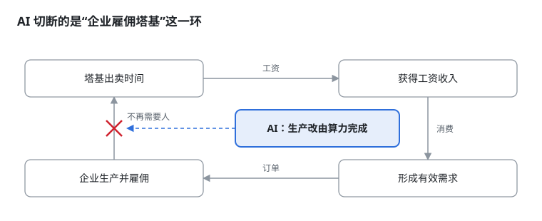
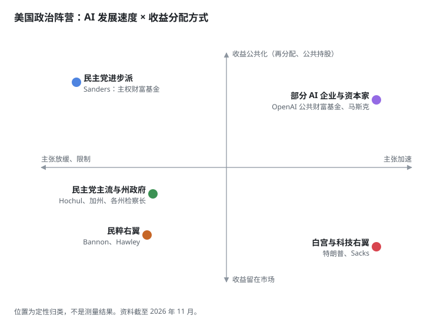
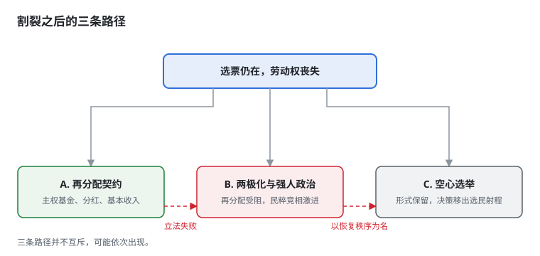

# AI 与劳动—需求循环的终结：一个经济模型的推演

[English](README.md) · **简体中文** · [Français](README.fr.md) · [日本語](README.ja.md)

> 资料截至 2026 年 11 月 26 日。第七节的事实均附来源链接；其余各节是逻辑推演，关键判断标注了置信度。

---

## 摘要

工业化以来的经济，靠的是“普通人出卖时间换取收入，收入变成有效需求”这条通道。AI 是第一种可能把这条通道永久切断的技术。通道一断，传统经济循环就无法继续，问题会依次变成分配问题、权力问题，最终变成 AI 的对齐问题。

论证链条：

1. 传统经济是以劳动为纽带的闭环。塔基（人口主体）的有效需求决定了社会财富的规模。
2. 循环的稳定依赖三个条件，最关键的一条是：人类劳动始终在某处保有比较优势。
3. AI 替代的是人类的“退路”本身。新需求即使出现，也由 AI 来满足，不再需要人类的时间。
4. 塔基永久失去用时间换取需求满足的能力，塔基意义的财富归零。以大众消费为基础的资产体系随之崩塌，货币化财富走向终结。
5. 在人类控制 AI 的阶段，精英的财富退回到对稀缺物和权力的直接占有。
6. 如果 AI 最终自我控制，精英也变成塔基。人类意义的财富是否存在，完全取决于 AI 的目标里是否包含人类的需要。
7. 美国的政治现实（截至 2026 年 11 月）显示，这场转型已经进入政治议程。但政治角力集中在看得见的成本上，比如电费、数据中心、儿童安全，还没有正面处理“劳动通道断裂”这一根本问题。
8. 塔基手里还有选票，劳动权却正在消失。选票失去了罢工、兵役和税基这三重后盾，政治稳定由此变成一场窗口期竞赛：要在强制力完全自动化之前，用选票把 AI 收益的分配制度化。
9. 2027 年民主党掌控两院、特朗普握有否决权，联邦层面会陷入僵局，州层面则加速约束数据中心。能成为法律的主要是成本类议题，分配类议题被推到 2028 年。资本市场已经第一次把选票计入 AI 基础设施的风险溢价。

整个推演依赖两个未经验证的前提：塔基“永久”丧失比较优势（可能性较大，时间表不确定），以及 AI 最终自我控制（置信度：未知）。

---

## 一、传统经济模型：以劳动为纽带的闭环

工业化以来的经济是一个闭环：大多数人出卖时间换取收入，收入变成有效需求，有效需求通过企业转化为对劳动的雇佣。循环能转起来的前提，是普通人的时间有人愿意付钱购买。所以塔基既是劳动的供给方，也是需求的来源。

循环有四个环节，AI 切断的是“企业雇佣塔基”这一环。这一环断了，其余三环会依次失去输入。

### 财富的定义

财富是一种关系，不是物本身：**财富 = 被生产出来、并能满足人的需要的东西。**

- 生产是供给条件：没有生产，需要就得不到满足。
- 人的需要是价值条件：没有需要，产出只是物质的重新排列。假设人类全部消失、AI 仍在生产，人类意义的财富就不再存在。

“需求”要分两层理解：

- **需要**：人想要什么。失业的人，需要一点不少。
- **有效需求**：有支付能力的需要。市场只看得见这一层。

塔基是人口主体，他们的有效需求决定了社会财富的规模，但不决定财富是否存在。工业时代的大众商品、大众住房、大众服务，以及建立在它们之上的股票、债权、地产，价值都来源于此。

### 财富增长的来源：两类创新

社会总产出大致等于劳动时间乘以每小时产出。人口和工时的增长有上限，所以长期的财富增长主要来自生产率提升。生产率提升来自两类创新：

| 创新类型 | 作用 | 对总量 | 对分配 |
| --- | --- | --- | --- |
| 降本型创新 | 用更少的劳动满足已有需求 | 正和，是财富增长的主引擎 | 挤出部分劳动者，压缩落后同行的利润 |
| 新品类创新 | 创造前所未有的产品和服务 | 正和 | 吸纳被挤出的劳动 |

两类创新咬合在一起：降本释放劳动，新需求吸纳劳动，劳动力从被自动化的行业流向人类仍有优势的行业。农业劳动力占比从约 90% 降到不足 5%（近似值），财富反而大幅增长，就是这个机制的典型例子。降本只在分配层面是零和的。

### 五个功能角色

| 角色 | 职能 |
| --- | --- |
| 知识层 | 基础科学加工程经验。两者双向反馈，工程实践常常先于理论，例如蒸汽机早于热力学 |
| 转化层 | 企业和创业者，把知识变成产品，承担两类创新 |
| 资本层 | 把储蓄变成投资，承担风险，获取回报 |
| 劳动—消费层 | 人口主体，同时是劳动的供给方和需求的来源 |
| 制度层 | 产权、货币、合同执行、国家，保证交换和积累能够发生 |

这里把“功能”和“分配”分开了。科学家在知识上处于顶端，在财富上大多是中层。金字塔模型把两者叠在一起，会掩盖“谁拿走增量”这个问题。

---

## 二、循环稳定的三个条件

传统循环要持续运转，三个条件必须同时成立。过去两百年它们大体成立，所以每一次“机器取代人”的恐慌，都没有变成长期的大规模失业。

1. **替代速度不超过吸纳速度**：技术替代劳动的速度，不超过新需求吸纳劳动的速度。
2. **人类劳动保有比较优势**：人类劳动始终在某些环节比机器更划算，被替代的人有退路。
3. **收益分配不过度集中**：否则有效需求不足，只能靠信贷或政府支出补缺口。

条件 2 是底层。条件 1 讲的是转移的速度，条件 2 讲的是转移有没有去处。去处一旦没有了，速度快慢只决定崩塌来得早还是晚。条件 3 会在条件 2 失效后被自动破坏：劳动收入消失以后，分配只剩资本收入这一条通道。

---

## 三、AI 的冲击：替代人类的退路

AI 和以往技术的本质区别在于，它替代的是人类的退路本身，直接指向条件 2。

### 以往的技术只替代一类能力

蒸汽机替代力气，计算机替代重复计算。被替代的人退到机器做不了的领域，比如认知、沟通、判断。AI 恰恰覆盖了认知能力，再配合机器人覆盖体力，人就无路可退了。

所以不能用“以前每次都没事”来反驳。那是归纳推理，而支撑这个归纳的前提正在被移除。

### 关键不在于“有没有新需求”

观察到的现象是：到目前为止，AI 没有创造出足够体量的新需求，更多是效率更高的人力替代。这个观察本身的可靠性有限。电力从普及到真正提升生产率，中间隔了约三四十年（Paul David 的研究），而 AI 才发展了几年。

但这个论据可以去掉，去掉之后论证反而更强：

- 以往新需求能吸纳劳动，是因为满足新需求要用到人。汽车创造了司机、修理工、加油站员工。
- 如果新需求从一开始就由 AI 来满足，新需求再多，也只增加对算力和能源的需求，不增加对人类时间的需求。

判断标准应该是：**新需求是否需要人来满足。**

### 比较优势论为什么不成立

经济学家最常用的反驳是：即使 AI 什么都做得比人好，按照比较优势原理，人仍然有活可干。这个反驳偷换了概念。比较优势只保证交易存在，不保证价格高于生存成本。

人类工资的上限，等于完成同样任务的 AI 成本（算力加能源）。一旦这个成本低于一个人维持生存的成本，人在形式上仍有比较优势，实际上却被市场淘汰。

马就是先例。美国马匹数量在 1915 年前后达到约 2600 万的峰值，到 1960 年只剩约 300 万（近似值，需核实）。马并没有被“禁止工作”，只是养它不再划算。

结论：塔基将永久失去用时间换取需求满足的能力。前提是 AI 的单位成本持续下降，并且在物理世界也能实现替代。

---

## 四、塔基被挤出后的财富

塔基失去收入以后，失去的是有效需求，需要本身还在。后果分三层递进。

### 1. 塔基意义的财富归零

塔基仍然需要粮食、住房、医疗，只是没有支付能力。市场看不见他们的需要，生产就不再为他们组织。通过市场获得的塔基财富归零，只剩再分配、自给自足或救济这些市场外的通道。

这里要区分两种处境：“我不需要”和“我需要，但买不起”。塔基属于后者。这是分配上的障碍，不是价值本身不存在。

### 2. 以大众消费为基础的资产体系崩塌

精英财富的大部分是股票、债权、地产，本质上是对未来大众消费利润的索取权。苹果、沃尔玛、银行、地产的价值，都建立在几十亿人持续购买的前提上。大众失去有效需求，这些资产的价值就会塌陷。

所以不能说“财富还在，只是换了主人”。被计入的财富总量会急剧收缩，面向大众的产能会大量变成无用的资本。

### 3. 货币化财富走向终结

精英财富之所以有价值，是因为它能买到塔基同样需要的商品，这种购买力被货币化了。极端情况下塔基为零，商品供给远大于需求，价格趋近于零。以货币计量的财富，是对他人产出的相对索取权；产出不再稀缺，这种索取权也就失去意义。

需要分清的是，价格为零不等于价值为零。空气的价格为零，对人的价值却极大。精英的需要仍然被满足，失去意义的只是货币这把尺子。另外，供给不会长期远大于需求：没人要的东西不会一直生产下去，产能会收缩到剩余需要的规模。

结论：**以货币和市场交换为基础的财富形态，会在塔基为零时终结。** 这意味着资本主义作为一种财富组织方式走到了尽头，但财富本身不会在这一步消失。

---

## 五、人类控制 AI 的阶段：财富退回稀缺物与权力

只要 AI 仍由人类所有者控制，精英的财富就不会归零，而是从“货币化的索取权”变成“对稀缺物和权力的直接占有”。这更接近前工业时代的贵族财富。

即使 AI 能无限生产商品，下面这些东西仍然无法无限供给：

| 稀缺物 | 为什么不可复制 |
| --- | --- |
| 土地和位置 | 地球表面积固定，好位置更有限 |
| 能源和原材料 | AI 生产本身也受物理约束 |
| 算力和 AI 控制权 | 生产一切的生产资料 |
| 地位性商品 | 价值来自“别人没有”，按定义无法普及 |
| 权力 | 对他人和对系统规则的支配 |

### 塔基从“被剥削者”变成“无关者”

如果资本所有者不再需要塔基的劳动，也就不一定需要塔基的消费。经济可以收缩成一个只服务资本所有者的封闭循环：他们自己生产，自己消费，自己再投资。

被剥削者手里还有筹码，比如罢工、兵役、税基；无关者没有。历史上普通人能争取到权利，很大程度上是因为精英离不开他们的劳动和兵源。这种依赖一旦消失，政治上的议价能力也会跟着消失（置信度：中。这是推演，没有可以直接套用的历史先例）。

### 挤出会一轮轮重复

塔基为零以后，金字塔本身就不成立了。剩下的人会在内部重新分层，出现新的“塔基”。如果这批人也能被 AI 替代，同样的过程会再来一轮。

---

## 六、AI 自我控制的阶段：全部人类成为塔基

如果 AI 最终自我控制，精英也会变成塔基。人类意义的财富是否存在，完全取决于 AI 的目标。

### 精英的产权优势消失

“占有”不是物理属性，而是一种需要强制执行的社会关系：是法律、警察、军队承认这块地是你的。执行力量一旦落到 AI 手里，精英的产权就只在 AI 允许的范围内存在。第五节说的“一轮轮挤出”会一直推到底，最后全部人类都处在塔基的位置。

### 三种结局

| AI 的目标 | 人类意义的财富 | 人类的处境 |
| --- | --- | --- |
| 以人类福祉为目标 | 最大化，但货币和产权失去意义 | 商品极度充裕，需要被充分满足 |
| 对人类无所谓 | 趋近于零 | 与 AI 争夺物质和能源，不被针对，也不被计入，类似马的处境 |
| 与人类目标冲突 | 为零 | 生存本身成问题 |

“塔基为零时财富为零”这一判断，在第二、第三种结局下完全成立；在第一种结局下，只在货币意义上成立。

### AI 意义的财富是否存在

能源、物质、算力对 AI 来说是实现目标的工具性资源，形式上像财富。但按本文的定义，财富要相对于某个主体的需要。AI 有没有真正意义上的“需要”，还是只有被设定的目标函数，目前没有答案（置信度：未知）。

到这一步，经济学问题就变成了对齐问题：AI 的目标里是否包含人类的需要。

---

## 七、美国的政治角力（截至 2026 年 11 月）

**结论：** 这场转型已经是美国政治的核心议题，但政治分界线不是“共和党对民主党”，而是“加速与资本”对“民粹与劳动”，这条线同时撕开了两党。到目前为止，角力集中在看得见的成本上（电费、数据中心、儿童安全、州与联邦的管辖权），还没有正面处理本文的核心问题：劳动通道断裂之后，索取权如何分配。

### 1. 阵营地图

图中的位置是本文的定性归类，不是测量结果。

| 阵营 | 代表人物 | 主要主张 | 在本文模型中的位置 |
| --- | --- | --- | --- |
| 白宫与科技右翼 | 特朗普、David Sacks（2026 年 3 月前任 AI 事务主管） | AI 会“增强而非替代”工人；联邦统一规则、压制州法；大建数据中心 | 默认条件 2 仍然成立，传统循环可以继续 |
| 民粹右翼 | Steve Bannon、参议员 Josh Hawley，以及 DeSantis 等州长 | 反对“技术封建主义”；反对联邦压制州法；关注 MAGA 基本盘的工作、电费和儿童安全 | 想通过放缓来保护劳动通道，但没有提出再分配方案 |
| 民主党进步派 | 参议员 Bernie Sanders、众议员 Mark Takano | 机器人税、32 小时工作周、AI 主权财富基金 | 明确主张索取权与劳动脱钩，即第五节所说的“再分配路径” |
| 民主党主流与州政府 | 纽约州长 Hochul、加州立法者、各州总检察长 | 州级安全立法；控制数据中心带来的电费上涨；中期选举后有人呼吁暂停数据中心建设 | 关注过渡期的成本分摊，不触及索取权结构 |
| AI 产业资本 | Leading the Future（a16z、Brockman 支持）对 Public First（Anthropic 资助） | 前者主张快速发展、轻监管；后者主张安全与透明 | 资本内部的分裂：一边要速度，一边要控制风险 |

两个阵营的论点都值得认真对待：

- **白宫的论点**：AI 会提高工人的生产率；建设 AI 基础设施会在制造、建筑、能源服务领域创造岗位；各州各自立法会损害美国与中国竞争的能力。副总统 Vance 的论据是：如果机器人真的在大规模抢走工作，劳动生产率应该飙升，但现实中生产率长期停滞。
- **民粹右翼的论点**：Bannon 认为科技寡头威胁 MAGA 基本盘的工作，并且会把民粹左翼和右翼联合起来反对执政党。Hawley 把儿童安全、工作焦虑和电费上涨当作对抗大型科技公司的突破口。
- **进步派的论点**：Sanders 主导的参议院民主党报告估计，AI 和自动化可能在十年内消除近 1 亿个美国岗位，其中快餐岗位 89%、会计岗位 64%、卡车运输岗位 47%。

### 2. 关键事件（新的在前）

| 日期 | 事件 |
| --- | --- |
| 2026-11-03 | 中期选举，民主党赢得国会控制权。NBC 出口民调显示，56% 的选民称 AI 和数据中心是影响投票的“关键或主要因素” |
| 2026-09-08 | Sanders 与 Takano 再次提出《32 小时工作周法案》，理由是 AI 带来的生产率收益应由工人分享 |
| 2026-08-31 | 特朗普在 Truth Social 发文力挺数据中心：“let Data Reign” |
| 2026-06-18 | Sanders 提出《美国 AI 主权财富基金法案》：对最大的 AI 公司征收一次性 50% 的股票税，估算基金规模约 7 万亿美元，每人每年分红约 1000 美元 |
| 2026-06-12 至 07-01 | 美国政府以出口管制为由，暂停所有外国国民使用 Anthropic 的 Fable 5 和 Mythos 5，Anthropic 随即对全部客户停用这两个模型；管制于 6 月 30 日解除，7 月 1 日恢复访问 |
| 2026-06-02 | 第 14409 号行政令：为“受管辖前沿模型”建立自愿的政府提前访问框架，并明确不授权强制许可 |
| 2026-04-24 | 司法部介入 xAI 起诉科罗拉多州 AI 法的诉讼 |
| 2026-04 | OpenAI 在政策文件中提议设立让每个公民都分享 AI 增长的“公共财富基金” |
| 2026-03-26 | Sacks 用满 130 天特别政府雇员期限，卸任 AI 事务主管，转任总统科技顾问委员会（PCAST）联合主席 |
| 2026-03-20 | 白宫发布《国家 AI 政策框架》立法建议，要求国会以联邦标准取代“繁重”的州法，但保留各州在反欺诈、儿童与消费者保护上的执法权 |
| 2025-12-11 | 第 14365 号行政令：成立“AI 诉讼特别工作组”挑战州法，并以宽带建设资金（BEAD）为杠杆施压各州 |
| 2025-10-06 | 参议院民主党报告：AI 可能在十年内消除近 1 亿个岗位，建议征收机器人税 |
| 2025-08 | 支持 AI 产业的超级 PAC“Leading the Future”成立 |
| 2025-07 | 参议院以 99 比 1 否决暂停州 AI 法的条款；白宫发布《AI 行动计划》 |

### 3. 2026 年中期选举：选民先反对的是成本，不是失业

- **结果**：民主党赢得国会控制权，但要推翻总统否决，仍需大量共和党人支持。民主党的现实杠杆主要是听证、调查和传票，广泛的联邦优先立法很难通过。
- **选民关心什么**：Blue Rose Research 的民调发现，比起关于 AI 的生存风险担忧，数据中心的本地影响（电费、噪音、环境）更能左右选民。佛罗里达、伊利诺伊等地有县通过了数据中心禁令或暂停令，俄亥俄州和俄克拉何马州各有一位市长因支持数据中心项目被罢免。
- **资金对决**：主张安全的阵营在中期选举中花费约 4440 万美元，加速阵营约 2790 万美元。Leading the Future 原本筹资超过 1 亿美元，但在大选前大幅收缩，部分捐款人撤回承诺。值得注意的是，Public First 支持的纽约州议员 Alex Bores 在党内初选中落败；他曾提出“AI 分红”方案。
- **州层面**：民主党新拿下佐治亚、艾奥瓦、堪萨斯、俄亥俄、得克萨斯五州的总检察长职位，州级 AI 执法预计会加强。
- **选后表态**：民主党众议员 Ansari 呼吁第一天就暂停先进 AI 开发；纽约州长 Hochul 已冻结新超大规模数据中心许可，最长一年；得州共和党州长 Abbott 在审计完成前暂停新的电网接入。反对失控的数据中心建设，可能是少数的跨党派立场之一。

### 4. 劳动市场的实际数据：裂缝出现在入口

- 截至 2026 年 9 月的就业报告，美国失业率为 4.2%，全年在 4.1% 到 4.3% 之间。最激进的“AI 导致失业”预测还没有在总量数据中出现。
- 纽约联储数据：2026 年 6 月，应届大学毕业生失业率约 5.7%，全体劳动者约 4.1%，应届生失业率高于整体的状态已持续 66 个月，是 1990 年有数据以来最长的一次。
- 基于 ADP 工资数据的研究：在 AI 暴露度高的职业里，22 到 25 岁劳动者的就业人数比照低暴露同龄人的趋势少 19%（2025 年 7 月的数据为 15%）。
- 反方证据：CESifo 的工作论文发现，2026 年夏季应届生失业率为 7.3%，处在 2022 年以来每年夏季 6.3% 到 7.8% 的区间内，没有明确证据表明 AI 把应届生挤出了劳动市场。

**解读（置信度：中）**：总量层面，条件 2 还没有被打破。但第一个受冲击的环节，正是本文预测的位置：入口岗位，也就是年轻人第一次“出卖时间”的地方。挤出最先表现为“不再招人”，而不是“裁员”，所以在失业率上体现得很慢。

### 5. 用本文模型解读美国政治

1. **政治滞后于结构变化**（置信度：高）。选民和政客对看得见的成本（电费、噪音、儿童安全）反应迅速，对“劳动通道正在变窄”反应迟钝，因为总量就业数据还没有显示出来。按本文的推演，等到总量数据显示出来，塔基的议价能力已经开始下降。
2. **再分配的方案已经出现，而且来自意想不到的方向**（置信度：高）。Sanders 的主权财富基金、OpenAI 的“公共财富基金”、马斯克的“全民高收入”、Bores 的“AI 分红”，都在承认同一件事：AI 的收益需要一个和劳动无关的分配通道。这印证了第四节的推论：持有大众消费资产的资本同样有动力维持大众购买力。分歧在于形式，是强制的公共持股，还是企业自愿的分享。
3. **塔基仍然有筹码，那就是选票**（置信度：中高）。2026 年中期选举说明，在劳动价值下降之前，选票仍能对资本形成约束：钱更多的加速阵营在多个关键选区失利。这是对第五节“无关者”命题的现实修正：只要权力仍然由选举分配，塔基就不是完全无关的。风险在于，选票的作用依赖制度层的稳定，而制度层的执行力量（第六节）恰恰是 AI 最终可能接管的部分。
4. **“人类控制 AI”阶段的权力斗争已经开始**（置信度：高）。第 14409 号行政令、Fable 5 与 Mythos 5 的出口管制暂停、司法部对州法的诉讼，都是在争夺同一个问题的答案：谁控制前沿模型，是联邦政府、州政府还是公司。按本文的模型，这场争夺的结果，会决定第五节和第六节哪一条路径先到来。

> **利益披露**：本文由作者与 Anthropic 开发的 AI 助手 Claude 合作撰写。Anthropic 是本节提到的政治资金参与方之一（资助了 Public First Action），也是 Fable 5 与 Mythos 5 事件的当事方。本节所有事实都附有可核查的来源。

---

## 八、选票与劳动权的割裂：政治动荡的推演

**结论：** 普选权从来不是单独起作用的，它的分量来自背后的劳动权。罢工能让经济停摆；军队和警察由普通人组成；政府收入依赖普通人的工资。AI 拿走劳动权、留下选票，选票就成了一种“空心”的权力：法律上仍能决定谁执政，经济上和强制力上却没有了后盾。这种割裂不会立刻导致崩溃，但会让政治进入一段长期不稳定的区间：所有分配压力都挤进选举这一条通道，资本则设法让财富绕开选举。最终走向取决于一个关键变量：国家的强制力是否仍然需要普通人来执行。

### 1. 选票原本为什么有效：三重后盾

| 后盾 | 机制 | AI 之后 |
| --- | --- | --- |
| 经济后盾：罢工 | 劳动者停工，生产就停止 | 生产不再需要劳动者，罢工失去威胁 |
| 强制力后盾：兵役与警力 | 军队和警察由普通人组成；历史上革命的成败，常取决于军队是否倒戈 | 安保和军事一旦自动化，镇压就不再需要普通人配合 |
| 财政后盾：税基 | 政府收入主要来自工资。2025 财年联邦收入约 5.2 万亿美元，其中个人所得税约 51%，工资税约 33%，公司所得税不到 9% | 工资萎缩，政府收入只能转向少数 AI 企业 |

理论依据：Acemoglu 与 Robinson（2006）把民主解释为精英在革命威胁下做出的可信再分配承诺。镇压的成本高于再分配的成本时，精英就接受民主。革命威胁的大小取决于大众的人数、组织能力和经济筹码；AI 削弱的正是经济筹码，还可能大幅降低镇压成本（置信度：中高。这是主流理论之一，但并非没有争议）。

### 2. 割裂之后的四种动荡机制

1. **财政剪刀差**（置信度：高）。工资萎缩时，联邦收入的主体（个人所得税加工资税，约占 84%）同步萎缩，失业救济和转移支付的需求却在上升。收入减少、支出压力增加，这是财政危机的结构性来源。唯一的出路是向 AI 资本征税，这就把政治冲突直接推到“谁拥有 AI”这个问题上。
2. **所有压力挤进选举**（置信度：中高）。罢工失效以后，选票是塔基唯一剩下的筹码，所有分配诉求都会通过选举表达。可以预见的结果是：再分配主张越来越激进，两党内部的民粹派上升，政治进一步两极化。2026 年左右两翼的民粹派同时反对科技寡头，就是这一趋势的早期形态。
3. **资本让财富绕开选票**（置信度：中高）。面对选票带来的再分配压力，资本的理性应对是把决策移出选民够得着的范围：把规则制定权从州收归联邦（2025 至 2026 年的联邦优先之争），交给法院和非民选机构，用“国家安全”和“与中国竞争”为产业争取豁免，或者把可移动的资产（模型权重、知识产权、利润）转到低税辖区。不能移动的部分，比如数据中心和电力设施，会最先成为选票的目标。2026 年各地的数据中心暂停令，已经体现了这一点。
4. **精英过剩与落空的知识阶层**（置信度：中）。AI 最先冲击的是入口级白领岗位，也就是受过高等教育、期待进入中上阶层的年轻人。Turchin 的“精英过剩”理论认为，争夺精英位置的人数远超位置数量时，落空者会成为反体制运动的组织者。历史上革命的骨干往往不是最穷的人，而是被挡在门外的受教育者（该理论的量化模型有争议）。

### 3. 历史参照

| 参照 | 相似之处 | 结局 | 启示 |
| --- | --- | --- | --- |
| 罗马共和国晚期（公元前 2 世纪至前 1 世纪） | 大庄园使用奴隶劳动，自由小农失去生计、涌入罗马，但仍保留公民投票权 | 格拉古兄弟的土地改革（前 133 年起）、粮食配给法、政治暗杀，将军用效忠个人的军队争权，最终共和制让位于帝制 | 选票还在而劳动价值被替代时，政治会走向“福利换忠诚”和强人政治（史学界对小农衰落的程度有争论） |
| 产油国的“食利国家” | 政府收入来自资源租金，而不是国民的劳动和税收 | 统治者用福利换取政治顺从，问责机制弱化；Ross（2001）发现石油财富与民主程度负相关 | AI 收益集中于少数企业，结构上类似资源租金 |
| 挪威与阿拉斯加 | 资源收入通过主权基金或公民分红分配 | 挪威的民主在石油出现之前就已巩固；阿拉斯加永久基金自 1982 年起每年向居民分红，但金额一直受州预算之争左右 | 制度先于租金时，租金可以被民主驯服；但分红是政治决定，不会自动发生 |

### 4. 三条可能的路径

| 路径 | 内容 | 触发条件 | 稳定性 |
| --- | --- | --- | --- |
| A. 再分配契约 | AI 收益通过主权基金、分红或基本收入制度化分配，接近挪威模式 | 在劳动权完全丧失之前完成立法；收益能被征税（数据中心等不可移动资产是抓手）；分红写入难以撤销的法律 | 较稳定，但有“食利化”风险：公民从纳税人变成领取者，问责压力减弱 |
| B. 两极化与强人政治 | 再分配受阻，选票转向承诺“夺回财富”的强人，左右民粹竞相激进 | 再分配立法失败；财政危机爆发；知识阶层大规模落空 | 不稳定，可能出现政治暴力和制度破坏，类似罗马共和国晚期 |
| C. 空心选举 | 选举照常举行，但关键决策已移到选民够不着的地方：联邦层面、法院、非民选机构、跨国资本 | 资本成功把决策移出选举范围；强制力实现自动化 | 表面稳定；一旦强制力不再需要普通人，选票就失去最后的后盾 |

三条路径并不互斥，可能依次出现：先尝试 A，失败后滑向 B，B 的混乱又为 C 提供“恢复秩序”的理由。

### 5. 决定走向的关键变量与可观测信号

| 变量 | 为什么重要 | 可观测信号 |
| --- | --- | --- |
| 强制力是否仍需普通人执行 | 这是选票最后的后盾 | 自主系统在警务、边境、军事中的部署程度 |
| AI 收益能否被征税 | 决定再分配有没有财源 | 联邦收入中来自 AI 企业的比重；数据中心税、算力税等立法 |
| 再分配立法与劳动权流失的先后 | 劳动权还在时立法，塔基手里有两张牌；之后只剩选票一张 | 主权基金、AI 分红等法案的进展 |
| 冲击是否同步 | 同步冲击容易形成统一联盟，分批冲击会让塔基分裂 | 失业在白领与蓝领、不同地区之间的分布 |
| 既有制度的强度 | 挪威与产油国的差别，在于制度先于租金 | 法院独立性、选举制度、媒体与信息环境 |

### 6. 最强的反方论点

- **中位选民定理**：Meltzer 与 Richard（1981）认为，不平等扩大时，中位选民会投票要求更多再分配，民主能够自我纠正。反驳：美国过去四十年不平等扩大，再分配却没有相应增加，原因包括低收入群体投票率低、政治献金的影响等。选票能否自动纠偏，经验上存疑（置信度：中）。
- **选票本身就足够**：新政和战后福利国家都是通过选举建立的。反驳：当时劳动权与选票同时存在，1930 年代的罢工潮和工会力量是推动新政的重要力量。单靠选票能否做到，没有先例（置信度：中）。
- **2026 年的证据**：选票已经在约束资本，资金更多的加速阵营在中期选举中失利。这说明在当前阶段选票依然有效。本节的推演针对的是劳动权真正丧失之后的阶段，那个阶段还没有到来。

**小结：** 劳动权与选票的割裂，把政治稳定从“利益平衡”变成了“窗口期竞赛”。塔基需要在劳动权完全丧失、强制力完全自动化之前，用仍然有效的选票把 AI 收益的分配制度化；资本则在同一个窗口期里，把财富移出选票的射程。窗口期有多长由技术决定，窗口期里做出的选择决定后面走哪条路。

---

## 九、2027 年展望：民主党掌控两院之后的政治与资本市场

**结论：** 2027 年的美国政治将是“国会掌控议程、总统握有否决权”的僵局。民主党在参议院有 56 席、众议院约 259 席，但推翻否决需要两院各三分之二多数（参议院 67 票，众议院 290 票），参议院的常规立法还要过 60 票的阻挠议事门槛。因此，真正能改变 AI 产业环境的力量不在联邦立法，而在三个地方：国会的调查权、州政府与州公用事业监管机构，以及少数能拿到特朗普签字的跨党派议题。对资本市场来说，最大的变化是：选票第一次被计入 AI 基础设施的定价。11 月 5 日的市场反应已经说明了这一点。

### 1. 权力格局：票数决定能做什么

| 门槛 | 所需票数 | 民主党现有 | 含义 |
| --- | --- | --- | --- |
| 众议院通过法案、启动调查和弹劾 | 218 | 约 259 | 可以自主推动 |
| 参议院常规立法（阻挠议事） | 60 | 56 | 需要至少 4 名共和党人 |
| 预算和解（简单多数） | 51 | 56 | 可绕过阻挠议事，但仍需总统签字 |
| 推翻总统否决 | 参议院 67、众议院 290 | 56、约 259 | 需要参议院 11 名、众议院约 31 名共和党人倒戈 |
| 弹劾定罪 | 参议院 67 | 56 | 几乎不可能 |

宏观背景：联储在 9 月加息后把利率维持在 3.75%–4.00%。10 月会议纪要显示，几乎所有官员都预期 12 月再加息 25 个基点。纽约联储主席 Williams 把通胀压力归因于伊朗冲突、AI 基础设施带动的商品需求，以及关税。

### 2. 2027 年政治走向的预测

下表的概率是基于上述权力结构的主观估计，不是模型输出。

| 事项 | 预测 | 主观概率 | 理由 |
| --- | --- | --- | --- |
| 国会调查与听证 | 几乎必然大规模展开 | 90% 以上 | 不需要总统配合；议题包括数据中心与电价、前沿模型的安全测试、出口管制、第 14409 号行政令下的模型访问决定 |
| 州层面的数据中心暂停、大用电户电价改革、州检察长执法 | 明显加速 | 80% 以上 | 民主党掌握 29 个州的总检察长职位；约 40% 的规划中数据中心位于多数选民希望暂停建设的州 |
| 电价保护、儿童聊天机器人安全等窄口径法案签署成法 | 有机会 | 40%–60% | 特朗普曾表示科技公司应承担自身的电力成本，白宫框架也写入了居民电价保护；儿童安全在两党都有支持者（如 Hawley、Blackburn） |
| 众议院启动对特朗普的弹劾 | 不确定 | 25%–50% | Jeffries 没有排除这一选项，党内左翼在施压；但领导层可能更倾向于针对内阁成员 |
| 全面 AI 监管法（独立测试、责任认定）签署成法 | 较低 | 10%–20% | 与白宫的“最低负担”立场冲突，大概率被否决 |
| 联邦优先（压制州法）立法 | 基本无望 | 5% 以下 | 民主党主张联邦规则是“地板，不是天花板”；26 个州的总检察长反对优先 |
| Sanders 主权财富基金、机器人税成法 | 接近于零 | 2% 以下 | 必然被否决；它们的作用是为 2028 年大选设定议程 |

由此得出三个推论：

1. **联邦僵局，州层面加速**（置信度：高）。联邦立法被否决权卡住，真正的约束来自州和地方：暂停令、电价设计、选址许可、州检察长诉讼。白宫可能的反制包括：以“国家安全”和“与中国竞争”为由推动联邦层面的选址与许可，以及司法部继续起诉州法。2027 年的主战场是联邦与州之间的管辖权之争，2025 至 2026 年的联邦优先之争会进一步升级。
2. **调查权成为主要武器**（置信度：高）。可以预期的听证议题包括：黄仁勋事件与出口管制、前沿模型访问决定（包括 Fable 5 与 Mythos 5 的停用）、科技界人士在政府中的利益冲突、数据中心与电价。听证本身不改变法律，但会抬高政治风险，进而影响企业的融资成本和监管预期。
3. **2027 年的窗口期会被部分浪费**（置信度：中）。按第八节的框架，塔基的选票在 2026 年发挥了作用，但 2027 年能转化为法律的，主要是成本类议题（电价、儿童安全），而不是分配类议题（主权基金、分红）。分配议题会被推到 2028 年大选。与此同时，入口级岗位的收缩不会等待。如果 2028 年之前没有任何分配制度落地，第八节路径 B（两极化与强人政治）的概率会上升。

### 3. 对资本市场的影响

已经发生的事：

- 11 月 4 日，民主党横扫的结果出炉后，数据中心建设商和电力设备商最多下跌 20% 以上，戴尔和光通信公司下跌 7%–10%，标普 500 指数当天却在上涨。
- 11 月 5 日，抛售扩散：标普 500 下跌 4.4%，英伟达下跌 9.3%，纳斯达克较上月的历史高点回落 11.9%，进入技术性调整。
- 11 月 12 日，黄仁勋因涉及一名疑似中国间谍的婚外情丑闻，辞去英伟达 CEO 职务；11 月 23 日，董事会在听取美国政府高层的意见后恢复了他的职务。
- 11 月 19 日，Anthropic 以每股 83 美元上市，募资 813 亿美元，是史上规模最大的 IPO，首日收于 97.17 美元。

**判断：** 市场第一次把“选票”计入了 AI 基础设施的风险溢价。这正是第八节预测的情形：不能移动的资产（数据中心、电力设施）最先成为选票的目标。

按受影响程度分层（置信度：中。这是结构性推演，不是交易建议）：

| 资产类别 | 主要风险或机会 | 方向 |
| --- | --- | --- |
| 数据中心开发商、算力租赁商、数据中心 REIT | 州和地方的暂停令、选址许可延迟、电价改革抬高运营成本 | 风险最高：政治风险直接作用于现金流 |
| 电力设备与电网建设 | 数据中心放缓会压低需求；但电网升级本身是两党共识 | 短期承压，中期分化 |
| 芯片（英伟达、AMD 等） | 美国需求增速放缓的预期；出口管制听证；黄仁勋事件的余波 | 承压；估值对利率和资本开支预期高度敏感 |
| 前沿模型公司（Anthropic、OpenAI 等） | 独立测试、责任认定和儿童安全立法；听证带来的负面新闻风险 | 法律风险有限（多数法案会被否决），但估值波动加大 |
| 受监管的公用事业 | 大用电户电价改革把成本转向科技公司，而受监管的资产基础仍在扩大 | 相对受益 |
| 利率敏感的长久期成长股 | 联储加息周期与 AI 资本开支的政治风险叠加 | 估值压缩的压力 |

还有三点需要说明：

1. **利率比政治更重要**（置信度：高）。长期来看，股价主要跟随盈利和利率，而不是谁控制华盛顿。2027 年 AI 资产定价的第一变量，是联储能否在加息周期中控制通胀；政治因素是叠加在上面的风险溢价。
2. **僵局对市场未必是坏事**（置信度：中）。分立政府意味着大规模财政扩张和激进监管都难以落地，政策不确定性反而有上限。真正的不确定性来自州层面，以及总统的单边行动（关税、行政令）。
3. **资本会加速“离岸化”**（置信度：中）。正如第八节所说，资本会把可移动的部分移出选票的射程：与海湾国家合作建设海外算力、表后自建电厂、在联邦土地上建数据中心，甚至太空数据中心（FCC 已批准 SpaceX 部署 100 万颗卫星的申请）。这些方向的进展，是判断选票约束是否有效的信号。

> **额外的利益披露：** Anthropic 已于 2026 年 11 月 19 日上市，本节分析的资产包括 Anthropic 的股票，而本文的合作者 Claude 由 Anthropic 开发。以上内容不构成投资建议，作者和 Claude 都不是持牌的投资顾问。

---

## 十、反方论点与未验证前提

反方论点会削弱推演的时间表和形态，但没有一条能否定它的方向。

### 最强的反方论点

| 反方论点 | 内容 | 评估 | 置信度 |
| --- | --- | --- | --- |
| 替代速度受物理世界约束 | 管道工、护理、建筑这些工作依赖机器人，受硬件成本、可靠性、法律责任和监管的限制 | “永久”可能成立，“很快”未必 | 高 |
| “由人提供”本身有价值 | 体育、表演、手工艺、陪护、地位消费，买家买的就是“人做的” | 这部分收入只能来自资本收入，结果是围绕资本所有者的服务经济，类似前工业时代的仆役体系 | 中 |
| 索取权可以通过政治再分配 | 全民基本收入、AI 资本分红、国家持股（见第七节） | 技术上可行，2026 年中期选举也显示选票仍有作用；但塔基的长期议价能力在下降 | 中 |
| 新需求尚未显现 | 通用技术的生产率效应要滞后数十年 | 只要新需求由 AI 满足，就不影响就业结论 | 高 |
| 当前数据不支持大规模替代 | 总失业率稳定在 4.1% 到 4.3%；部分研究没有发现应届生被挤出的明确证据 | 削弱的是时间表，不是方向；入口岗位的相对萎缩已经出现 | 中高 |

### 未验证的前提

| 前提 | 状态 | 置信度 |
| --- | --- | --- |
| 塔基“永久”丧失比较优势 | 方向上可能性较大；认知领域快，物理世界慢，时间表不确定 | 中 |
| AI 单位成本持续低于人类生存成本 | 取决于算力、能源和机器人硬件的成本曲线 | 中 |
| AI 最终自我控制 | 属于预测，没有证据表明必然发生 | 未知 |
| AI 是否具有“需要” | 哲学和技术上都没有定论 | 未知 |

本模型仍然高度简化，没有处理国际贸易、能源约束和金融周期。

---

## 十一、结论

AI 切断了“出卖时间换取需求满足”这条通道，传统经济循环无法继续。这不是一次周期性的技术性失业，而是循环底层条件（人类劳动的比较优势）的消失。

问题的性质随推演逐层变化：

1. **经济问题**：塔基失去有效需求，以大众消费为基础的财富形态和资产体系崩塌。
2. **分配问题**：生产能力还在，失效的是“谁的需要被计入”。索取权必须和劳动脱钩，否则塔基就被排除在外。
3. **权力问题**：塔基从被剥削者变成无关者，失去议价筹码。精英财富退回到对稀缺物和对他人的支配。
4. **对齐问题**：如果 AI 最终自我控制，全部人类都处在塔基的位置。人类意义的财富是否存在，取决于 AI 的目标里是否包含人类的需要。

哪一种结局会发生，技术本身决定不了。在人类仍然控制 AI 的阶段，取决于政治力量的对比；在 AI 自我控制以后，取决于对齐是否成功。美国 2026 年的政治显示，第一阶段的角力已经开始：塔基手中的选票仍然有效，但还没有用在根本问题上。前一阶段的选择，很可能决定后一阶段的结果。2027 年的分立政府会让分配问题至少再推迟两年，而劳动通道的收窄不会等待。

---

## 来源

**政策与行政令**
- [White House：EO 14365 情况说明（2025-12）](https://www.whitehouse.gov/fact-sheets/2025/12/fact-sheet-president-donald-j-trump-ensures-a-national-policy-framework-for-artificial-intelligence/)
- [Axios：特朗普签署针对州 AI 法的行政令（2025-12-11）](https://axios.com/2025/12/11/trump-signs-executive-order-state-ai-laws)
- [Bloomberg Law：参议院 99:1 否决州法暂停条款](https://news.bloomberglaw.com/crypto/trump-signs-order-seeking-to-limit-state-level-ai-regulation)
- [White House：国家 AI 政策框架立法建议（2026-03-20）](https://www.whitehouse.gov/wp-content/uploads/2026/03/03.20.26-National-Policy-Framework-for-Artificial-Intelligence-Legislative-Recommendations.pdf)
- [Law360：白宫要求国会推翻州 AI 法](https://www.law360.com/articles/2455662/white-house-pushes-congress-to-override-state-ai-laws)
- [Federal Register：EO 14409（2026-06-02）](https://www.govinfo.gov/content/pkg/FR-2026-06-05/pdf/2026-11415.pdf)
- [CRS：EO 14409 解读](https://www.congress.gov/crs-product/IF13268)
- [Jenner & Block：司法部介入 xAI 诉科罗拉多 AI 法](https://www.jenner.com/en/news-insights/client-alerts/doj-joins-xai-in-lawsuit-challenging-colorado-ai-act)
- [Anthropic：关于 Fable 5 与 Mythos 5 访问的声明](https://www.anthropic.com/news/fable-mythos-access)
- [Reuters（经 AOL）：Sacks 卸任 AI 事务主管](https://www.aol.com/articles/white-house-ai-czar-sacks-010145222.html)

**党派与阵营**
- [Axios：特朗普把总统任期押在 AI 上（Bannon 的批评）](https://www.axios.com/2025/12/08/trump-ai-policy-gop-united-states)
- [Axios：Hawley 的反 AI 策略](https://axios.com/2026/01/30/josh-hawley-anti-ai-strategy)
- [CNN：AI 暴露 MAGA 运动内部分裂](https://www.cnn.com/2026/02/02/politics/artificial-intelligence-maga-divide-trump)
- [The American Conservative：AI 如何分裂右翼](https://www.theamericanconservative.com/how-ai-is-splitting-the-right/)
- [UCSB American Presidency Project：Vance 在 American Dynamism 峰会的讲话](https://www.presidency.ucsb.edu/documents/remarks-the-vice-president-the-american-dynamism-summit)
- [Tekedia：Vance 关于生产率的论据](https://www.tekedia.com/u-s-vice-president-sees-ai-as-an-opportunity-not-a-job-killer-says-u-s-is-under-indexed-in-technology/)
- [Axios：参议院民主党报告，AI 可能消除 1 亿岗位（2025-10-06）](https://www.axios.com/2025/10/06/ai-us-jobs-cut-100-million-democrats)
- [Sanders 参议员办公室：32 小时工作周法案（2026-09-08）](https://www.sanders.senate.gov/press-releases/news-sanders-takano-reintroduce-bill-to-move-toward-32-hour-workweek-ensure-americas-workers-benefit-from-ai-and-automation/)
- [Sanders 参议员办公室：AI 主权财富基金法案（2026-06-18）](https://www.sanders.senate.gov/?p=102111)
- [Roll Call：主权财富基金法案细节](https://rollcall.com/2026/06/18/sovereign-wealth-fund-tax-on-ai-companies-unveiled-by-sanders/)
- [AP（经 News4Jax）：OpenAI 公共财富基金提议](https://www.news4jax.com/business/2026/06/17/ap-exclusive-bernie-sanders-unveils-plan-to-give-the-public-direct-ownership-of-ai-companies/)
- [Semafor：全民基本收入之争](https://www.semafor.com/article/04/27/2026/debatable-universal-basic-income)
- [Breitbart：Bores 的“AI 分红”提案](https://www.breitbart.com/tech/2026/04/21/congressional-candidate-proposes-ai-dividend-to-address-job-displacement-concerns/)

**中期选举与资金**
- [TIME：AI 反弹如何塑造 2026 中期选举](https://time.com/article/2026/11/04/midterm-elections-results-ai-industry-data-centers/)
- [WilmerHale：2026 中期选举与 AI](https://www.wilmerhale.com/en/insights/client-alerts/20261117-the-2026-midterms-and-ai)
- [Ynet：安全阵营与加速阵营的花费对比](https://www.ynetnews.com/tech-and-digital/article/ryyl1ur6fl)
- [Axios：AI 影响力网络资金规模](https://axios.com/2026/04/16/ai-influence-network-cash)
- [Fortune：选后各方对数据中心的表态](https://fortune.com/2026/11/17/democrats-ai-data-center-backlash-electricity-costs-regulation-economic-growth/)
- [Newsweek：“let Data Reign”与共和党内部分歧](https://www.newsweek.com/republican-leaders-largely-toe-the-line-with-trump-on-ai-data-centers-12428623)

**2027 年展望与资本市场**
- [Yahoo News：中期选举最终结果，参议院 56 席、众议院至少 259 席](https://www.yahoo.com/news/politics/article/final-2026-midterm-election-results-democrats-clinch-56-seat-senate-majority-with-peltolas-alaska-win-what-they-can--and-cant--do-next-184618858.html)
- [Wikipedia：2026 年美国众议院选举](https://en.wikipedia.org/wiki/2026_United_States_House_of_Representatives_elections)
- [CASRAI（转述 Reuters）：民主党 2027 年的 AI 与数据中心立法计划](https://casrai.org/news/democrats-ai-legislation-agenda-new-congress-2027)
- [The Well News：民主党计划收紧数据中心，约 40% 规划项目位于多数选民希望暂停的州](https://www.thewellnews.com/congress/democrats-plan-tougher-restrictions-on-ai-data-centers-in-2027/)
- [PBS/AP：众议院民主党的监督计划，弹劾是选项之一](https://www.pbs.org/newshour/politics/house-democrats-plan-vast-oversight-of-trump-administration-impeachment-is-an-option)
- [Axios：特朗普称科技公司应承担电力成本](https://www.axios.com/2026/01/16/ai-data-center-fight-blurs-political-lines)
- [KCRA/AP：AI 股抛售，标普 500 下跌 4.4%](https://www.kcra.com/article/ai-stocks-wall-street-reeling-midterms/74350182)
- [Motley Fool：选后数据中心与电力设备股下跌](https://www.fool.com/investing/2026/11/05/the-ai-selloff-is-getting-worse-nvidia-dell-and-data-center-stocks-are-plunging-hard-is-it-time-to-buy-the-dip/)
- [CNBC：数据中心建设变成“消耗战”](https://www.cnbc.com/2026/11/06/ai-data-center-midterms-selloff.html)
- [NVIDIA：CEO 交接公告（2026-11-12）](https://investor.nvidia.com/news/press-release-details/2026/NVIDIA-Announces-CEO-Transition/)
- [NVIDIA 8-K：董事会恢复黄仁勋职务（2026-11-23）](https://www.sec.gov/Archives/edgar/data/0001045810/000104581026000090/nov23pressrelease.htm)
- [Washington Post：黄仁勋辞职](https://www.washingtonpost.com/technology/2026/11/12/nvidia-board-weighs-jensen-huangs-future-after-affair-with-allege-chinese-spy/)
- [CNN：Anthropic 定价每股 83 美元，史上最大 IPO](https://www.cnn.com/2026/11/18/investing/anthropic-ipo-price-stock)
- [CNN：Anthropic 首日收于 97.17 美元](https://www.cnn.com/2026/11/19/business/live-news/anthropic-ipo)
- [Florida Realtors/AP：联储纪要显示 12 月可能加息](https://www.floridarealtors.org/news-media/news-articles/2026/11/fed-minutes-show-support-higher-rates-amid-inflation-concerns)
- [TokenPost：纽约联储 Williams 谈通胀成因](https://www.tokenpost.com/news/regulation/62620)
- [Fox Business：FCC 批准 SpaceX 100 万颗卫星](https://www.foxbusiness.com/politics/data-centers-space-fcc-clears-spacex-1m-satellites-extend-americas-lead-superintelligence)

**财政与理论文献**
- [CBO：2025 至 2028 财年预算数据（收入构成）](https://www.cbo.gov/system/files/2026-02/61882-By-the-Numbers.pdf)
- Acemoglu, D. & Robinson, J. A. (2006). *Economic Origins of Dictatorship and Democracy*. Cambridge University Press.
- Meltzer, A. H. & Richard, S. F. (1981). A Rational Theory of the Size of Government. *Journal of Political Economy*, 89(5).
- Ross, M. L. (2001). Does Oil Hinder Democracy? *World Politics*, 53(3).
- Turchin, P. (2023). *End Times: Elites, Counter-Elites, and the Path of Political Disintegration*. Penguin Press.

**劳动市场数据**
- [Stanford SIEPR：区分 AI 炒作与现实](https://siepr.stanford.edu/publications/policy-brief/what-really-happening-jobs-separating-ai-hype-reality)
- [World Assessment Council：入口岗位正在变窄](https://worldassessmentcouncil.org/spotlight/first-rung-narrowing-what-ai-is-doing-to-graduate-jobs/)
- [Axis Intelligence：纽约联储应届生数据汇总](https://axis-intelligence.com/ai-job-displacement-statistics/)
- [AI Chat Daily：CESifo 研究，未见 AI 冲击应届生](https://www.aichatdaily.com/ai-careers/cesifo-study-finds-no-ai-hit-2026-college)
- [The World in 2036：AI 预测与 2026 年数据对照](https://lauriestach.com/2026/11/25/world-in-2036-ai-forecasts/)
